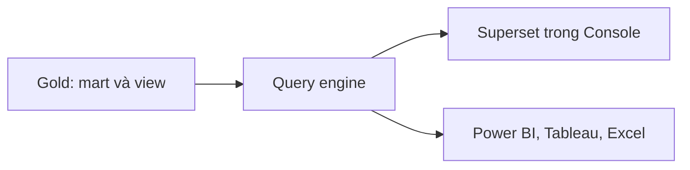

Hanas Data Platform phục vụ phân tích theo hai hướng: dùng Apache Superset nhúng trong Hanas Console, hoặc kết nối công cụ BI sẵn có tới query engine. Mục này dành cho analyst, BI developer và quản trị viên chuẩn bị kết nối.

## Các trang trong mục

| Trang | Nội dung |
|---|---|
| [Analytics với Superset](superset.md) | Dùng Superset trong Console: dataset, chart, dashboard và quyền. |
| [Công cụ BI bên ngoài](external-bi.md) | Kết nối Power BI, Tableau, Excel qua JDBC, ODBC hoặc Arrow Flight bằng token. |

## Chọn hướng nào

| Nhu cầu | Gợi ý |
|---|---|
| Xây dashboard nhanh, không cài thêm phần mềm | Superset trong Console |
| Tổ chức đã có Power BI hoặc Tableau | Công cụ BI bên ngoài |
| Phân tích tự do trên bảng bằng bảng tính | Excel qua ODBC |

Cả hai hướng đều đọc qua query engine, nên [workspace và view](../query/spaces-and-views.md) cùng [Reflection](../query/acceleration.md) áp dụng cho cả hai. Nên để BI đọc lớp gold hoặc view đã chuẩn hóa thay vì bảng bronze.

:::note Điều kiện

Superset là thành phần tuỳ chọn; quản trị viên cần bật khi triển khai. Công cụ bên ngoài cần driver tương ứng và token do bạn tạo.

:::

## Tiếp theo

- [Dùng Superset](superset.md).
- [Kết nối công cụ BI bên ngoài](external-bi.md).
- [Chuẩn mô hình hóa](../transform/modeling-standards.md).
