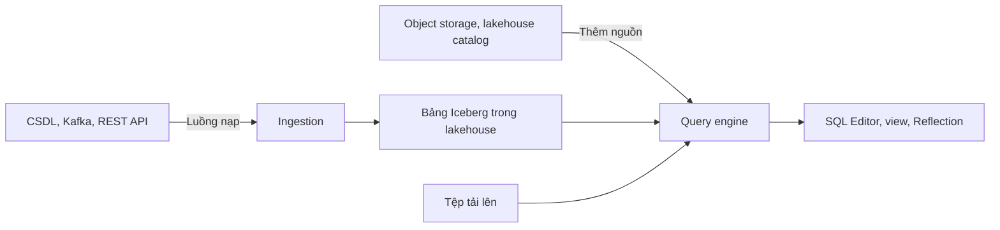

Mục này hướng dẫn bạn đưa dữ liệu vào **Hanas Data Platform**: kết nối nguồn để truy vấn tại chỗ, tải tệp lên, hoặc nạp dữ liệu từ hệ thống vận hành vào lakehouse. Nội dung dành cho data engineer và quản trị viên dữ liệu.

## Hai cách đưa dữ liệu vào nền tảng

Hanas có hai đường tách biệt, dùng cho hai nhu cầu khác nhau.

| Tiêu chí | Truy vấn trực tiếp (federation) | Nạp vào lakehouse (Ingestion) |
|---|---|---|
| Dữ liệu nằm ở đâu | Vẫn ở hệ thống nguồn | Được sao chép vào bảng Iceberg |
| Cách thực hiện | Thêm nguồn trong Connections, truy vấn bằng SQL | Tạo connection, destination và luồng nạp |
| Độ tươi của dữ liệu | Đọc trực tiếp khi truy vấn | Theo lịch chạy hoặc theo thay đổi (CDC) |
| Tải lên hệ thống nguồn | Mỗi truy vấn đọc từ nguồn | Chỉ tăng khi luồng nạp chạy |
| Phù hợp khi | Khám phá nhanh, đối chiếu, dữ liệu không đổi nhiều | Phân tích lặp lại, lưu lịch sử, giảm tải cho hệ thống vận hành |

Hai cách bổ trợ nhau: dữ liệu nạp vào lakehouse cũng được truy vấn qua query engine như mọi nguồn khác. Thông thường bạn khám phá dữ liệu bằng federation, rồi chuyển sang nạp khi cần dữ liệu ổn định và nhanh.

## Các trang trong mục

| Trang | Nội dung |
|---|---|
| [Nguồn dữ liệu truy vấn trực tiếp](./data-sources.md) | Nhóm connector, các bước thêm nguồn, tuỳ chọn metadata refresh, format tệp thành dataset. |
| [Tải tệp lên](./file-upload.md) | Tải tệp từ cây DATA của SQL Editor và chọn định dạng. |
| [Nạp dữ liệu vào lakehouse (Ingestion)](./ingestion.md) | Khái niệm, các engine nạp, wizard tạo luồng, ánh xạ kiểu dữ liệu, giới hạn. |
| [Lịch chạy, checkpoint và chạy lại](./ingestion-schedules.md) | Lịch, checkpoint, chạy lại, theo dõi run và xử lý lỗi. |

## Tiếp theo

- Truy vấn dữ liệu vừa kết nối trong [SQL Editor](../query/sql-studio.md).
- Tăng tốc truy vấn trên nguồn ngoài bằng [Reflection](../query/acceleration.md).
- Thu thập metadata để tìm kiếm tài sản dữ liệu: [Thu thập metadata](../govern/metadata-ingestion.md).
