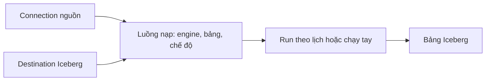

Ingestion nạp dữ liệu từ hệ thống nguồn vào bảng Apache Iceberg trong lakehouse của **Hanas Data Platform**. Trang này dành cho data engineer cần chọn engine phù hợp và tạo luồng nạp trong **Hanas Console**. Phần biến đổi dữ liệu sau khi nạp thuộc về [dbt Studio](../transform/dbt-studio.md).

## Khái niệm

| Khái niệm | Ý nghĩa |
|---|---|
| Connection (nguồn) | Thông tin kết nối tới hệ thống nguồn: PostgreSQL, MySQL, SQL Server, Oracle, MongoDB, S3, Kafka, REST API, Kafka T24. Có thao tác kiểm tra kết nối và khám phá danh sách bảng. |
| Destination (đích) | Catalog Iceberg nhận dữ liệu: Iceberg REST hoặc Iceberg Hive. Bạn có thể nhập cấu hình Lakehouse từ query engine rồi bổ sung secret. |
| Luồng nạp (ingestion) | Cấu hình nối một nguồn với một đích: team, namespace, engine, danh sách bảng và chế độ đồng bộ của từng bảng. |
| Run | Một lần thực thi của luồng nạp. Trạng thái: queued, running, cancelling, succeeded, failed, cancelled. |
| Checkpoint, watermark | Trạng thái đọc đã lưu sau mỗi run thành công; run kế tiếp đọc tiếp từ đó. Xem [Lịch chạy, checkpoint và chạy lại](./ingestion-schedules.md). |

## Chế độ đồng bộ

- **Full refresh**: đọc lại toàn bộ bảng mỗi run.
- **Incremental**: chỉ đọc hàng mới hoặc thay đổi dựa trên cột theo dõi (cursor). Không phát hiện hàng bị xoá ở nguồn.
- **CDC**: đọc nhật ký thay đổi của nguồn, ghi cả cập nhật và xoá. Cần chuẩn bị phía nguồn (xem bảng dưới).

## Các engine nạp

Mỗi luồng dùng một engine. Wizard chỉ đề xuất engine phù hợp với loại nguồn và mục tiêu bạn chọn.

| Nguồn | Engine | Năng lực chính |
|---|---|---|
| PostgreSQL, MySQL, SQL Server | OLake | Full refresh, incremental, CDC. Hàng bị xoá được giữ lại với cột đánh dấu `_op_type = 'd'`. |
| Oracle | OLake | Full refresh, incremental. Không có CDC. |
| PostgreSQL, MySQL, SQL Server, Oracle | dlt | Full refresh, incremental. Giữ DECIMAL chính xác. Không có CDC; incremental không phát hiện xoá. |
| PostgreSQL, MySQL, SQL Server, Oracle | Debezium | CDC với kiểu dữ liệu chính xác, xoá cứng hàng. |
| MongoDB | OLake | Mỗi collection thành một bảng; CDC qua change stream. |
| S3 | OLake | CSV, JSON lines hoặc mảng, Parquet; mỗi folder thành một bảng; full refresh hoặc incremental theo thời điểm sửa tệp. |
| Kafka | OLake | JSON hoặc Avro qua schema registry; chế độ append hoặc upsert. |
| REST API | dlt | Full refresh hoặc incremental, upsert hoặc append. Không phát hiện hàng bị xoá ở API. |
| Kafka T24 | T24 | Phân tích XML từ Kafka thành bảng RAW, bảng trạng thái hiện tại và bảng con cho trường multi-value theo mapping. |

:::note Điều kiện

- CDC cần chuẩn bị phía nguồn: PostgreSQL cần publication và replication slot; MySQL cần binlog ở dạng ROW cùng quyền replication; SQL Server cần bật CDC và SQL Server Agent; Oracle (Debezium) cần ARCHIVELOG, supplemental logging và người dùng có quyền LogMiner; MongoDB cần replica set. Bước preflight kiểm tra và hiển thị câu lệnh cần chạy.
- Engine Debezium chỉ được đề xuất khi môi trường có Kafka Connect.
- Luồng nạp cần dịch vụ Ingestion được triển khai cùng nền tảng và một catalog Iceberg làm đích.

:::

Không phải mọi tổ hợp nguồn và đích đều được kiểm chứng. Hãy chạy thử tổ hợp bạn dự định dùng trước khi đưa vào vận hành.

## Tạo luồng nạp

1. Mở menu **Ingestion Flows** trong Hanas Console, vào mục **Sources** và tạo connection. Chọn **Test** để kiểm tra kết nối.
2. Vào mục **Destinations**, tạo connection Iceberg REST hoặc Iceberg Hive, hoặc nhập cấu hình Lakehouse và bổ sung secret.
3. Vào mục **Ingestion Flows** và chọn **New** trong danh sách luồng nạp.
4. Chọn nguồn, đích, team, namespace và engine.
5. Chọn mục tiêu (full refresh, incremental hoặc CDC). Wizard khám phá danh sách bảng và chỉ cho phép chọn bảng phù hợp.
6. Chọn các bảng cần nạp và đặt tên bảng đích.
7. Cấu hình từng bảng: cột theo dõi (cursor) cho incremental, cột khoá khi bảng không có khoá chính, phân vùng, bộ lọc, chọn cột (với OLake).
8. Chạy preflight. Xử lý các cảnh báo, đặc biệt về kiểu dữ liệu và điều kiện CDC.
9. Chọn lịch chạy, rồi lưu. Xem [Lịch chạy, checkpoint và chạy lại](./ingestion-schedules.md).

Sau khi luồng đã chạy, bạn có thể thêm bảng, sửa cấu hình bảng hoặc xoá bảng khỏi luồng tuỳ khả năng của engine. Thay đổi chế độ, cột theo dõi hoặc khoá của bảng đã nạp sẽ xoá bảng đích và đọc lại từ đầu; giao diện liệt kê các bảng bị ảnh hưởng trước khi bạn xác nhận.

## Ánh xạ kiểu dữ liệu

Cách giữ số thập phân là khác biệt quan trọng nhất giữa các engine.

| Engine | Cách xử lý số thập phân và kiểu số |
|---|---|
| OLake | DECIMAL, NUMBER có thể ghi thành DOUBLE. Preflight từ chối một số kiểu rộng (ví dụ DECIMAL trên 15 chữ số, `money` của SQL Server). Với Oracle, một số kiểu NUMBER có độ chính xác lớn bị từ chối, kiểu không giới hạn được cảnh báo. |
| dlt | Giữ DECIMAL với độ chính xác đã khai báo. Kiểu `numeric` không khai báo độ chính xác thành DECIMAL(38,9); giá trị có nhiều chữ số lẻ hơn làm run thất bại thay vì bị làm tròn. |
| Debezium | Numeric thành DECIMAL(p,s); không giới hạn thành DECIMAL(38,9); rộng hơn 38 chữ số thành văn bản chính xác. Giá trị không vừa làm run thất bại. |
| T24 | Mọi cột là văn bản. |

Với dữ liệu tài chính, hãy chọn dlt hoặc Debezium để giữ số tiền chính xác. Wizard gợi ý engine này khi preflight phát hiện kiểu mà OLake không giữ chính xác.

Quy tắc khác:

- MongoDB: tài liệu lồng và mảng thành văn bản JSON; Decimal128 thành văn bản chính xác.
- Kafka: JSON number thành DOUBLE; hãy gửi số tiền dạng chuỗi. Tin nhắn bị topic retention xoá trước khi run đọc sẽ mất.
- S3: số, kể cả DECIMAL của Parquet, thành DOUBLE; schema suy ra từ tệp đầu tiên của mỗi folder.

## Phân quyền và team

- Dịch vụ dùng role `ingest-admin` (toàn quyền, gồm cấp quyền namespace và quy tắc egress) và `ingest-viewer` (chỉ xem).
- Team là các group trong Keycloak; luồng nạp thuộc về một team. Cần bật claim `groups` cho client của Console.
- Guardrail có hai chế độ. Ở chế độ `open` (mặc định), mọi team ghi được mọi namespace và truy cập mọi host, trừ địa chỉ loopback, link-local và metadata đám mây luôn bị chặn. Ở chế độ `enforced`, mọi thứ bị từ chối cho tới khi quản trị viên cấp quyền namespace và quy tắc egress cho team trong tab **Admin**.

Xem thêm [Quản lý người dùng, group và role](../operate/user-management.md).

## Giới hạn

:::caution Giới hạn hiện tại

- Mỗi bảng đích chỉ có một luồng ghi.
- CDC và Kafka chạy dưới dạng nhiều run ngắn lặp lại theo lịch, không phải luồng streaming liên tục. Độ trễ gần với khoảng cách giữa hai run.
- Bảng đích được nhiều run commit liên tục tạo nhiều delete file; cần bật compaction tự động của catalog Iceberg để duy trì tốc độ đọc.
- Debezium và T24 không hỗ trợ **Reload all**; muốn dựng lại, xoá luồng và bảng đích.
- Không có đường dẫn lineage tự động từ luồng nạp sang Hanas Catalog. Dùng [Thu thập metadata](../govern/metadata-ingestion.md) để đưa bảng đích vào catalog.
- Kafka T24 cần mapping thực thể cho từng stream và không tương thích từng byte với các hệ nạp khác.

:::

## Xử lý sự cố

| Hiện tượng | Nguyên nhân thường gặp | Cách xử lý |
|---|---|---|
| Không kết nối được nguồn | Mạng, tên host, quy tắc egress của team | Kiểm tra mạng và tab **Admin**, rồi **Test** lại connection. |
| Preflight từ chối cột | Kiểu số mà OLake không giữ chính xác | Chọn dlt hoặc Debezium. |
| Lỗi liên quan replication slot, publication, binlog | Thiếu điều kiện CDC ở nguồn | Chạy câu lệnh preflight đề xuất. |
| Lỗi 401 hoặc 403 từ catalog | PAT hết hạn hoặc thiếu quyền trên catalog | Cấp lại PAT trên destination, cấp quyền CREATE và MODIFY. |

Xem thêm [Xử lý sự cố](../operate/troubleshooting.md).

## Tiếp theo

- [Lịch chạy, checkpoint và chạy lại](./ingestion-schedules.md)
- [Bảng Iceberg: DDL, DML, time travel](../query/iceberg-tables.md)
- [dbt Studio](../transform/dbt-studio.md) để biến đổi dữ liệu đã nạp
