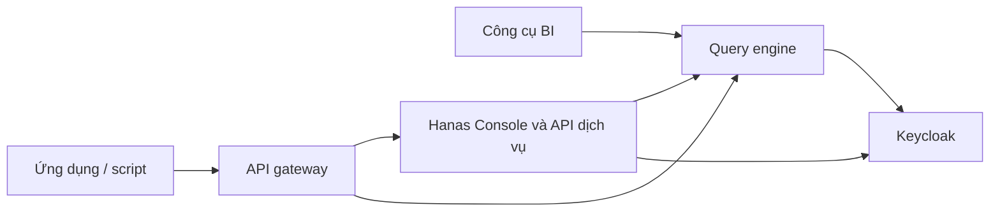

Mục này dành cho lập trình viên và kỹ sư dữ liệu cần truy cập Hanas Data Platform từ ứng dụng, công cụ BI hoặc script tự động. Bạn sẽ biết nên dùng giao diện nào cho từng nhu cầu, cách xác thực và cách đọc lỗi trả về.

## Các bề mặt tích hợp

| Bề mặt | Dùng khi | Trang chi tiết |
|---|---|---|
| SQL client (JDBC, ODBC, Arrow Flight) | Chạy SQL từ công cụ BI, ứng dụng hoặc Python, lấy kết quả dạng bảng hoặc Arrow. | [JDBC, ODBC và Arrow Flight](sql-clients.md) |
| REST API của query engine | Gửi SQL bất đồng bộ, quản lý catalog, Reflection, job và người dùng bằng HTTP. | [REST API của query engine](query-engine-api.md) |
| Ontology API | Đọc và thao tác trên đối tượng, quan hệ và metric của ontology. | [Ontology API](ontology-api.md) |
| Kapas API | Hỏi đáp dữ liệu và nhận phản hồi dạng stream. | [Kapas API và SSE](kapas-api.md) |
| Hanas Catalog API | Tìm kiếm tài sản dữ liệu, đọc lineage, quản lý glossary, tag và thu thập metadata. | [Hanas Catalog API](catalog-api.md) |

Tên miền và đường dẫn công khai do gateway của đơn vị bạn quy định. Xem [API gateway và tên miền](../operate/gateway.md) và [Cổng và endpoint](../reference/ports-and-endpoints.md).

## Phương thức xác thực

Hanas hỗ trợ hai loại credential. Chúng khác nhau về nơi cấp và phạm vi dùng, không thay thế trực tiếp cho nhau.

| Phương thức | Cấp bởi | Dùng cho | Cách gửi |
|---|---|---|---|
| Token OIDC của Keycloak | Keycloak, sau khi đăng nhập hoặc qua client credentials | API dịch vụ Hanas (Hanas Catalog, Ontology, Kapas, dbt, Ingestion) | Header `Authorization: Bearer <access_token>` |
| Personal Access Token (PAT) | Hanas Console, menu tài khoản **Access Tokens** | Query engine: REST, JDBC, ODBC, Arrow Flight; script và công cụ không đăng nhập tương tác được | Header `Authorization: Bearer <PAT>` hoặc làm mật khẩu của SQL client |

Token Keycloak có thời hạn ngắn và được cấp lại khi đăng nhập hoặc làm mới. Với service account, bạn dùng luồng client credentials của realm Hanas; xem [Xác thực và SSO với Keycloak](../operate/identity.md) để biết realm, client và audience.

:::note Điều kiện

Việc query engine chấp nhận trực tiếp token Keycloak phụ thuộc cấu hình SSO của môi trường. Nếu chưa bật, hãy dùng PAT cho mọi truy cập vào query engine.

:::

### Tạo Personal Access Token

PAT gắn với tài khoản của bạn và kế thừa đúng quyền của tài khoản đó trên dữ liệu.

1. Đăng nhập Hanas Console.
2. Mở menu tài khoản (biểu tượng avatar ở góc dưới bên trái), chọn **Access Tokens**. Hộp thoại **Personal Access Tokens** hiện ra, liệt kê token với các cột Token ID, Label, Creation và Expiration.
3. Bấm **Generate Token**.
4. Nhập **Label** mô tả mục đích sử dụng, ví dụ `bi-reporting`.
5. Nhập **Lifetime** tính theo ngày. Giá trị mặc định trong form là 30 ngày.
6. Bấm **Generate**, rồi sao chép token hiển thị.

:::caution Giới hạn hiện tại

Token chỉ hiển thị một lần ở bước cuối. Sau khi đóng cửa sổ, bạn không xem lại được; hãy tạo token mới nếu mất. Tên các nút có thể hiển thị bằng tiếng Việt, tuỳ ngôn ngữ giao diện.

:::

Bạn có thể xem ngày tạo và ngày hết hạn của từng token trong cùng màn hình, xoá một token hoặc xoá tất cả. Hãy dùng một token riêng cho mỗi ứng dụng để thu hồi độc lập, và đặt thời hạn ngắn nhất phù hợp.

Lưu PAT trong secret manager hoặc biến môi trường, không đưa vào mã nguồn hay ticket hỗ trợ. Ví dụ trong tài liệu dùng placeholder `<PAT>`.

## Quy ước lỗi chung

| Mã HTTP | Ý nghĩa thường gặp | Cách xử lý |
|---|---|---|
| 400 | Request sai định dạng hoặc tham số không hợp lệ (ví dụ `limit` vượt giới hạn). | Kiểm tra body và query string. |
| 401 | Thiếu, sai hoặc hết hạn token. | Cấp lại token hoặc tạo PAT mới. |
| 403 | Token hợp lệ nhưng tài khoản thiếu quyền (role ứng dụng hoặc quyền dữ liệu). | Nhờ quản trị viên cấp quyền; xem [Quản lý người dùng, group và role](../operate/user-management.md). |
| 404 | Không có đối tượng, hoặc đối tượng tồn tại nhưng bạn không có quyền xem. | Kiểm tra mã định danh và quyền. |
| 409 | Xung đột, như tên trùng hoặc đối tượng đang được tác vụ khác xử lý. | Đổi tên hoặc thử lại sau. |
| 5xx | Lỗi phía dịch vụ. | Thử lại có backoff; gửi mã job hoặc thời điểm lỗi khi liên hệ [hỗ trợ](../reference/support.md). |

Hanas Catalog trả lỗi dạng JSON `{ "status": 400, "message": "...", "detail": "..." }`. Query engine trả JSON mô tả lỗi kèm mã HTTP; với job SQL, trạng thái lỗi nằm ở bản ghi job chứ không ở phản hồi của lệnh gửi.

Khi gọi API, hãy ghi lại mã job hoặc thời điểm gọi để đối chiếu với [lịch sử job](../query/jobs.md) và log dịch vụ.

## Tiếp theo

- [Kết nối bằng JDBC, ODBC hoặc Arrow Flight](sql-clients.md).
- [Gửi SQL qua REST API](query-engine-api.md).
- [Tra cứu metadata qua Hanas Catalog API](catalog-api.md).
