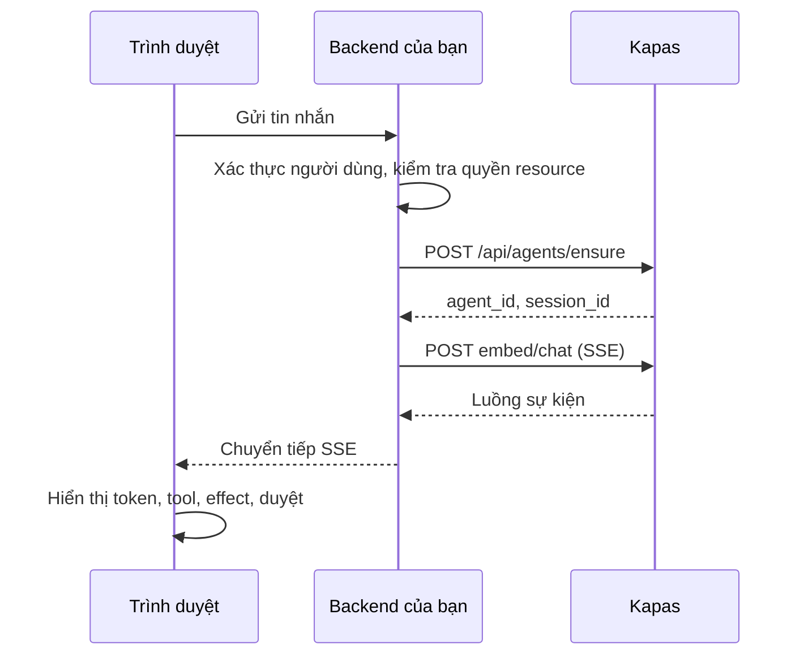

Bạn có hai cách đưa Kapas vào ứng dụng của mình. Chọn theo mức tùy biến giao diện bạn cần.

| | Iframe Kapas Console | Giao diện tự xây (Embed API) |
|---|---|---|
| Công sức | Thấp: nhúng một URL | Cao hơn: tự dựng UI và backend proxy |
| Giao diện | Kapas Console nguyên bản | Do bạn quyết định |
| Ngữ cảnh ứng dụng (project, object hiện tại) | Không truyền được | Có, qua `meta.app` |
| Agent phù hợp | Mọi agent | Agent có kênh `embed` |

## Cách 1: iframe Kapas Console

Nhúng Kapas Console bằng thẻ iframe trong trang của bạn.

1. Đăng ký tên miền ứng dụng của bạn vào danh sách origin được phép nhúng của Kapas. Cổng Kapas chỉ cho phép nhúng từ chính nó và các origin Hanas được khai báo rõ.
2. Nhúng URL Kapas.
3. Người dùng đăng nhập qua SSO Keycloak như bình thường.

```html
<iframe
  src="https://<kapas-host>/"
  title="Kapas"
  style="width:100%;height:640px;border:0"
  allow="clipboard-write">
</iframe>
```

:::caution Giới hạn hiện tại

Origin chưa được khai báo sẽ bị trình duyệt chặn. Đăng nhập SSO và cookie khi nhúng chéo origin phụ thuộc cấu hình trình duyệt và tên miền; kiểm tra thực tế trước khi triển khai rộng. Nếu cần SSO qua cookie, đặt ứng dụng và Kapas cùng miền cha. Xem [Xác thực và SSO với Keycloak](../operate/identity.md).

:::

## Cách 2: giao diện tự xây trên Embed API

Kapas cung cấp hợp đồng HTTP và SSE, không phải một widget JavaScript chèn một dòng. Bạn xây giao diện, và backend của bạn đứng giữa trình duyệt và Kapas.



Quy trình chuẩn:

1. Backend xác thực người dùng và quyền với resource (project, workspace).
2. Gọi `POST /api/agents/ensure` bằng token người dùng, kèm `template_id` và `meta.app`.
3. Nhận `agent_id` và `session_id`, rồi gọi chat với `stream: true`.
4. Chuyển tiếp SSE về trình duyệt; hiển thị văn bản, tool, effect và yêu cầu duyệt.
5. Đọc lịch sử khi mở lại phiên; dùng API dừng khi người dùng bấm Stop.

Chi tiết endpoint và envelope sự kiện ở [Kapas API và SSE](kapas-api.md).

### Template và binding

Mỗi template khai báo cách ghép phiên từ ngữ cảnh ứng dụng:

| Agent | Phiên | Ngữ cảnh `meta.app` |
|---|---|---|
| Ontology Assistant | một phiên chính | có thể kèm `current_type`, `current_pk` |
| Project Copilot | một phiên cho mỗi project | `project_id` bắt buộc |
| SQL Copilot | một phiên chính | nội dung editor do host gửi |
| Analytics Studio, Catalog Steward | mỗi agent một phiên chính | tùy chọn |
| Concept, Mapping Copilot | một phiên chính | cần thêm workspace, run, draft |

Binding chỉ phân vùng phiên trong cùng người dùng, không tạo chat dùng chung giữa nhiều người.

### Backend proxy (Python, FastAPI)

Ví dụ dưới dùng thư viện `httpx`; bạn tự cài và đặt `KAPAS_URL` trong môi trường.

```python
import os
import httpx
from fastapi import FastAPI, Request, HTTPException
from fastapi.responses import StreamingResponse

KAPAS_URL = os.environ["KAPAS_URL"]  # ví dụ https://kapas.example.com
app = FastAPI()


def bearer(request: Request) -> str:
    auth = request.headers.get("authorization", "")
    if not auth.lower().startswith("bearer "):
        raise HTTPException(401, "Thiếu token")
    return auth.split(" ", 1)[1]


@app.post("/ai/project/{project_id}/chat")
async def chat(project_id: str, request: Request):
    token = bearer(request)
    # TODO: kiểm tra người dùng có quyền với project_id trước khi gọi Kapas
    payload = await request.json()
    headers = {"Authorization": f"Bearer {token}"}
    app_ctx = {"project_id": project_id}

    async with httpx.AsyncClient(timeout=30) as client:
        r = await client.post(
            f"{KAPAS_URL}/api/agents/ensure",
            headers=headers,
            json={"template_id": "project-copilot", "meta": {"app": app_ctx}},
        )
        r.raise_for_status()
        ids = r.json()

    body = {
        "message": payload["message"],
        "session_id": ids["session_id"],
        "stream": True,
        # token người dùng cuối cho các tool phía sau
        "meta": {"user_token": token, "app": app_ctx},
    }

    async def relay():
        async with httpx.AsyncClient(timeout=None) as client:
            async with client.stream(
                "POST",
                f"{KAPAS_URL}/api/agents/{ids['agent_id']}/embed/chat",
                headers=headers,
                json=body,
            ) as resp:
                if resp.status_code != 200:
                    raise HTTPException(502, "Kapas từ chối request")
                async for chunk in resp.aiter_raw():
                    yield chunk  # chuyển tiếp nguyên byte SSE

    return StreamingResponse(relay(), media_type="text/event-stream")
```

Kapas cũng cung cấp SDK Python và TypeScript đi kèm bản phát hành, làm sẵn các việc trên (tạo agent, chuyển tiếp luồng, đọc lịch sử, đọc SSE, duyệt và từ chối). Liên hệ đội hỗ trợ để lấy SDK theo phiên bản bạn đang chạy.

### Frontend (TypeScript)

Đọc SSE từ endpoint proxy của bạn bằng `fetch`. Ví dụ tối giản, tự xử lý envelope:

```ts
type Envelope = {
  contract_version: number;
  type: string;
  seq: number;
  data: Record<string, unknown>;
};

export async function chat(
  message: string,
  onToken: (text: string) => void,
  signal?: AbortSignal,
) {
  const resp = await fetch("/ai/project/project-123/chat", {
    method: "POST",
    headers: { "Content-Type": "application/json" },
    body: JSON.stringify({ message }),
    signal,
  });
  if (!resp.ok || !resp.body) throw new Error(`Lỗi ${resp.status}`);

  const reader = resp.body.getReader();
  const decoder = new TextDecoder();
  let buffer = "";
  let lastSeq = -1;

  for (;;) {
    const { done, value } = await reader.read();
    if (done) break;
    buffer += decoder.decode(value, { stream: true });
    const parts = buffer.split("\n\n");
    buffer = parts.pop() ?? "";
    for (const part of parts) {
      const line = part.split("\n").find((l) => l.startsWith("data:"));
      if (!line) continue;
      const ev: Envelope = JSON.parse(line.slice(5).trim());
      if (ev.seq <= lastSeq) continue; // loại trùng
      lastSeq = ev.seq;
      switch (ev.type) {
        case "token":
          onToken(String(ev.data.text ?? ""));
          break;
        case "approval_request":
          // hiển thị hộp thoại, rồi gọi API duyệt hoặc từ chối
          break;
        case "error":
        case "done":
          return ev;
        default:
          break; // bỏ qua type chưa biết (ping, effect...)
      }
    }
  }
}
```

Cần thêm hai việc ở môi trường thật: nút Stop (gọi API dừng và hủy `AbortController`) và xử lý `effect` để làm mới giao diện, ví dụ làm mới cây file khi agent sửa file.

## Giới hạn

:::caution Giới hạn hiện tại

- Với Embed API, backend của bạn chịu trách nhiệm gửi đúng token người dùng cuối. Kapas không tự đổi token query engine như trong Console. Xem [An toàn](../kapas/safety.md).
- Tích hợp nhúng không có tự kết nối lại; backend và frontend phải tự xử lý như ở [Kapas API](kapas-api.md).
- `meta.app` là ngữ cảnh, không phải quyền. Luôn kiểm tra quyền của người dùng với resource ở backend của bạn.
- Hanas Analyst không có kênh `embed`; dùng agent khác hoặc Kapas Console.

:::

## Tiếp theo

- [Kapas API và SSE](kapas-api.md)
- [Agent, skill và tool](../kapas/agents.md)
- [API gateway và tên miền](../operate/gateway.md)
