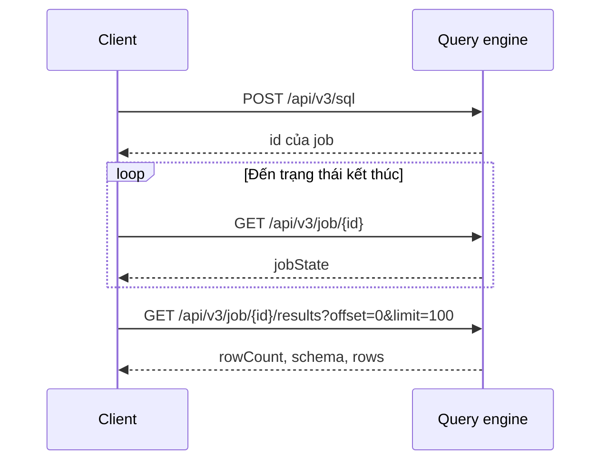

REST API của query engine cho phép bạn gửi SQL, theo dõi job, quản lý catalog và Reflection bằng HTTP. Trang này dành cho lập trình viên cần tự động hoá các thao tác mà bạn thường làm trong Hanas Console.

## Khái niệm

API nằm dưới đường dẫn gốc `/api/v3`, trên cổng web của query engine (mặc định 9047) hoặc qua tên miền gateway của đơn vị bạn. Mọi request gửi JSON và cần header `Authorization: Bearer <PAT>`; xem [Tạo Personal Access Token](index.md).

Hanas Console còn dùng một số API nội bộ ngoài v3 cho đăng nhập và cài đặt hệ thống. Các API đó không thuộc hợp đồng tích hợp; hãy chỉ dựa vào nhóm endpoint v3 bên dưới.

## Nhóm endpoint

| Nhóm | Endpoint chính | Chức năng |
|---|---|---|
| SQL | `POST /sql` | Gửi SQL bất đồng bộ, trả về mã job. |
| Job | `GET /job/{id}`, `GET /job/{id}/results`, `POST /job/{id}/cancel` | Xem trạng thái, lấy kết quả theo trang, huỷ job. |
| Catalog | `GET /catalog`, `GET /catalog/{id}`, `GET /catalog/by-path/{path}`, `POST /catalog`, `PUT /catalog/{id}`, `DELETE /catalog/{id}` | Liệt kê, đọc, tạo, cập nhật và xoá source, space, folder, view. |
| Catalog (mở rộng) | `POST /catalog/{id}` (promote dataset), `POST /catalog/{id}/refresh`, `GET /catalog/search`, `POST /catalog/by-ids`, `POST /catalog/by-paths` | Promote file hoặc folder thành dataset, làm mới metadata, tìm kiếm và tra cứu hàng loạt. |
| Reflection | `GET /reflection/{id}`, `POST /reflection`, `PUT /reflection/{id}`, `DELETE /reflection/{id}` | Quản lý [Reflection](../query/acceleration.md). |
| User | `POST /user`, `GET /user/{id}`, `PUT /user/{id}`, `GET /user/by-name/{name}` | Quản lý người dùng ở query engine. |
| Source | `/source`, `/source/type` | Danh sách loại nguồn và cấu hình nguồn mà Console dùng. |
| Role | `/role` và thao tác thành viên | Quản lý role. |
| Object ACL | `GET/PUT /catalog/{id}/grants` | Đọc và ghi quyền trên đối tượng. |
| Workload | `/wlm/queue`, `/wlm/rule` | Queue và rule điều phối tải. |
| PAT | `/user/{uid}/token` | Quản lý Personal Access Token của người dùng. |

:::note Điều kiện

Các nhóm Source, Role, Object ACL, Workload và PAT được Hanas Console gọi, nhưng mức hỗ trợ cụ thể phụ thuộc bản query engine đang chạy. Hãy thử trên môi trường của bạn trước khi dựa vào chúng trong tự động hoá sản xuất. Nhóm SQL, Job, Catalog, Reflection và User là nhóm cốt lõi.

:::

## Luồng gửi SQL

`POST /sql` không trả kết quả trực tiếp. Bạn thực hiện ba bước: gửi SQL để nhận mã job, kiểm tra trạng thái đến khi job kết thúc, rồi lấy kết quả theo trang.



### Bước 1: gửi SQL

```bash
export HANAS_URL="https://<host>"
export HANAS_PAT="<PAT>"

JOB_ID=$(curl -s -X POST "$HANAS_URL/api/v3/sql" \
  -H "Authorization: Bearer $HANAS_PAT" \
  -H "Content-Type: application/json" \
  -d '{"sql": "SELECT customer_id, COUNT(*) AS txn_count FROM lakehouse.retail.transactions GROUP BY customer_id LIMIT 10"}' \
  | jq -r '.id')
echo "$JOB_ID"
```

Phản hồi có dạng `{ "id": "<job-id>" }`. Bạn có thể thêm khoá `context` để chỉ định đường dẫn mặc định cho tên bảng không đầy đủ.

### Bước 2: theo dõi job

```bash
until [ "$STATE" = "COMPLETED" ] || [ "$STATE" = "FAILED" ] || [ "$STATE" = "CANCELED" ]; do
  STATE=$(curl -s "$HANAS_URL/api/v3/job/$JOB_ID" \
    -H "Authorization: Bearer $HANAS_PAT" | jq -r '.jobState')
  echo "jobState=$STATE"
  sleep 2
done
```

Các trạng thái kết thúc gồm `COMPLETED`, `FAILED` và `CANCELED`. Khi job lỗi, bản ghi job chứa thông báo lỗi; bạn cũng xem được profile trong [Lịch sử job](../query/jobs.md).

### Bước 3: lấy kết quả

```bash
curl -s "$HANAS_URL/api/v3/job/$JOB_ID/results?offset=0&limit=100" \
  -H "Authorization: Bearer $HANAS_PAT" | jq '.rowCount, .rows[:3]'
```

| Tham số | Mặc định | Ghi chú |
|---|---:|---|
| `offset` | 0 | Vị trí dòng bắt đầu. |
| `limit` | 100 | Tối đa 500 dòng mỗi lần gọi; giá trị lớn hơn bị từ chối. |

Để đọc nhiều hơn 500 dòng, tăng `offset` theo từng trang. Chỉ lấy được kết quả khi job ở trạng thái hoàn tất.

### Huỷ job

```bash
curl -s -X POST "$HANAS_URL/api/v3/job/$JOB_ID/cancel" \
  -H "Authorization: Bearer $HANAS_PAT"
```

## Giới hạn

- Mỗi lần lấy kết quả tối đa 500 dòng. Với tập kết quả lớn, dùng [Arrow Flight](sql-clients.md) hoặc ghi kết quả ra bảng bằng SQL.
- `POST /sql` luôn bất đồng bộ; không giả định kết quả có ngay sau lệnh gửi.
- Hãy giới hạn tần suất polling (vài giây một lần) để không tạo tải không cần thiết.

## Xử lý sự cố

| Triệu chứng | Nguyên nhân thường gặp | Cách xử lý |
|---|---|---|
| 401 khi gọi | PAT sai hoặc hết hạn. | Tạo PAT mới. |
| 403 khi gửi SQL | Tài khoản thiếu quyền truy vấn đối tượng. | Cấp grant; xem [Phân quyền dữ liệu](../govern/access-control.md). |
| 400 khi lấy kết quả | `limit` vượt 500 hoặc job chưa hoàn tất. | Giảm `limit`, chờ job `COMPLETED`. |
| Job `FAILED` | Lỗi cú pháp, thiếu bảng hoặc thiếu quyền. | Đọc thông báo lỗi trong bản ghi job. |

## Tiếp theo

- [Tham chiếu SQL](../query/sql-reference.md).
- [Kết nối bằng JDBC, ODBC hoặc Arrow Flight](sql-clients.md).
- [Hanas Catalog API](catalog-api.md).
