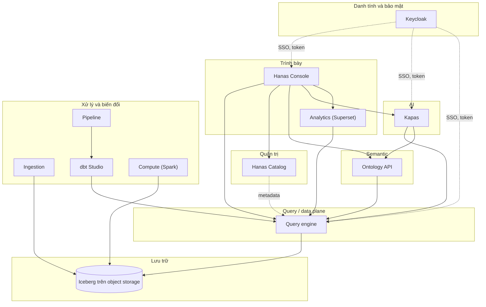
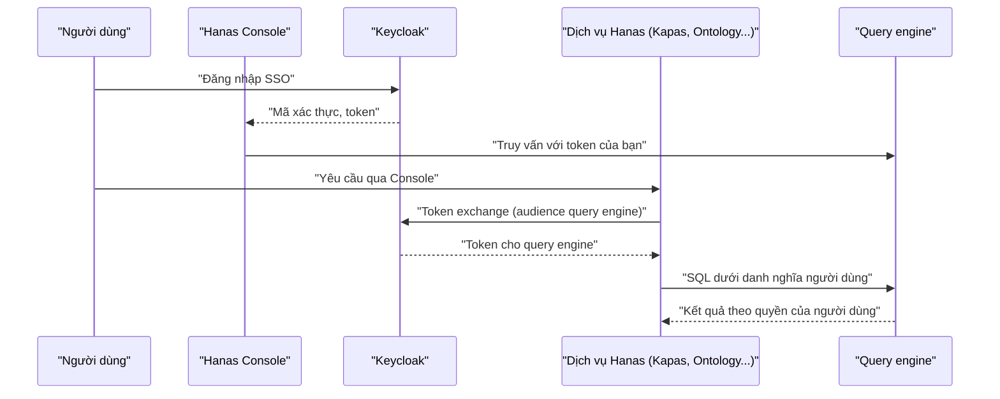

import Diagram from '@site/src/components/Diagram';

Trang này mô tả các lớp của Hanas Data Platform, cách dữ liệu đi từ nguồn đến người dùng cuối và cách danh tính của bạn được chuyển tiếp qua các dịch vụ. Nội dung dành cho kiến trúc sư, data engineer và quản trị viên cần hiểu ranh giới giữa các thành phần trước khi cấu hình hoặc tích hợp.

<Diagram name="01-tong-quan" alt="Kiến trúc tổng thể Hanas Data Platform" />

## Các lớp của nền tảng

Hanas Data Platform gồm tám lớp. Mỗi lớp có trách nhiệm riêng và có thể được bật hoặc tắt độc lập theo cấu hình triển khai.

| Lớp | Thành phần | Trách nhiệm |
|---|---|---|
| Lưu trữ | Apache Iceberg trên object storage (MinIO hoặc dịch vụ tương thích) | Lưu data file, metadata bảng và snapshot; Iceberg catalog tra cứu bảng |
| Query / data plane | Query engine | Thực thi SQL, quản lý dataset, view, job, Reflection; cung cấp REST API, JDBC, ODBC, Arrow Flight |
| Xử lý và biến đổi | Ingestion, dbt Studio, Pipeline, Compute (Spark) | Nạp dữ liệu vào Iceberg, phát triển model, điều phối bước xử lý, chạy Spark |
| Quản trị | Hanas Catalog | Tìm kiếm metadata, ownership, glossary, tag, lineage |
| Semantic / Ontology | Ontology Workspace và Ontology API | Mô hình object type, link type, metric gắn với dataset |
| AI | Kapas | Hội thoại, agent, tool; gọi query engine, Ontology và các dịch vụ khác |
| Trình bày | Hanas Console, Analytics (Apache Superset) | Giao diện chung, dataset BI, chart, dashboard |
| Danh tính và bảo mật | Keycloak, User API | SSO, group, role; chuyển tiếp danh tính giữa các ứng dụng |

### Lưu trữ: Iceberg trên object storage

Bảng lakehouse được lưu theo định dạng Apache Iceberg trên object storage. Mỗi bảng gồm data file, metadata và snapshot, nên hỗ trợ time travel và thay đổi schema có kiểm soát. Iceberg catalog quản lý việc tra cứu bảng; đây là thành phần khác với Hanas Catalog.

### Query / data plane

Query engine là điểm thực thi SQL duy nhất cho truy vấn tương tác. Nó đọc cả nguồn đã kết nối (truy vấn trực tiếp) lẫn bảng Iceberg, lưu view, ghi lịch sử job và quản lý Reflection. Ontology, Kapas, Analytics và SQL client đều đi qua query engine khi cần đọc dữ liệu.

### Xử lý và biến đổi

- **Ingestion** nạp dữ liệu từ nguồn vào bảng Iceberg theo lịch, có log và checkpoint.
- **dbt Studio** phát triển và chạy dbt project; câu lệnh SQL của model chạy trên query engine.
- **Pipeline** điều phối nhiều bước theo dependency và lịch.
- **Compute** chạy PySpark và notebook trên Kubernetes, đọc ghi Iceberg bằng danh tính nền tảng.

### Quản trị

Hanas Catalog lưu metadata thu thập từ các nguồn và phục vụ tìm kiếm, glossary, tag, ownership và lineage. Catalog mô tả tài sản dữ liệu nhưng không thực thi truy vấn.

### Semantic / Ontology

Ontology định nghĩa object type, property, link type và metric, rồi ánh xạ chúng vào dataset. PostgreSQL lưu định nghĩa và trạng thái Ontology; record nghiệp vụ vẫn nằm trong dữ liệu và được đọc qua query engine.

### AI

Kapas chạy agent theo từng người dùng. Agent gọi query engine để chạy SQL, gọi Ontology để duyệt đối tượng và tính metric, và có thể gọi dbt Studio hay Analytics tuỳ agent được cấp.

### Trình bày

Hanas Console là điểm vào chung. Analytics nhúng Apache Superset để tạo dataset BI, chart và dashboard trên dữ liệu đã kết nối.

### Danh tính và bảo mật

Keycloak cung cấp SSO, group và role. User API chuyển các thao tác quản trị user, role, group sang Keycloak và đồng bộ với query engine. Mỗi dịch vụ vẫn tự kiểm tra quyền khi nhận yêu cầu.

## Luồng dữ liệu end-to-end

<Diagram name="02-vong-doi-du-lieu" alt="Vòng đời dữ liệu trên Hanas" />

1. **Kết nối**: bạn thêm source để truy vấn trực tiếp, hoặc cấu hình Ingestion để nạp dữ liệu vào bảng Iceberg.
2. **Xử lý**: dbt model, Pipeline hoặc Spark biến đổi dữ liệu thô thành các lớp được chuẩn hóa.
3. **Ngữ nghĩa**: bạn lưu SQL thành view, tạo Reflection khi cần tăng tốc, và có thể ánh xạ dataset vào object type và metric trong Ontology.
4. **Sử dụng**: analyst truy vấn trong SQL Editor, người dùng nghiệp vụ khám phá đối tượng, đội BI dựng dashboard, và Kapas trả lời câu hỏi bằng ngôn ngữ tự nhiên.
5. **Quản trị**: Hanas Catalog thu thập metadata để tìm kiếm, gắn glossary và xem lineage trên các bước trên.

## Luồng danh tính

Query chạy dưới danh nghĩa người dùng, nên quyền trên source, table và view được kiểm tra theo tài khoản của bạn thay vì một tài khoản dùng chung.

1. Bạn đăng nhập qua Keycloak. Console nhận session và token để gọi query engine và các dịch vụ Hanas khác.
2. Khi một dịch vụ như Kapas cần chạy SQL thay bạn, nó dùng token của bạn. Nếu không có sẵn token query engine, dịch vụ đổi token Keycloak của bạn sang audience của query engine bằng **token exchange** (RFC 8693).
3. Query engine nhận token đã đổi và áp quyền của chính người dùng đó. Dịch vụ không dùng tài khoản dùng chung cho truy vấn SQL của Kapas.

:::note Điều kiện

Token exchange cần cấu hình client và quyền exchange trong Keycloak, cùng External Token Provider ở query engine. Xem [Xác thực và SSO với Keycloak](../operate/identity.md).

:::

:::caution Giới hạn hiện tại

Không phải mọi tích hợp đều dùng danh tính riêng của người dùng. Ingestion và Spark truy cập storage bằng credential riêng, nên chính sách trong query engine không tự áp dụng cho các đường đọc này. Một số tích hợp metadata và dbt có thể dùng service credential tuỳ cấu hình. Khi nhúng Kapas vào ứng dụng, ứng dụng chủ phải cung cấp credential đúng hợp đồng; xem [Nhúng Kapas vào ứng dụng](../develop/kapas-embed.md).

:::

## Tiếp theo

- [Khái niệm chính](concepts.md).
- [Kiến trúc triển khai](../operate/deployment-architecture.md).
- [Xác thực và SSO với Keycloak](../operate/identity.md).
- [Làm quen Hanas Console](console-tour.md).
