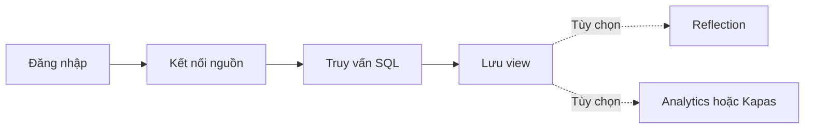

Hanas Data Platform phục vụ nhiều vai trò cùng làm việc trên dữ liệu doanh nghiệp. Mục này giúp bạn hiểu cấu trúc nền tảng, chọn công cụ và hoàn thành luồng sử dụng đầu tiên.

Nếu bạn đã có tài khoản và nguồn dữ liệu mẫu, có thể bắt đầu trực tiếp với quickstart. Nếu bạn chuẩn bị triển khai hoặc tích hợp, hãy đọc kiến trúc và các khái niệm trước khi thao tác.

## Các trang trong mục này

| Trang | Nội dung | Phù hợp với |
|---|---|---|
| [Hanas Data Platform là gì](introduction.md) | Vai trò, thành phần và mô hình triển khai nền tảng | Mọi người đọc |
| [Kiến trúc nền tảng](architecture.md) | Các lớp, luồng dữ liệu và danh tính thực thi truy vấn | Kiến trúc sư, engineer, quản trị viên |
| [Khái niệm chính](concepts.md) | Phân biệt các khái niệm thường gặp xuyên sản phẩm | Mọi người đọc |
| [Làm quen Hanas Console](console-tour.md) | Menu, khu vực làm việc và điều kiện hiển thị | Người dùng Console |
| [Quickstart](quickstart.md) | Đăng nhập, thêm nguồn, chạy SQL và lưu view | Analyst, data engineer |

## Lộ trình thực hành

Quickstart sử dụng dữ liệu mẫu do đơn vị triển khai chuẩn bị và không yêu cầu dựng đầy đủ mọi thành phần. Các bước Analytics, Kapas và Reflection chỉ thực hiện khi có dịch vụ và quyền tương ứng.

## Chuẩn bị trước khi thao tác

Bạn cần địa chỉ Hanas Console, tài khoản và phạm vi dữ liệu được cấp quyền sử dụng. Để thêm source hoặc lưu view, bạn cần thêm quyền tại query engine và vị trí lưu đích.

:::tip

Nếu chỉ cần phân tích dữ liệu đã được chuẩn bị, bạn có thể dùng source và view có sẵn. Hãy xác nhận đường dẫn dataset, mô tả cột và người chịu trách nhiệm dữ liệu trước khi sử dụng.

:::

## Tiếp theo

- [Tìm hiểu nền tảng](introduction.md).
- [Thực hiện quickstart](quickstart.md).
- [Tra cứu thuật ngữ](../reference/glossary.md).
