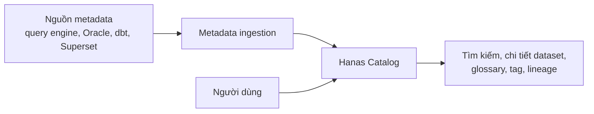

Hanas Catalog là nơi bạn tìm kiếm, mô tả và theo dõi các tài sản dữ liệu của Hanas Data Platform. Mục này dành cho data steward, analytics engineer và quản trị viên cần biết dữ liệu nằm ở đâu, ai sở hữu, đi từ đâu tới và ai được truy cập.

Trong Hanas Console, Hanas Catalog nằm ở menu **Data Governance** với các mục con **Glossary**, **Tags** và **Data Sources**. Trang đầu của menu là màn hình tìm kiếm metadata.

## Hai loại catalog trong nền tảng

Trong Hanas Console có hai khái niệm "catalog" phục vụ hai mục đích khác nhau. Bạn nên phân biệt rõ để tìm đúng nơi thao tác.

| | Catalog thực thi của query engine | Hanas Catalog (metadata và governance) |
|---|---|---|
| Mục đích | Duyệt source, workspace, folder, bảng và view để truy vấn | Khám phá, mô tả, gắn nhãn và theo dõi lineage của tài sản dữ liệu |
| Dữ liệu quản lý | Đối tượng mà query engine đọc và ghi trực tiếp | Metadata do metadata ingestion thu thập hoặc do người dùng khai báo |
| Thao tác điển hình | Chạy SQL, tạo view, đặt Reflection, cấp quyền đối tượng | Tìm kiếm, sửa mô tả, gắn tag và term, xem lineage |
| Phạm vi | Chỉ dữ liệu mà query engine quản lý | Có thể gồm cả dbt, Superset và các nguồn thu thập metadata khác |

Hanas Catalog không thay thế query engine. Nó đọc metadata, còn quyền xem một dataset vẫn do query engine quyết định theo phiên của chính người xem.

## Các trang trong mục

| Trang | Nội dung |
|---|---|
| [Tìm kiếm và khám phá tài sản dữ liệu](catalog.md) | Tìm kiếm, lọc và đọc trang chi tiết dataset. |
| [Thu thập metadata](metadata-ingestion.md) | Tạo source, recipe, chạy theo lịch, Run History và Secrets. |
| [Glossary, tag và ownership](glossary-and-tags.md) | Chuẩn hóa thuật ngữ, gắn nhãn và chỉ định người sở hữu. |
| [Lineage](lineage.md) | Xem quan hệ upstream, downstream và các giới hạn về nguồn lineage. |
| [Phân quyền dữ liệu](access-control.md) | Các miền quyền, grant, row access policy và column masking. |

## Quyền trong Hanas Catalog

Hanas Catalog có ba mức: viewer, editor và admin; mức cao bao gồm mức thấp. Người dùng không có role nào được xem như viewer. Chi tiết nằm ở [Phân quyền dữ liệu](access-control.md).

## Tiếp theo

- [Tìm kiếm và khám phá tài sản dữ liệu](catalog.md)
- [Thu thập metadata](metadata-ingestion.md)
- [Quy ước đặt tên](../transform/naming-conventions.md)
