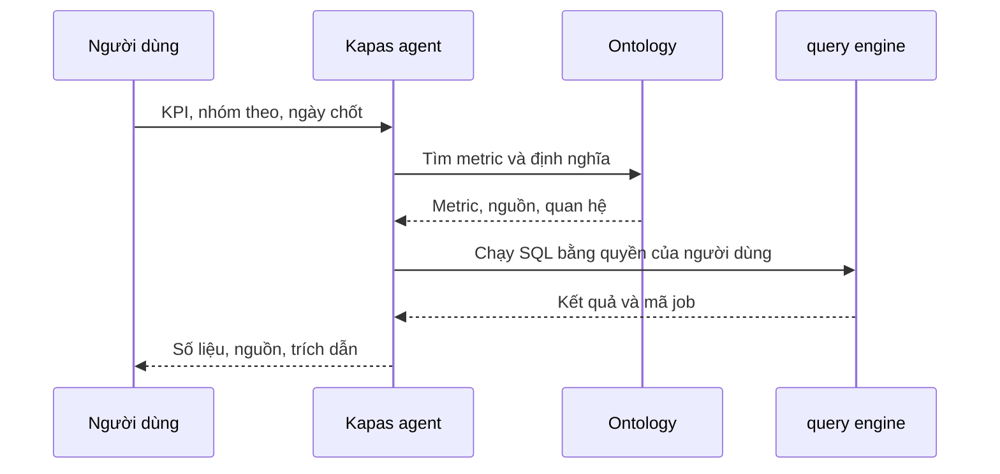

Trang này hướng dẫn bạn đặt câu hỏi về dữ liệu với Hanas Analyst và SQL Copilot, hiểu Kapas xử lý câu hỏi như thế nào và kiểm tra kết quả nhận được.

## Khái niệm

- **Hanas Analyst**: agent trả lời câu hỏi dữ liệu. Agent tìm bảng và cột phù hợp, gọi truy vấn hoặc metric, rồi trả lời bằng tiếng Việt.
- **Metric**: chỉ số đã được khai báo và phát hành trong Ontology. Khi có metric phù hợp, Kapas dựng SQL từ định nghĩa metric thay vì để mô hình tự viết công thức.
- **SQL Copilot**: agent hỗ trợ viết, sửa, giải thích và kiểm tra SQL trong **SQL Editor**.

## Điều kiện cần

- Tài khoản đăng nhập Hanas qua Keycloak (SSO).
- Quyền đọc dữ liệu tại query engine. Kapas truy vấn bằng quyền của bạn; xem [An toàn](safety.md).
- Với câu hỏi theo metric: workspace Ontology đã publish và có metric liên quan.

## Các bước

1. Đăng nhập Hanas Console bằng SSO, rồi mở menu **AI Agent** ở thanh bên trái.
2. Chọn **New chat** để bắt đầu hội thoại mới, hoặc chọn một hội thoại trong lịch sử chat. Chọn agent **Hanas Analyst** trong danh sách agent.
3. Nhập câu hỏi, nêu rõ chỉ số, nhóm theo gì (grain) và **ngày chốt** nếu là số dư tại một thời điểm.
4. Theo dõi phản hồi streaming. Các bước gọi tool hiện ngay trong khung chat.
5. Đọc câu trả lời kèm bảng nguồn, bộ lọc, đơn vị và các lưu ý. Mở trích dẫn để đối chiếu truy vấn gốc.

## Luồng xử lý

Với câu hỏi như "Tổng dư nợ theo vùng tại ngày chốt X", agent làm theo trình tự sau. Đây là minh họa luồng, không phải kết quả thật.

1. Làm rõ chỉ số, grain và ngày chốt nếu bạn chưa nêu.
2. Tìm metric trong Ontology.
3. Nếu có metric phù hợp, chạy metric với ngày chốt, nhóm và bộ lọc; SQL được dựng từ định nghĩa metric.
4. Nếu chưa có metric, tìm đường dẫn bảng thật, đọc schema, viết SQL và chạy truy vấn chỉ đọc.
5. Trả số liệu cùng bảng nguồn, snapshot, bộ lọc và lưu ý dữ liệu.

Compiler metric từ chối hoặc cảnh báo khi thiếu ngày chốt, metric trùng tên hoặc có nhiều đường join. Khi dữ liệu snapshot gần nhất cũ hơn ngày bạn yêu cầu, kết quả kèm cảnh báo.

## Mẹo đặt câu hỏi

| Nên | Tránh |
|---|---|
| "Tổng dư nợ theo chi nhánh tại ngày 30/06" | "Dư nợ bao nhiêu?" |
| Nêu đơn vị, bộ lọc, kỳ cần xem | Để agent tự đoán giá trị mã (ví dụ mã trạng thái) |
| Hỏi tiếp trong cùng phiên để thu hẹp | Dán nhiều câu hỏi độc lập vào một tin nhắn |

Hanas Analyst được hướng dẫn phân biệt số liệu theo kỳ với số dư tại một thời điểm, và không tự dịch giá trị mã. Phần này là chỉ dẫn cho mô hình, không phải ràng buộc cứng; hãy kiểm tra các chỉ số nghiệp vụ nhạy cảm.

## Hỏi đáp trong SQL Editor

Kapas cũng được nhúng dưới dạng panel **AI Agent** bên cạnh trình soạn thảo trong **SQL Editor** (menu **Workspaces**). SQL Copilot nhận nội dung editor, vùng chọn và lỗi job do ứng dụng gửi sang. Agent kiểm tra SQL bằng `EXPLAIN`, đề nghị chèn hoặc mở SQL; thao tác trên editor do giao diện thực hiện sau khi bạn xác nhận. Kapas Console độc lập không biết editor đang chứa gì.

## Biểu đồ trong hội thoại

Agent có thể trả bảng hoặc biểu đồ ngay trong chat. Đây là hiển thị tạm thời, khác với dashboard lưu trong Superset. Để lưu lại, xem [Báo cáo và lịch chạy](reports-and-schedules.md).

## Giới hạn

:::caution Giới hạn hiện tại

- Không có số đo độ chính xác NL sang SQL được công bố; luôn kiểm tra kết quả quan trọng.
- Truy vấn mặc định thêm `LIMIT 100` khi câu lệnh thiếu LIMIT, và chỉ đọc một số dòng đầu của kết quả. Đây là giới hạn mặc định, không phải trần cứng.
- Tìm kiếm trong Ontology là so khớp chuỗi con, cần đúng dấu tiếng Việt, không phải tìm theo ngữ nghĩa.
- Tổng hợp qua Ontology chỉ trả tối đa 100 nhóm; đừng suy ra "nhóm thấp nhất toàn bộ dữ liệu" từ tập này.

:::

## Xử lý sự cố

| Triệu chứng | Nguyên nhân thường gặp | Cách xử lý |
|---|---|---|
| Báo thiếu hoặc hết hạn token query engine | Phiên đăng nhập hết hạn | Đăng nhập lại. Kapas không có tài khoản dự phòng cho query engine. |
| Agent không tìm thấy bảng | Bạn chưa có quyền hoặc tên không khớp | Cung cấp tên bảng đầy đủ hoặc nhờ quản trị cấp quyền. |
| Agent hỏi lại ngày chốt | Câu hỏi về số dư thiếu thời điểm | Trả lời ngày chốt cụ thể. |

## Tiếp theo

- [Báo cáo, trích dẫn và lịch chạy](reports-and-schedules.md)
- [Agent, skill và tool](agents.md)
- [SQL Editor](../query/sql-studio.md)
