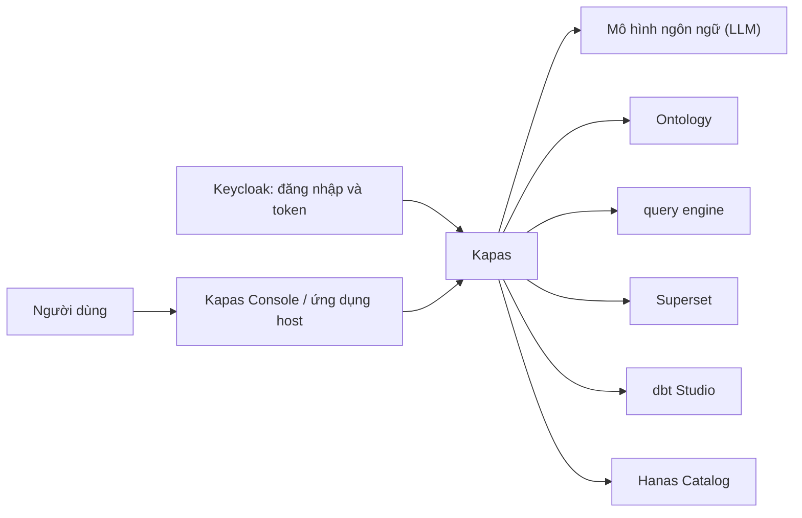

import Diagram from '@site/src/components/Diagram';

Kapas là lớp AI assistant của Hanas Data Platform. Bạn đặt câu hỏi bằng ngôn ngữ tự nhiên; Kapas gọi các công cụ đã được cấp (query engine, Ontology, Apache Superset, dbt, Hanas Catalog) rồi tổng hợp câu trả lời tiếng Việt kèm nguồn số liệu.

Trong Hanas Console, bạn trò chuyện với Kapas ở menu **AI Agent** (nút **New chat** và lịch sử chat). Kapas cũng được nhúng dưới dạng panel **AI Agent** trong **SQL Editor** (menu **Workspaces**).

Mục này dành cho người dùng nghiệp vụ, người quản trị và nhà phát triển muốn tích hợp Kapas vào ứng dụng. Phần cấu hình mô hình AI nằm ở mục vận hành, phần API nằm ở mục phát triển.

## Kapas nằm ở đâu trong kiến trúc?

Kapas là một dịch vụ riêng, chạy trong cùng cụm Kubernetes và dùng PostgreSQL (có extension vector) cùng Redis của chính nó. Mỗi người dùng có không gian làm việc riêng cho agent, phiên chat và lịch chạy.

## Kapas làm được gì?

<Diagram name="06-ai-agent" alt="Kapas làm việc cùng người dùng" />

| Nhu cầu | Agent phụ trách | Trang hướng dẫn |
|---|---|---|
| Hỏi số liệu, KPI bằng ngôn ngữ tự nhiên | Hanas Analyst | [Hỏi đáp dữ liệu](chat-with-data.md) |
| Viết, sửa, giải thích SQL | SQL Copilot | [Hỏi đáp dữ liệu](chat-with-data.md) |
| Dựng chart và dashboard trên Superset | Analytics Studio Copilot, Dashboard Copilot | [Agent, skill và tool](agents.md) |
| Khám phá object và metric Ontology | Ontology Assistant | [Agent, skill và tool](agents.md) |
| Tra cứu, bổ sung metadata trong catalog | Catalog Steward | [Agent, skill và tool](agents.md) |
| Hỗ trợ dự án dbt | Project Copilot | [Agent, skill và tool](agents.md) |
| Đề xuất concept và mapping Ontology | Concept Copilot, Mapping Copilot | [Agent, skill và tool](agents.md) |
| Trích dẫn số liệu, đặt lịch chạy | Hanas Analyst, Cron job | [Báo cáo, trích dẫn và lịch chạy](reports-and-schedules.md) |

## Các trang trong mục này

| Trang | Nội dung |
|---|---|
| [Hỏi đáp dữ liệu bằng ngôn ngữ tự nhiên](chat-with-data.md) | Luồng hỏi đáp, cách đặt câu hỏi tốt, đọc kết quả. |
| [Agent, skill và tool](agents.md) | Chín system agent, công cụ mỗi agent được dùng. |
| [Báo cáo, trích dẫn và lịch chạy](reports-and-schedules.md) | Dashboard, trích dẫn số liệu, Cron job và Inbox. |
| [An toàn và kiểm soát truy cập](safety.md) | Danh tính truy vấn, SQL chỉ đọc, sandbox, giới hạn quản trị. |

Liên quan: [Cấu hình mô hình AI](../operate/ai-models.md), [Kapas API và SSE](../develop/kapas-api.md), [Nhúng Kapas](../develop/kapas-embed.md).

## Điều kiện và giới hạn chung

:::note Điều kiện

Kapas cần được bật trong cấu hình triển khai, có ít nhất một mô hình ngôn ngữ đã cấu hình, và query engine, Ontology hoặc dịch vụ tương ứng đang chạy. Thiếu một thành phần, agent dùng thành phần đó sẽ báo lỗi thay vì trả lời.

:::

:::caution Giới hạn hiện tại

Kapas là trợ lý, không phải nguồn sự thật. Câu trả lời do mô hình ngôn ngữ sinh ra; hãy kiểm tra số liệu quan trọng qua trích dẫn truy vấn. Phân quyền dữ liệu do query engine và các dịch vụ đích quyết định, không phải do Kapas. Xem [An toàn](safety.md).

:::

## Tiếp theo

- Bắt đầu với [Hỏi đáp dữ liệu](chat-with-data.md).
- Quản trị viên: đọc [An toàn](safety.md) trước khi cấp quyền sử dụng rộng.
- Quản trị viên hạ tầng: [Cấu hình mô hình AI](../operate/ai-models.md).
