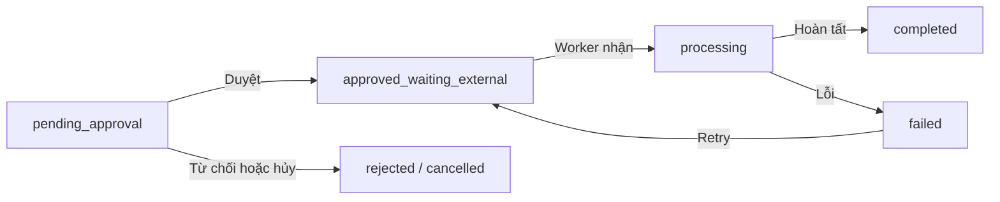

Action mô tả một thao tác đề xuất trên một record, ví dụ cập nhật hạn mức hay đổi trạng thái. Trang này giải thích luồng **action request** hiện có và nêu rõ phần nào chưa hoạt động.

:::caution Giới hạn hiện tại

Writeback trực tiếp từ action vào record hiện bị chặn. Endpoint thực thi action kiểu cũ trả lỗi và yêu cầu dùng luồng request. Ontology ghi nhận đề xuất và phê duyệt; việc thay đổi hệ thống nguồn do bộ xử lý bên ngoài đảm nhận. Hanas Data Platform chưa cung cấp connector ghi sẵn vào hệ thống lõi.

:::

## Khái niệm

Một action gồm object type đích, parameters, thay đổi đề xuất và chính sách phê duyệt. Mỗi request lưu giá trị trước thay đổi, thay đổi đề xuất, parameters, revision của ontology và chính sách duyệt tại thời điểm gửi.

Luồng dùng nguyên tắc **maker-checker**: người gửi và người duyệt là hai vai trò khác nhau. Phạm vi của người duyệt có thể gắn với giá trị property của record.

| Vai trò | Việc làm |
|---|---|
| Người gửi | Tạo request từ trang chi tiết record, theo dõi và hủy khi còn chờ. |
| Người duyệt | Xem hộp thư phê duyệt, duyệt hoặc từ chối kèm lý do. |
| Bộ xử lý bên ngoài | Tài khoản máy có role `ontology-action-worker`, nhận request đã duyệt, thực hiện và báo kết quả. |

## Vòng đời request

1. Người gửi tạo request; trạng thái là `pending_approval`.
2. Người duyệt duyệt hoặc từ chối. Request được duyệt chuyển sang `approved_waiting_external`.
3. Worker bên ngoài nhận request (`processing`), xử lý ở hệ thống nguồn rồi báo hoàn tất kèm tham chiếu ngoài hoặc báo lỗi.
4. Request lỗi có thể được đưa trở lại hàng đợi ngoài bằng thao tác retry.

Trạng thái `completed` ghi nhận kết quả mà worker báo cáo. Nó không tự chứng minh hệ thống nguồn đã thay đổi.

## Các bước dùng

1. Mở trang chi tiết của một record có action.
2. Chọn action, nhập parameters và gửi request.
3. Theo dõi trong danh sách request của record hoặc trong **Ontology** > **My requests**.
4. Người duyệt xử lý request trong hộp thư phê duyệt.

:::note Điều kiện

Trang chi tiết chỉ hiện action khi ontology định nghĩa action cho object type. Mục **My requests** trong menu **Ontology** luôn hiển thị; đây là nơi bạn theo dõi các request đã gửi. Nếu bạn cần truy cập hộp thư phê duyệt, liên hệ quản trị viên.

:::

## Dành cho nhà phát triển

Các endpoint request nằm trong nhóm Action trên trang [Ontology API](../develop/ontology-api.md). Worker bên ngoài dùng role `ontology-action-worker` để liệt kê, nhận, hoàn tất, báo lỗi và retry request.

## Xử lý sự cố

| Hiện tượng | Cách xử lý |
|---|---|
| Gọi endpoint thực thi action cũ nhận lỗi | Dùng endpoint gửi request. |
| Request đứng ở trạng thái đã duyệt | Chưa có worker nhận; kiểm tra bộ xử lý bên ngoài. |
| Không thể duyệt request của chính mình | Maker-checker yêu cầu người duyệt khác. |

## Tiếp theo

- [Quản trị ontology](governance.md) cho role và audit.
- [Khám phá đối tượng](explore.md) để mở record.
- [Ontology API](../develop/ontology-api.md) để tích hợp worker.
