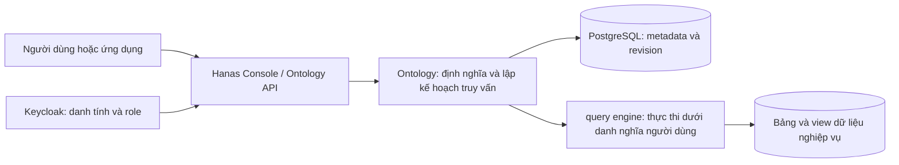

Ontology của Hanas Data Platform bổ sung ngữ nghĩa nghiệp vụ lên các bảng và view do query engine cung cấp. Thay vì bắt đầu từ tên cột hoặc câu SQL, bạn làm việc với khách hàng, tài khoản, giao dịch và quan hệ giữa chúng.

Mục tài liệu này dành cho người thiết kế mô hình nghiệp vụ, người quản trị và người sử dụng dữ liệu. Nhà phát triển có thể dùng cùng định nghĩa để xây dựng ứng dụng qua Ontology API.

## Ontology nằm ở đâu trong kiến trúc?

Ontology giữ định nghĩa đối tượng, ánh xạ dữ liệu, metric và thông tin phát hành trong kho metadata PostgreSQL. Dữ liệu nghiệp vụ vẫn được đọc qua query engine; publish ontology không sao chép toàn bộ record vào kho metadata.

Khi bạn lọc một danh sách khách hàng, Ontology xác định object type, property và capability được khai báo. Planner kiểm tra request rồi sinh truy vấn từ các định nghĩa hợp lệ, thay vì nhận SQL tự do từ Query DSL.

Trong cấu hình production, truy vấn chạy dưới danh nghĩa người gọi thông qua trao đổi token với Keycloak. Quyền trên dữ liệu, row access và masking phụ thuộc chính sách được cấu hình tại query engine.

:::note Điều kiện

Để đọc record, workspace phải có deployment đang phục vụ và object type phải được ánh xạ vào dataset hợp lệ. Người dùng cần role Ontology phù hợp, đồng thời có quyền đọc dữ liệu tại query engine.

:::

## Từ bảng và view đến đối tượng nghiệp vụ

Một view khách hàng có thể cung cấp mã, tên và chi nhánh quản lý. Bạn ánh xạ view này thành object type khách hàng, chọn mã khách hàng làm khóa và khai báo các property.

Một view tài khoản có thể liên kết tới khách hàng qua mã khách hàng. Link type mô tả quan hệ đó, bao gồm cặp cột join và nhãn đọc theo mỗi chiều.

| Lớp | Nội dung | Ví dụ minh họa |
|---|---|---|
| Nguồn dữ liệu | Bảng hoặc view đã có trong query engine | View khách hàng và tài khoản |
| Định nghĩa nghiệp vụ | Ý nghĩa, identity và quan hệ của concept | Khách hàng sở hữu tài khoản |
| Mapping | Dataset, cột, khóa và điều kiện join | Mã khách hàng nối sang tài khoản |
| Runtime | Object type, property, link và metric đã phát hành | Danh sách khách hàng và tài khoản liên quan |
| Ứng dụng | Khám phá record hoặc gọi API theo định nghĩa | Lọc khách hàng theo chi nhánh |

Concept có thể được giữ làm từ vựng nghiệp vụ mà chưa cần dataset. Chỉ những định nghĩa có mapping và đáp ứng điều kiện runtime mới cung cấp record để truy vấn.

## Bạn có thể làm gì?

Người thiết kế dùng **Ontology Workspace** để soạn concept, cấu hình mapping và chuẩn bị phát hành. Draft được kiểm tra trước khi admin publish và kích hoạt deployment. Trong Hanas Console, công việc được tổ chức theo project: mở menu **Ontology** > **Explore**, chọn **Create project** hoặc chọn **Open Build** trên thẻ project. Menu **Ontology** gồm **Explore**, **My requests**, **Workbench**, **Governance** và **Settings**.

Người dùng nghiệp vụ dùng **Explore** để tìm object type, lọc record và đi theo các quan hệ đã khai báo. Metric được hiển thị theo vị trí và ngữ cảnh mà người thiết kế cấu hình.

Nhà phát triển dùng API đọc định nghĩa, truy vấn record, tổng hợp dữ liệu hoặc duyệt link. Các ứng dụng cần giữ đúng workspace và danh tính người dùng trong mỗi request.

## Các trang trong mục này

| Trang | Nội dung |
|---|---|
| [Khái niệm Ontology](concepts.md) | Object type, property, link, interface, metric và vòng đời định nghĩa. |
| [Ontology Workspace](workspace.md) | Soạn draft, kiểm tra mapping và phát hành một workspace. |
| [Ánh xạ ontology vào dữ liệu](mapping.md) | Chọn dataset, khóa, property, quan hệ và chính sách ngày. |
| [Metric](metrics.md) | Định nghĩa chỉ số, cấu hình thực thi và vị trí hiển thị. |
| [Khám phá đối tượng](explore.md) | Tìm kiếm, lọc, xem record và khám phá quan hệ. |
| [Action và yêu cầu thay đổi](actions.md) | Gửi yêu cầu, phê duyệt và hiểu giới hạn cập nhật dữ liệu. |
| [Quản trị ontology](governance.md) | Role, release gate, audit, revision và rollback. |
| [Mẫu ontology ngành ngân hàng](industry-templates.md) | Sử dụng mẫu nghiệp vụ và bổ sung mapping cho dữ liệu của bạn. |

## Phạm vi và giới hạn

:::caution Giới hạn hiện tại

Writeback trực tiếp từ action vào record hiện bị chặn. Luồng action request có thể ghi nhận đề xuất và phê duyệt; việc thay đổi hệ thống nguồn cần bộ xử lý bên ngoài.

:::

Ontology không tự tạo quyền đọc dataset khi bạn publish một object type. Cờ ẩn property và business group cũng không thay thế cơ chế phân quyền dữ liệu.

Project IDE trong Console được trình bày dưới nhãn **Preview** ở trang Workspace. Các chức năng AI tùy chọn cần dịch vụ và cấu hình tương ứng; đề xuất vẫn cần được kiểm tra trước khi phát hành.

## Tiếp theo

- Đọc [Khái niệm Ontology](concepts.md) để thống nhất thuật ngữ trước khi thiết kế.
- Thực hiện luồng authoring tại [Ontology Workspace](workspace.md).
- Tích hợp ứng dụng bằng [Ontology API](../develop/ontology-api.md) và [Query DSL](../develop/ontology-query-dsl.md).
