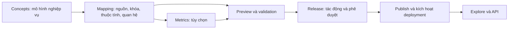

Ontology Workspace trong Hanas Data Platform là nơi bạn thiết kế và phát hành mô hình nghiệp vụ. Trang này dành cho tác giả ontology và admin chịu trách nhiệm đưa định nghĩa vào runtime.

Một workspace giữ tài liệu canonical, platform manifest và lịch sử revision của dự án. Bản đã lưu, revision đã phê duyệt và deployment đang phục vụ là những trạng thái khác nhau.

## Điều kiện cần

| Công việc | Quyền hoặc thành phần cần có |
|---|---|
| Đọc catalog và record | `ontology-viewer` và quyền dữ liệu tại query engine. |
| Soạn concept, mapping và metric | `ontology-editor` hoặc `ontology-admin`. |
| Tạo và quản lý workspace | `ontology-admin`. |
| Publish, rollback và activation | `ontology-admin`. |
| Xem trước dữ liệu | Dataset có thể truy cập bằng danh tính người thực hiện. |

:::note Điều kiện

Các công cụ Copilot cần dịch vụ AI và cấu hình tích hợp tương ứng. Bạn có thể soạn mô hình và mapping thủ công mà không dùng đề xuất AI.

:::

## Các giai đoạn authoring

Luồng Workbench gồm **Concepts**, **Mapping**, **Metrics** và **Release**. Metric là bước tùy chọn; một object type có thể được phát hành khi không khai báo metric.

### 1. Chọn project

Công việc ontology được tổ chức theo **project**. Menu **Ontology** có các mục **Explore**, **My requests**, **Workbench**, **Governance** và **Settings**.

1. Mở **Ontology** > **Explore** trong Hanas Console. Trang hiển thị **Explore projects**.
2. Để tạo project mới, chọn **Create project**. Để làm việc với project có sẵn, tìm thẻ của project; thẻ cho biết trạng thái **PUBLISHED** (kèm số phiên bản, ví dụ vN) hoặc **NOT PUBLISHED**.
3. Trên thẻ project, chọn **Open Build** để vào môi trường authoring (Workbench) của project đó. Chọn **Explore** để duyệt dữ liệu đã phát hành.

Kiểm tra tên project trước khi sửa hoặc import tài liệu. Project xác định phạm vi nội dung, còn quyền truy cập vẫn được kiểm tra theo tenant và role.

### 2. Khởi tạo draft

Bạn có thể tạo draft từ template, import tài liệu YAML/JSON hoặc tạo draft thay đổi từ revision trước. Workspace chưa có nội dung có thể bắt đầu bằng draft rỗng.

Chọn cách khởi tạo phù hợp với tài liệu hiện có, sau đó kiểm tra namespace và mô tả. Import chỉ tạo nội dung để author; nó chưa phát hành record cho người dùng.

### 3. Thiết kế concept

Trong **Concepts**, khai báo ý nghĩa nghiệp vụ, identity và relationships của các concept cần sử dụng. Phân biệt concept cần runtime với vocabulary chưa cần nối dữ liệu.

Bạn có thể tổ chức concept theo business group để dễ duyệt mô hình. Với subtype, kiểm tra điều kiện phân loại và quan hệ tới concept gốc trước khi cấu hình runtime.

Nếu dùng Copilot, chọn metadata datasets làm căn cứ rồi kiểm tra từng đề xuất. Nguồn được chọn cho agent tham khảo chưa trở thành dataset binding của object type.

### 4. Ánh xạ dữ liệu

Trong **Mapping**, hoàn thành lần lượt nguồn dữ liệu, property, khóa, relationship và trải nghiệm record. Chỉ bật capability mà dữ liệu và nhu cầu sử dụng thực sự đáp ứng.

Một entity bắt buộc có runtime nhưng thiếu dataset hoặc primary key sẽ chặn phát hành. Xem [Ánh xạ ontology vào dữ liệu](mapping.md) để xử lý grain, composite key và chính sách ngày.

### 5. Xem trước draft

Dùng preview record để kiểm tra danh sách và một số record cụ thể theo mapping đang soạn. Kiểm tra thêm quan hệ và ngữ cảnh ngày nếu mô hình sử dụng snapshot.

Preview dùng danh tính người thực hiện để đọc dữ liệu. Việc thấy record trong preview không chứng minh mọi người dùng sẽ có cùng quyền hoặc cùng kết quả.

### 6. Kiểm tra release

1. Mở **Release** của draft.
2. Chạy validation để lấy danh sách issue.
3. Xử lý các lỗi chặn theo mã và vị trí được báo.
4. Xem tác động thay đổi so với bản đang phục vụ.
5. Kiểm tra các tài nguyên phụ thuộc trước thay đổi có tính phá vỡ.

Validation kiểm tra mô hình, mapping, schema nguồn và các điều kiện phát hành. Nếu agent vẫn đang chạy, bạn cần kết thúc run trước khi phát hành draft.

### 7. Gửi phê duyệt hoặc publish

Editor gửi draft sang trạng thái chờ phê duyệt. Khi đó draft chuyển sang chỉ đọc; người gửi có thể rút lại để sửa nếu cần.

Admin kiểm tra preview và checksum hiện tại trước khi publish. Luồng publish chuẩn phê duyệt revision, chuẩn bị deployment và kích hoạt bản runtime mới.

Nếu nội dung đã đổi sau preview, bạn cần tải lại và xem tác động mới. Không dùng checksum cũ để tiếp tục phát hành một bản đã bị người khác sửa.

## Project IDE trong Console (Preview)

Project IDE đã có giao diện trong Console, nhưng nhóm API của IDE vẫn ở mức thử nghiệm. Các mô tả dưới đây giúp nhận biết giao diện, không bảo đảm toàn bộ thao tác chạy được trong mọi triển khai.

| Khu vực | Nội dung hiển thị |
|---|---|
| Explorer | Cây file của dự án và thao tác file. |
| Tab **Concept** | Góc nhìn cấu trúc concept và tiến trình liên quan. |
| Tab **Mapping** | Góc nhìn ánh xạ từ concept sang dữ liệu. |
| Editor | Góc nhìn trực quan hoặc YAML cho nội dung được hỗ trợ. |
| **Problems** và **Thay đổi** | Diagnostics và phần thay đổi của nội dung. |
| Agent pane | Điều khiển và theo dõi các tác vụ AI. |

Thanh công cụ có **Lưu**, **Validate**, **Biên dịch**, **Xuất bản**, **Tải zip** và **Import**. Nút **Lưu** chỉ lưu nội dung; trạng thái phục vụ phải được xác nhận qua luồng release.

:::caution Giới hạn hiện tại

Import ZIP của Project IDE có giao diện xác nhận ghi đè toàn bộ file bản nháp và cấu hình khởi tạo. Không coi thao tác này tương đương staged import có reconciliation của Ontology Workspace.

:::

## Xử lý sự cố

| Hiện tượng | Cách xử lý |
|---|---|
| Draft không sửa được | Kiểm tra role và trạng thái chờ phê duyệt; rút submission nếu bạn có quyền. |
| Lưu bị xung đột | Giữ nội dung đang soạn, tải revision mới rồi đối chiếu thay đổi. |
| Preview không có record | Kiểm tra dataset, khóa, bộ lọc ngày và quyền của người gọi. |
| Publish bị chặn | Đọc issue trong release preview; xử lý blocker và agent run còn hoạt động. |
| Đã lưu nhưng Explore chưa đổi | Kiểm tra publish và deployment đang phục vụ của đúng workspace. |

## Tiếp theo

- Hoàn thiện [Mapping dữ liệu](mapping.md) trước khi phát hành.
- Thêm chỉ số tại [Metric](metrics.md).
- Áp dụng [Quản trị ontology](governance.md) cho review và rollback.
