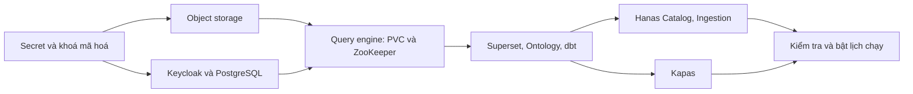

Trang này liệt kê những gì cần sao lưu để khôi phục Hanas Data Platform, và thứ tự khôi phục theo phụ thuộc giữa các thành phần. Bạn dùng nó để xây runbook của đơn vị mình.

:::caution Giới hạn hiện tại

Bộ cài chưa cung cấp cơ chế backup và restore tự động thống nhất cho toàn nền tảng. Chưa có RPO, RTO, retention hay lịch diễn tập khôi phục nào được xác nhận. Các bước dưới đây là khung đề xuất; bạn phải kiểm chứng runbook trong môi trường tách biệt tại nơi triển khai trước khi dựa vào nó.

:::

Hiện chỉ Kapas có sẵn một CronJob sao lưu PostgreSQL (`pg_dump`, giữ 7 bản gần nhất, lưu trên PVC của cluster) và CronJob này đang tắt theo cấu hình mẫu. Bản sao lưu nằm cùng cluster không đủ để khôi phục khi mất cluster.

## Cần sao lưu những gì

| Hạng mục | Phạm vi | Điều kiện khôi phục |
|---|---|---|
| Khoá mã hoá của Hanas Catalog | Lưu riêng trong hệ quản lý secret, ghi kèm mốc database | Mất hoặc đổi khoá thì credential nguồn đã mã hoá trong database không giải mã được. |
| PostgreSQL của Hanas Catalog | Metadata, nguồn, credential mã hoá, lineage, lịch chạy, lịch sử migration | Khôi phục cùng phiên bản ứng dụng tương thích và đúng khoá. |
| Ingestion | Khoá mã hoá, PostgreSQL và PVC trạng thái | Giữ khoá cũ; checkpoint phải nhất quán với dữ liệu đích để tránh nạp lặp hoặc bỏ sót. |
| dbt | Khoá mã hoá, PostgreSQL và PVC (storage, workspace, Git SSH) | Không chỉ restore database rồi tạo workspace rỗng nếu run phụ thuộc file. |
| Keycloak | PostgreSQL: realm, client, role, user, group, bản dịch | Secret của client phải khớp. Job seed chỉ tái tạo một phần cấu hình, không thay cho backup realm và user. |
| Superset | PostgreSQL và các secret key | Đúng major version PostgreSQL và schema ứng dụng; PAT được cấp lại bằng Job. |
| Ontology | PostgreSQL (pgvector) | Cần extension và số chiều embedding đúng. Redis là cache, không phải nguồn dữ liệu chính. |
| Kapas | PostgreSQL và PVC (data, secrets, backups) | Giữ cấu hình agent và credential; kiểm tra tác động migration template trước khi khởi động. |
| Query engine | PVC metadata, bảo mật, keystore và trạng thái ZooKeeper cần thiết | Object storage không phải toàn bộ backup của query engine. |
| Object storage (MinIO hoặc S3) | Object ở bucket và path đang dùng, cùng IAM và policy | Không đổi endpoint hay bucket rồi mong metadata tự tìm lại dữ liệu. |
| Cấu hình phát hành | File cấu hình môi trường, `images.yaml` (digest, revision), route APISIX, TLS, secret | Tái lập đúng môi trường. Không lưu secret dạng plaintext trong Git. |

Một file dump database không thay cho khoá mã hoá. Ngược lại, chỉ có khoá mà thiếu database cũng vô nghĩa. Sao lưu cả hai theo cùng một mốc.

## Thứ tự khôi phục theo phụ thuộc

1. Khôi phục kho secret và khoá mã hoá, theo đúng phiên bản đi cùng database.
2. Khôi phục object storage với đúng bucket, path và quyền.
3. Khôi phục Keycloak (database, realm), rồi xác nhận client secret khớp.
4. Khôi phục query engine: PVC và trạng thái điều phối.
5. Khôi phục các ứng dụng có database riêng (Superset, Ontology, dbt) cùng PVC của chúng.
6. Khôi phục Hanas Catalog, Ingestion, Kapas nếu bật.
7. Kiểm tra route, quyền và các luồng chính, rồi mới bật schedule và worker.

Thứ tự trên suy ra từ quan hệ phụ thuộc đã mô tả trong [Kiến trúc triển khai](deployment-architecture.md); chưa được diễn tập thực tế.

## Khung runbook đề xuất

1. Chọn phạm vi sao lưu nhất quán. Tạm dừng writer, schedule và Ingestion khi cần, và xác định mốc database, object và PVC tương ứng.
2. PostgreSQL: dùng sao lưu logic hoặc giải pháp vật lý và PITR mà bạn đã chọn, giữ cả role và extension. Chọn công cụ tương thích major version của server.
3. Object storage: dùng replication, versioning hoặc backup ngoài cluster đã được kiểm chứng.
4. PVC: dùng giải pháp storage đã chọn. Replica của Longhorn không phải backup độc lập.
5. Lưu khoá mã hoá và credential theo phiên bản trong kho bí mật có backup riêng.
6. Restore vào môi trường tách biệt, với ứng dụng tương thích. Chưa cho worker và schedule chạy cho đến khi database, khoá, object storage, route và quyền nhất quán.
7. Chạy smoke test và các ca nghiệp vụ, gồm giải mã credential và đọc ghi dữ liệu. Xác nhận không có lần chạy theo lịch bị lặp; ghi lại RPO và RTO đo được.

Với production, bạn cần thêm người chịu trách nhiệm, vị trí lưu, retention, lịch diễn tập và mục tiêu RPO, RTO đã được phê duyệt.

## Tiếp theo

- [Nâng cấp và rollback](upgrade.md).
- [Kiểm tra sức khỏe và giám sát](health-checks.md).
- [Kiến trúc triển khai](deployment-architecture.md).
