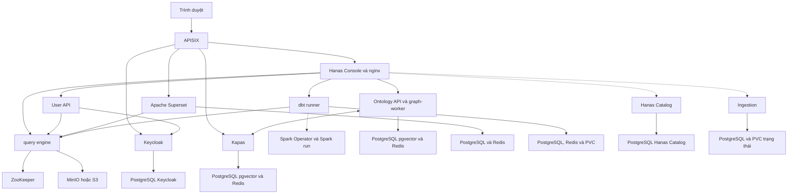
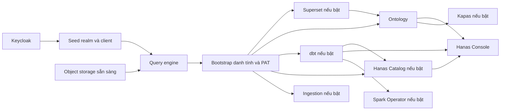

Hanas Data Platform tổ chức các ứng dụng thành nhiều Helm release trên Kubernetes, với Keycloak cung cấp danh tính chung. Trang này giúp đội vận hành xác định đường truy cập, dữ liệu bền vững và thứ tự triển khai.

## Thành phần và đường giao tiếp

Hanas Console là giao diện web chính, đồng thời sử dụng nginx để proxy các API nội bộ. APISIX tiếp nhận truy cập từ bên ngoài và chuyển request tới Service phù hợp trong cluster.

Đường nét đứt thể hiện thành phần tuỳ chọn theo feature flag. Sơ đồ lược bỏ một số kết nối xác thực để thể hiện rõ phụ thuộc ứng dụng và dữ liệu.

Bộ cài khai báo 14 release; cấu hình mẫu bật 11 release và tắt Hanas Catalog, Ingestion, Spark Operator. Số release không tương đương số pod, vì một release có thể chứa nhiều workload và datastore.

| Nhóm | Workload chính | Namespace mẫu |
|---|---|---|
| Danh tính | Keycloak, PostgreSQL và Job seed | `keycloak-dp` |
| Truy vấn | Master coordinator, coordinator, executor, ZooKeeper và bootstrap | `dataplatform` |
| Giao diện | Console UI và User API | `dataplatform` |
| Object storage | MinIO standalone | `hanas-minio` |
| BI | Superset web, worker, Celery beat, PostgreSQL, Redis và Job cấp PAT | `superset-dp` |
| Ontology | API, graph-worker, migration Job, PostgreSQL pgvector và Redis | `ontology` |
| AI | Kapas web, PostgreSQL pgvector và Redis | `kapas` |
| Biến đổi | dbt runner, PostgreSQL, Redis và PVC | `dbt-studio` |
| Quản trị metadata | Hanas Catalog API, runner và PostgreSQL | `hanas-catalog` |
| Nạp dữ liệu | API, worker và PostgreSQL | `ingestion` |
| Compute | Spark Operator và workload Spark theo run | `hanas-compute` |

## Mạng public và mạng nội bộ

Các Service ứng dụng mặc định dùng ClusterIP. PostgreSQL, Redis và graph-worker phục vụ giao tiếp nội bộ; không cần route public cho người dùng thông thường.

Browser sử dụng tên miền public cho đăng nhập, callback, iframe và giao diện ứng dụng. Các backend thường sử dụng Service DNS để gọi API, lấy JWKS hoặc kết nối datastore.

Riêng Superset và Kapas cần truy cập được tên miền public Keycloak từ bên trong pod. Cấu hình hostAliases trong bộ cài hỗ trợ đường này, nhưng không thay thế DNS trên máy người dùng.

Console và Job bootstrap ghim kết nối SSO query engine vào master coordinator qua headless DNS. Cách định tuyến này giữ request OAuth trên node đã phát state; thay bằng round-robin có thể gây lỗi phiên đăng nhập.

Ingress ứng dụng phần lớn bị tắt trong values hiện tại. APISIX được quản lý ngoài Helmfile, nên việc apply thành công chưa tạo đường truy cập public cho nền tảng.

## Thứ tự triển khai

Helmfile dùng quan hệ phụ thuộc để sắp xếp apply, kết hợp cấu hình chờ của từng release. Superset sử dụng cơ chế migration và gate riêng với chế độ không chờ Ready ở cấp release.

:::caution Giới hạn hiện tại

Hoàn tất apply không chứng minh Superset web, worker và Celery beat đã Ready. Bạn phải kiểm tra workload và thực hiện kiểm thử chức năng sau triển khai.

:::

## Dữ liệu bền vững và ranh giới phục hồi

Mỗi ứng dụng có PostgreSQL riêng, vì vậy không có một database duy nhất chứa toàn bộ trạng thái nền tảng. Ontology và Kapas sử dụng pgvector; khi phục hồi cần duy trì extension phù hợp.

Query engine cần object storage và metadata trên PVC. dbt lưu storage, workspace và dữ liệu Git SSH trên PVC; Ingestion giữ trạng thái engine trong workdir bền vững.

Kapas dùng PVC cho dữ liệu, secret và backup, cùng một replica trong cấu hình hiện tại. Redis của Ontology và Superset không bật persistence, trong khi Redis của Kapas và dbt có PVC riêng.

## Thành phần ngoài phạm vi bộ cài

StorageClass, APISIX, DNS, TLS và hệ thống backup cần được triển khai riêng. Một số tích hợp Kapas còn phụ thuộc dịch vụ tri thức, skill, TTS/STT; Ontology cần embedding provider theo cấu hình.

:::note Điều kiện

Compute yêu cầu bật dbt runner, có Spark Operator, image Spark và quyền tạo tài nguyên Kubernetes tương ứng. Các dịch vụ AI ngoài cụm phải được cấu hình bằng endpoint của môi trường triển khai.

:::

Không suy ra khả năng HA bằng cách tăng replica của từng ứng dụng. Với PVC RWO, shared state và database một instance, thay đổi topology cần được thiết kế và kiểm thử riêng.

## Tiếp theo

- [Định cỡ CPU, RAM và PVC](requirements.md).
- [Cài đặt theo thứ tự phụ thuộc](install.md).
- [Thiết lập gateway và tên miền](gateway.md).
- [Xác định dữ liệu cần sao lưu](backup-recovery.md).
