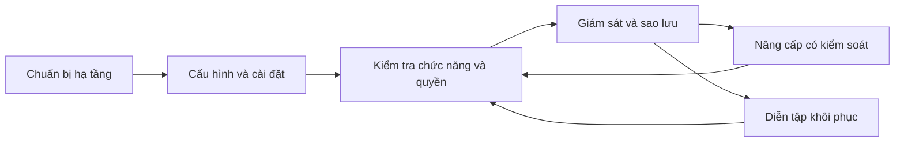

Hanas Data Platform được triển khai trên Kubernetes bằng Helmfile, với cấu hình tập trung cho các ứng dụng và datastore. Mục này dành cho quản trị viên nền tảng, đội hạ tầng và người phụ trách vận hành dịch vụ.

Bạn sẽ tìm thấy quy trình cài đặt, cấu hình gateway, quản lý danh tính, nâng cấp và phục hồi dữ liệu. Các hướng dẫn sử dụng bộ cài hợp nhất, thay cho việc ghép riêng từng thành phần.

:::note Phạm vi cấu hình

Các thông số trong mục này được đối chiếu với bộ cài phát hành tháng 11/2026. Chúng mô tả cấu hình khai báo; trạng thái triển khai thực tế cần được kiểm tra tại môi trường của bạn.

:::

## Chọn tài liệu theo công việc

| Trang | Nội dung |
|---|---|
| [Kiến trúc triển khai](deployment-architecture.md) | Thành phần, ranh giới mạng, datastore và thứ tự phụ thuộc giữa các release. |
| [Yêu cầu hệ thống và sizing](requirements.md) | Điều kiện hạ tầng, CPU, RAM, PVC và cách lập kế hoạch tài nguyên. |
| [Cài đặt bằng helmfile](install.md) | Chuẩn bị môi trường, apply, seed Keycloak và kiểm tra sau cài đặt. |
| [Tham chiếu cấu hình](configuration.md) | Feature flags, URL, storage, concurrency và nhóm secret cần quản lý. |
| [API gateway và tên miền](gateway.md) | Cấu hình APISIX, DNS, forwarded headers và đường truy cập ứng dụng. |
| [Xác thực và SSO](identity.md) | Realm, client, issuer, audience và token exchange với Keycloak. |
| [Quản lý người dùng, group và role](user-management.md) | Tạo tài khoản, gán quyền ứng dụng và kiểm tra quyền dữ liệu. |
| [Nâng cấp và rollback](upgrade.md) | Ghim image, xử lý migration và chọn phương án quay về phiên bản trước. |
| [Sao lưu và khôi phục](backup-recovery.md) | Phạm vi backup, khoá mã hoá và trình tự phục hồi theo phụ thuộc. |
| [Kiểm tra sức khỏe và giám sát](health-checks.md) | Smoke test, kiểm tra chức năng và tín hiệu vận hành cần theo dõi. |
| [Xử lý sự cố](troubleshooting.md) | Triệu chứng đã biết, nguyên nhân và hướng xử lý tương ứng. |

## Chu trình vận hành

Ở lần cài đầu, bạn nên đọc kiến trúc và yêu cầu hệ thống trước khi điền cấu hình môi trường. Sau khi các release được triển khai, hoàn tất route gateway và kiểm tra đăng nhập bằng tài khoản thông thường.

Ở giai đoạn vận hành, giữ bản ghi cấu hình phát hành, image digest, feature flags và kết quả kiểm tra. Khi thay đổi schema hoặc storage, bản ghi này giúp xác định bộ dữ liệu và phiên bản cần phục hồi cùng nhau.

## Ranh giới trách nhiệm

Bộ cài tạo các workload ứng dụng, datastore nội bộ và Job khởi tạo theo cấu hình đã chọn. Kubernetes, StorageClass, APISIX, DNS và chứng chỉ TLS phải được chuẩn bị trong hạ tầng triển khai.

| Phạm vi | Trách nhiệm cần xác định |
|---|---|
| Hạ tầng | Node, networking, DNS, storage, gateway và khả năng pull image. |
| Nền tảng | Cấu hình Helmfile, image, migration, secret và trạng thái ứng dụng. |
| Danh tính | Realm Keycloak, tài khoản quản trị, group, role và vòng đời credential. |
| Dữ liệu | Quyền nguồn, object storage, checkpoint, lịch chạy và tính nhất quán khi restore. |
| Dịch vụ ngoài cụm | Endpoint, credential, mạng và khả năng phục vụ các tích hợp AI hoặc nguồn dữ liệu. |

Hãy chỉ định người chịu trách nhiệm cho từng phạm vi trước khi nghiệm thu môi trường. Việc một ứng dụng Ready chưa chứng minh các luồng đăng nhập, truy vấn và chạy lịch đã hoạt động đúng.

## Những giới hạn cần biết

:::caution Giới hạn hiện tại

Cấu hình mẫu có nhiều thành phần chạy một replica và MinIO standalone. Bộ cài chưa cung cấp runbook HA, backup/restore hoặc monitoring tập trung đã được kiểm chứng cho toàn nền tảng.

:::

Feature flag có thể điều khiển vòng đời Helm release. Tắt thành phần rồi apply có thể gỡ release, vì vậy bạn cần xem diff và đánh giá dữ liệu liên quan trước.

Backup cần bao gồm cả datastore, PVC, object storage và khoá mã hoá tương ứng. Một file dump hoặc snapshot riêng lẻ chưa đủ chứng minh nền tảng có thể phục hồi sau sự cố.

Smoke test giúp phát hiện lỗi triển khai và kết nối thường gặp, nhưng cần bổ sung kiểm tra chức năng. Đặc biệt, hãy xác nhận quyền bằng tài khoản bị giới hạn và thử khôi phục tại môi trường tách biệt.

## Tiếp theo

- [Tìm hiểu kiến trúc triển khai](deployment-architecture.md).
- [Chuẩn bị tài nguyên và storage](requirements.md).
- [Thực hiện cài đặt bằng helmfile](install.md).
