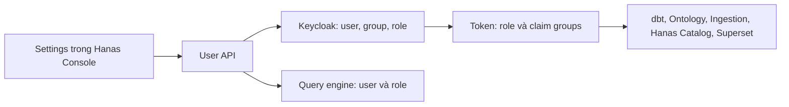

Quản trị viên quản lý người dùng, group và role ngay trong **Settings** > **User Administration** của Hanas Console. Console không lưu danh tính; các thao tác được chuyển sang Keycloak và đồng bộ sang query engine.

Menu **Settings** gồm các nhóm sau.

| Nhóm | Mục |
|---|---|
| **User Administration** | Các tab **Users**, **Roles**, **Permissions**; nút **New User** |
| **Integrations** | **BI Applications**, **External Tokens**, **AI Config** |
| **System** | **Preferences**, **Support**, **Compute** |
| **Custom** | **SQL Query Config** |

## Khái niệm

- Keycloak là nguồn danh tính. Người dùng, group và role được tạo ở đó.
- Query engine nhận bản đồng bộ của người dùng và role để áp quyền trên dữ liệu.
- Mỗi ứng dụng khác đọc role và group từ token của người dùng và tự quyết định quyền. Xem bảng role trong [Xác thực và SSO](identity.md).

## Điều kiện cần

- Tài khoản có quyền quản trị (role `admin`). Màn hình **Settings** dành cho quản trị viên.
- Hanas Console, User API, Keycloak và query engine đang hoạt động.

## Các bước

### Tạo người dùng

1. Mở **Settings** > **User Administration**, chọn tab **Users**.
2. Chọn **New User**, nhập tên đăng nhập, thông tin liên hệ và mật khẩu ban đầu.
3. Lưu. Người dùng xuất hiện trong realm Keycloak và được đồng bộ sang query engine.
4. Yêu cầu người dùng đăng nhập thử bằng Hanas Console.

### Tạo group và role

1. Trong **Settings** > **User Administration**, mở tab **Roles** (hoặc **Permissions** để xem quyền).
2. Tạo group theo cấu trúc tổ chức, ví dụ theo nhóm nghiệp vụ.
3. Gán người dùng vào group và gán role cho người dùng hoặc group.

Group xuất hiện trong claim `groups` của token dưới dạng đường dẫn đầy đủ. Ingestion dùng claim này để xác định team của người dùng.

### Gán quyền ứng dụng

Gán role theo ứng dụng, ví dụ `ontology-editor` cho người thiết kế ontology, `dbt-editor` cho người chạy dbt, `data-governance-editor` cho người quản trị metadata. Danh sách role đầy đủ nằm ở [Xác thực và SSO](identity.md).

## Kiểm tra quyền

Việc đồng bộ role không tự cấp mọi quyền dữ liệu. Ba loại quyền sau độc lập với nhau:

| Loại quyền | Nơi quản lý |
|---|---|
| Quyền dùng ứng dụng | Role trong Keycloak. |
| Quyền trên object dữ liệu (source, workspace, folder, view, bảng) | Grant trong query engine; xem [Phân quyền dữ liệu](../govern/access-control.md). |
| Quyền Superset và storage | Role của Superset và credential storage tương ứng. |

Sau khi tạo người dùng, hãy đăng nhập bằng một tài khoản bị giới hạn và xác nhận người đó chỉ thấy và truy vấn được phần dữ liệu được phép. Menu bị ẩn trên giao diện không thay thế kiểm soát ở backend.

## Giới hạn

:::caution Giới hạn hiện tại

Một số thay đổi có thể không có hiệu lực ngay cho token đã cấp. Người dùng cần đăng nhập lại để nhận role hoặc group mới. Dịch vụ User API cho phép một số đường pipeline không yêu cầu JWT, vì vậy đừng coi mọi endpoint của stack đều bắt buộc xác thực.

:::

:::note Điều kiện

Đổi mật khẩu quản trị ứng dụng trực tiếp trên Keycloak có thể bị Job seed đặt lại về giá trị trong secret khi Job chạy lại. Hãy đổi mật khẩu qua cấu hình secret.

:::

## Xử lý sự cố

- Người dùng đăng nhập được nhưng ứng dụng báo `403`: kiểm tra role tương ứng đã gán chưa, rồi đăng nhập lại.
- Người dùng không thấy nhóm trong Ingestion: kiểm tra mapper `groups` và việc gán group.

Xem thêm [Xử lý sự cố](troubleshooting.md).

## Tiếp theo

- [Xác thực và SSO với Keycloak](identity.md).
- [Phân quyền dữ liệu](../govern/access-control.md).
- [Kiểm tra sức khỏe và giám sát](health-checks.md).
