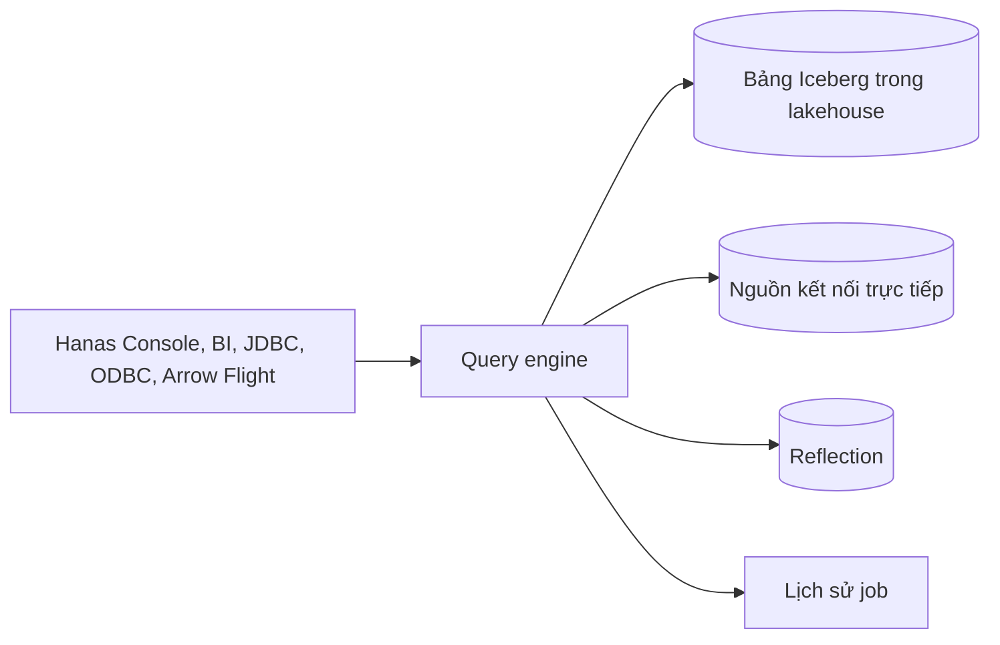

Query engine là thành phần thực thi SQL của Hanas Data Platform. Mọi truy vấn từ Hanas Console, công cụ BI, JDBC, ODBC hay Arrow Flight đều đi qua query engine, trên cả dữ liệu trong lakehouse lẫn các nguồn kết nối trực tiếp.

Mục này dành cho analyst, data engineer và quản trị viên cần viết SQL, tổ chức view, bảo trì bảng Iceberg và theo dõi hiệu năng.

## Vai trò trong nền tảng

Query engine đảm nhận bốn việc chính:

- Cung cấp một lớp SQL thống nhất trên bảng Apache Iceberg và các nguồn dữ liệu đã kết nối.
- Lưu view và cấu trúc workspace, folder làm semantic layer cho người dùng nghiệp vụ.
- Tăng tốc truy vấn lặp lại bằng Reflection.
- Ghi lại từng job để bạn theo dõi trạng thái, thời gian và profile.

## Các trang trong mục

| Trang | Nội dung |
|---|---|
| [SQL Editor](sql-studio.md) | Soạn và chạy SQL từ menu Workspaces, context, nhiều statement, Save as View. |
| [Workspace, folder và view](spaces-and-views.md) | Tổ chức semantic layer theo bronze, silver, gold và phân quyền. |
| [Bảng Iceberg](iceberg-tables.md) | DDL, DML, bảo trì và time travel. |
| [Tăng tốc với Reflection](acceleration.md) | Raw và Aggregation Reflection, refresh, theo dõi. |
| [Lịch sử job](jobs.md) | Lọc job, xem SQL, thời gian và profile. |
| [Engine, queue và điều phối tải](workload-management.md) | Quản lý tài nguyên và định tuyến truy vấn. |
| [Tham chiếu SQL](sql-reference.md) | Nhóm lệnh, hàm và kiểu dữ liệu. |

## Tiếp theo

- [Nguồn dữ liệu truy vấn trực tiếp](../connect/data-sources.md).
- [JDBC, ODBC và Arrow Flight](../develop/sql-clients.md).
- [REST API của query engine](../develop/query-engine-api.md).
