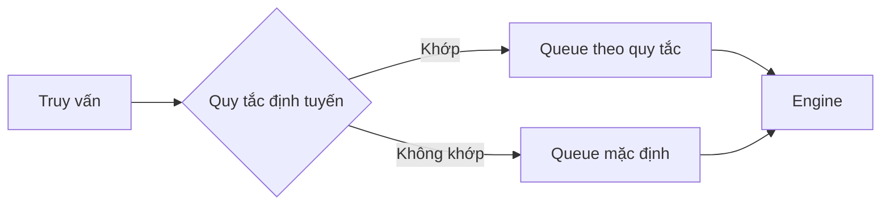

Workload management giúp quản trị viên chia tài nguyên tính toán giữa các nhóm người dùng và loại truy vấn: engine cung cấp tài nguyên, queue giới hạn tải, còn quy tắc định tuyến quyết định truy vấn nào vào queue nào.

:::note Điều kiện

Các màn hình này nằm trong menu **Engine** của Hanas Console và cần quyền quản trị. Menu **Engine** gồm **Monitor**, **Nodes**, **Engines**, **Queues**, **Routing** và **Reflections**. Nếu thao tác báo lỗi, hãy liên hệ nhóm vận hành.

:::

## Khái niệm

| Thành phần | Vai trò |
|---|---|
| Engine | Nhóm tài nguyên thực thi truy vấn, có kích thước và trạng thái. |
| Queue | Hàng đợi với giới hạn: ưu tiên CPU, số truy vấn đồng thời, bộ nhớ của queue và của mỗi job. |
| Quy tắc định tuyến | Điều kiện đánh giá theo thứ tự để chọn queue cho từng truy vấn. |
| Quy tắc mặc định | Áp dụng cho mọi truy vấn không khớp quy tắc nào. |

## Quản lý engine

Trang **Engine** → **Engines** liệt kê engine kèm trạng thái và kích thước; bạn lọc theo hai tiêu chí này. Từ đây bạn tạo engine mới hoặc điều chỉnh số lượng tài nguyên của engine hiện có.

## Quản lý queue

1. Mở **Engine** → **Queues**.
2. Chọn thêm queue và đặt tên.
3. Đặt ưu tiên CPU, giới hạn đồng thời, giới hạn bộ nhớ của queue và của mỗi job.
4. Lưu; queue xuất hiện trong danh sách để dùng trong quy tắc định tuyến.

## Quy tắc định tuyến

1. Mở **Engine** → **Routing**.
2. Thêm quy tắc, đặt tên, nhập điều kiện và chọn queue đích. Bạn cũng chọn từ chối truy vấn khớp quy tắc.
3. Kéo thả để sắp xếp thứ tự; quy tắc ở trên được đánh giá trước.
4. Chỉnh quy tắc mặc định cho các truy vấn còn lại.

Ví dụ ý tưởng: truy vấn của nhóm dashboard vào queue giới hạn đồng thời thấp, truy vấn của nhóm ETL vào queue bộ nhớ lớn.

## Giám sát

Menu **Engine** có hai màn hình giám sát. **Monitor** có ba tab: **Catalog usage**, **Jobs** và **Resources**. **Nodes** cho thấy hoạt động của từng node. Dùng chúng kết hợp với [Lịch sử job](jobs.md) để xác định queue hoặc node quá tải.

## Xử lý sự cố

| Hiện tượng | Cách kiểm tra |
|---|---|
| Không lưu được queue hoặc quy tắc | Kiểm tra quyền quản trị của bạn. |
| Truy vấn không vào queue mong đợi | Kiểm tra thứ tự quy tắc; quy tắc phía trên khớp trước. |
| Job chờ lâu | Tăng giới hạn đồng thời hoặc chuyển tải sang queue khác. |

## Tiếp theo

- [Lịch sử job](jobs.md).
- [Tăng tốc với Reflection](acceleration.md).
- [Kiểm tra sức khỏe và giám sát](../operate/health-checks.md).
