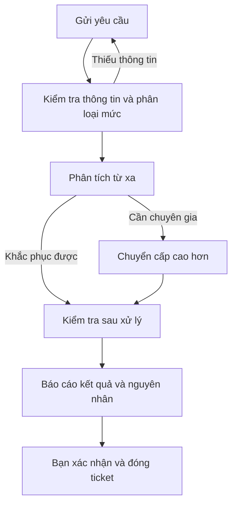

Trang này mô tả cách bạn gửi yêu cầu hỗ trợ cho Hanas Data Platform, cách yêu cầu được phân loại và xử lý, cũng như quy trình bảo trì và vá lỗi. Cam kết về thời gian phản hồi, khôi phục và mức sẵn sàng thực hiện theo hợp đồng dịch vụ.

:::note Phạm vi cam kết

Tài liệu này không nêu con số SLA. Thời gian phản hồi, thời gian khôi phục, giờ hỗ trợ và chỉ tiêu uptime được áp dụng theo hợp đồng dịch vụ và phụ lục kèm theo của đơn vị bạn.

:::

## Kênh hỗ trợ

Thông tin kênh liên hệ cụ thể được chốt khi bàn giao hệ thống. Bạn nên lưu các thông tin sau trong sổ tay vận hành nội bộ.

| Hạng mục | Nội dung |
|---|---|
| Kênh mở yêu cầu (hệ thống ticket, email hoặc điện thoại) | Theo hợp đồng dịch vụ |
| Giờ hỗ trợ và ngày nghỉ | Theo hợp đồng dịch vụ |
| Đầu mối của đơn vị bạn | Do đơn vị bạn chỉ định khi bàn giao |
| Đầu mối hỗ trợ của Hanas | Theo hợp đồng dịch vụ |
| Cửa sổ bảo trì | Thoả thuận giữa hai bên |

Mọi yêu cầu cần có ticket với mức độ ảnh hưởng, người phụ trách và dấu thời gian. Không gửi mật khẩu, token, private key hoặc dữ liệu nhạy cảm qua email hay ticket; hãy dùng tài khoản tạm thời hoặc quy trình cấp quyền đã được phê duyệt.

## Thông tin cần cung cấp

Yêu cầu đầy đủ thông tin giúp rút ngắn thời gian xử lý.

| Thông tin | Nội dung cần có |
|---|---|
| Người liên hệ | Họ tên, đơn vị, email hoặc số điện thoại |
| Môi trường | Dev, test, staging hay production; cụm và namespace |
| Thời điểm | Lúc bắt đầu, tần suất và lần gần nhất xảy ra |
| Ảnh hưởng | Dịch vụ, dataset, pipeline hoặc nhóm người dùng bị ảnh hưởng |
| Triệu chứng | Thông báo lỗi, mã job, mã chạy pipeline hoặc dbt |
| Đã thử | Các thao tác đã làm và kết quả |
| Phiên bản | Tag hoặc digest image, xem [Thành phần và phiên bản](components-and-versions.md) |
| Bằng chứng | Log, ảnh chụp màn hình, đã che secret và dữ liệu nhạy cảm |

Với truy vấn chậm hoặc lỗi, mã job và profile trong [Lịch sử job](../query/jobs.md) là thông tin hữu ích nhất. Bạn cũng nên tự kiểm tra trước với [Xử lý sự cố](../operate/troubleshooting.md).

## Mức độ nghiêm trọng

| Mức | Tiêu chí | Ví dụ |
|---|---|---|
| Mức 1, nghiêm trọng | Hệ thống production ngừng hoàn toàn hoặc một phần lớn; ảnh hưởng diện rộng hoặc có sự cố bảo mật. | Không truy cập được nền tảng; nghi ngờ rò rỉ dữ liệu. |
| Mức 2, cao | Một chức năng production lỗi, workaround hạn chế. | Pipeline chính thất bại liên tục; query không phục vụ được một nhóm người dùng lớn. |
| Mức 3, bình thường | Suy giảm một phần nhưng chưa chặn nghiệp vụ quan trọng. | Một dataset chạy chậm; một connector lỗi, có thể chạy bù. |
| Mức 4, yêu cầu | Câu hỏi, yêu cầu cấu hình hoặc thay đổi không khẩn cấp. | Xin hướng dẫn, đề xuất tối ưu. |

Mục tiêu thời gian của từng mức theo hợp đồng dịch vụ. Sự cố bảo mật được báo ngay cho đầu mối quản lý, và việc ngăn chặn bắt đầu mà không cần chờ đủ log.

## Quy trình xử lý yêu cầu

1. Bên hỗ trợ kiểm tra đủ thông tin, xác định dịch vụ và mức độ nghiêm trọng, rồi xác nhận ticket.
2. Phân tích ban đầu: trạng thái dịch vụ, cảnh báo gần nhất, thay đổi gần đây và phạm vi ảnh hưởng.
3. Chuyển cấp cao hơn khi cần chuyên gia, lỗi lặp lại, nghi ngờ mất dữ liệu hoặc bảo mật, hoặc cần thay đổi hạ tầng.
4. Mọi thay đổi trên production có bản ghi thay đổi, phương án quay lui, người phê duyệt và bước kiểm tra sau thay đổi.
5. Biện pháp tạm thời (workaround) phải nêu rõ rủi ro, thời hạn dùng và hành động khắc phục gốc.
6. Trước khi đóng, bên xử lý ghi lại nguyên nhân, phạm vi ảnh hưởng, thời gian gián đoạn và khuyến nghị phòng ngừa. Bạn xác nhận kết quả trước khi ticket được đóng.

## Quy trình bảo trì

Bảo trì chủ động giữ cho nền tảng sẵn sàng, an toàn và phục hồi được. Mỗi đợt bảo trì có bản ghi thay đổi, người thực hiện, người phê duyệt và bằng chứng kiểm tra.

| Chu kỳ tham chiếu | Nội dung chính |
|---|---|
| Hàng ngày | Trạng thái dịch vụ, job và pipeline lỗi, dung lượng lưu trữ, cảnh báo, bản sao lưu gần nhất. |
| Hàng tuần | Hàng đợi và retry, tình trạng bảng Iceberg (tệp nhỏ, snapshot), log nạp dữ liệu. |
| Hàng tháng | Kiểm tra tổng thể, xu hướng dung lượng và hiệu năng, rà soát quyền, hạn của chứng chỉ và secret, thử khôi phục mẫu. |
| Hàng quý | Diễn tập khôi phục theo phạm vi, rà soát capacity và RBAC. |
| Theo yêu cầu | Tối ưu, nâng cấp phiên bản, mở rộng nguồn, xử lý cảnh báo. |

Chu kỳ này chỉ mang tính tham chiếu. Tần suất chính thức được điều chỉnh theo hợp đồng dịch vụ, tốc độ tăng dữ liệu và lịch vận hành của đơn vị bạn.

Các bước của một đợt bảo trì:

1. Lập kế hoạch: phạm vi, rủi ro, cửa sổ thực hiện, tiêu chí thành công.
2. Chuẩn bị: kiểm tra bản sao lưu và điểm khôi phục, quyền truy cập, cấu hình hiện tại và phương án quay lui.
3. Thông báo lịch và phạm vi ảnh hưởng cho các bên liên quan.
4. Thực hiện theo checklist, ghi dấu thời gian và kết quả; không ghi giá trị secret.
5. Kiểm tra: trạng thái dịch vụ, đăng nhập, truy vấn mẫu, chạy lịch và quyền; xem [Kiểm tra sức khỏe và giám sát](../operate/health-checks.md).
6. Đóng: cập nhật bản ghi thay đổi, báo cáo và các việc tồn đọng.

:::caution Giới hạn hiện tại

Không xoá object, snapshot hoặc bảng production khi chưa có bản sao lưu, phê duyệt và kế hoạch phục hồi. Các tác vụ như expire snapshot, xoá file mồ côi và compaction phải chạy theo chính sách đã chốt.

:::

## Quy trình vá lỗi và cập nhật phiên bản

Cập nhật phiên bản hoặc vá lỗi được thực hiện bằng cách đổi image trong bộ cài rồi áp dụng bằng helmfile.

1. Đọc ghi chú thay đổi và, nếu có, cảnh báo về migration hoặc biến môi trường mới từ đội phát triển.
2. Sao lưu datastore, PVC, object storage và khoá mã hoá liên quan; xem [Sao lưu và khôi phục](../operate/backup-recovery.md).
3. Thử trên môi trường tách biệt với dữ liệu đại diện, kiểm tra cả luồng đăng nhập, truy vấn và chạy lịch.
4. Cập nhật tag hoặc digest image, xem `helmfile diff` và để người phụ trách phê duyệt.
5. Áp dụng trong cửa sổ bảo trì, theo dõi migration và trạng thái release.
6. Kiểm tra sau nâng cấp. Nếu có sự cố, chọn phương án quay lui theo [Nâng cấp và rollback](../operate/upgrade.md).

Một số phiên bản có migration một chiều, nên quay lui image có thể cần kèm khôi phục dữ liệu. Hãy ghi lại danh sách tag hoặc digest trước và sau cập nhật, theo [Thành phần và phiên bản](components-and-versions.md).

## Báo cáo bảo trì

Báo cáo định kỳ nên có: tóm tắt kỳ và phạm vi, chỉ số chính (tỷ lệ chạy thành công, dung lượng, độ trễ truy vấn, kết quả sao lưu), phát hiện và rủi ro, hành động đã làm, khuyến nghị kèm mức ưu tiên, và xác nhận của đại diện hai bên. Lưu báo cáo trong hệ thống ticket hoặc kho tài liệu đã được phê duyệt, không để một bản duy nhất trên máy cá nhân.

## Tiếp theo

- [Xử lý sự cố](../operate/troubleshooting.md).
- [Nâng cấp và rollback](../operate/upgrade.md).
- [Thành phần và phiên bản](components-and-versions.md).
