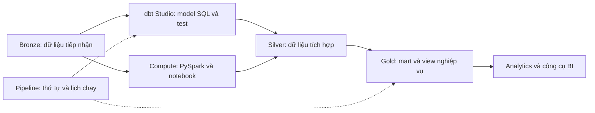

Hanas Data Platform cung cấp dbt Studio, Pipeline và Compute để phát triển, chạy và theo dõi các công việc biến đổi dữ liệu. Mục này dành cho data engineer, analytics engineer và người quản lý mô hình dữ liệu dùng chung.

Bạn có thể bắt đầu bằng model SQL trong dbt Studio, kiểm thử kết quả rồi tổ chức lịch chạy phù hợp. Với tác vụ PySpark hoặc notebook, Compute cung cấp môi trường thực thi trên Kubernetes khi thành phần này được bật.

## Các trang trong mục

| Trang | Nội dung |
|---|---|
| [dbt Studio](dbt-studio.md) | Tạo project, làm việc trong IDE và quản lý mã bằng Git. |
| [Chạy và lập lịch dbt](dbt-runs.md) | Chọn command, target, selector; xem log, artifacts và lịch chạy. |
| [Pipeline](pipelines.md) | Menu **Data Pipeline**. Ghép nhiều bước thành đồ thị phụ thuộc và theo dõi từng lần thực thi. |
| [Compute](compute.md) | Menu **Compute Engine**. Chạy PySpark, notebook và pipeline khai báo trên Spark. |
| [Chuẩn mô hình hóa](modeling-standards.md) | Áp dụng bronze, silver, gold và Data Vault theo nhu cầu dữ liệu. |
| [Quy ước đặt tên](naming-conventions.md) | Thống nhất tên namespace, model, bảng và cột kỹ thuật. |

## Chọn công cụ

| Nhu cầu | Công cụ phù hợp | Kết quả chính |
|---|---|---|
| Biến đổi bằng SQL, quản lý dependency giữa model | dbt Studio | Model, test, tài liệu và artifacts dbt |
| Chạy định kỳ một command cho một project | Lịch dbt | Các run được theo dõi trong dbt Studio → Orchestrate |
| Điều phối nhiều command hoặc nhiều project | Pipeline | Run gồm các Step và trạng thái phụ thuộc |
| Xử lý bằng Python/PySpark, thử nghiệm notebook | Compute | Run Spark, kết quả cell và log driver/executor |
| Thống nhất cấu trúc dữ liệu phục vụ BI | Chuẩn mô hình hóa | Các bảng và view có grain, owner, quy tắc chất lượng |

Pipeline điều phối thứ tự thực thi; model dbt mô tả logic biến đổi và quan hệ dữ liệu giữa các model. Spark có thể đọc, ghi trực tiếp lakehouse theo cấu hình catalog và storage của Compute.

Sơ đồ thể hiện cách tổ chức khuyến nghị. Việc ghép một loại Step vào Pipeline phụ thuộc engine và executor có trên bản triển khai.

## Điều kiện cần

:::note Điều kiện

Quản trị viên cần bật chức năng phát triển và triển khai dbt runner trước khi bạn sử dụng dbt Studio. Compute cần thêm Spark Operator, cấu hình lakehouse và quyền Compute; Pipeline engine mới cần dịch vụ điều phối cùng Temporal.

:::

Các role dbt gồm `dbt-viewer`, `dbt-editor` và `dbt-admin`. Viewer đọc project, xem lịch sử và thực hiện những thao tác đọc được cho phép; editor phát triển và chạy dbt. Admin quản lý thêm connection, target và các thao tác quản trị project.

Quyền chạy công cụ và quyền truy cập dữ liệu được cấu hình riêng. Một người có quyền sửa model vẫn cần quyền đọc nguồn và ghi vùng đích. Các chính sách trên query engine cũng có phạm vi thực thi riêng đối với đường đọc trực tiếp bằng Spark.

## Luồng làm việc khuyến nghị

1. Xác định grain, business key và nguồn dữ liệu của bảng đích trước khi viết model.
2. Chọn lớp bronze, silver hoặc gold theo trách nhiệm của dữ liệu sau biến đổi.
3. Tạo project dbt hoặc Compute và dùng connection do quản trị viên chuẩn bị.
4. Phát triển model trên dữ liệu thử nghiệm, đồng thời bổ sung mô tả và kiểm thử chất lượng.
5. Chạy thử công việc để kiểm tra target, quyền dữ liệu và kết quả trước khi đặt lịch.
6. Chọn lịch dbt hoặc Pipeline theo mức độ phụ thuộc giữa các bước thực thi.
7. Cập nhật metadata trong Hanas Catalog để người dùng tìm được bảng và hiểu lineage đã thu thập.

Với dữ liệu giao dịch, hãy kiểm tra cả bản ghi đến muộn, bản ghi bị xóa và khả năng chạy lại. Một run thành công chỉ xác nhận command đã hoàn tất theo trạng thái ghi nhận; kết quả nghiệp vụ cần các phép đối soát tương ứng.

## Ranh giới cần hiểu

Workspace dbt hiện được chia sẻ giữa những người có role dbt. Compute có thêm quyền theo project, gồm view, run, edit và manage. Bạn cần chọn mô hình chia sẻ phù hợp trước khi đặt dữ liệu mẫu, SQL hoặc thông tin nhạy cảm trong project.

Lineage trong IDE dbt được dựng từ manifest ở cấp model. Lineage cột trong Hanas Catalog phụ thuộc metadata và SQL đã thu thập. Sau khi thay đổi model, hãy chạy lại các bước sinh artifacts và thu thập metadata cần thiết.

## Tiếp theo

- [Tạo và phát triển project dbt](dbt-studio.md).
- [Chọn chuẩn mô hình hóa](modeling-standards.md).
- [Hiểu các miền phân quyền](../govern/access-control.md).
