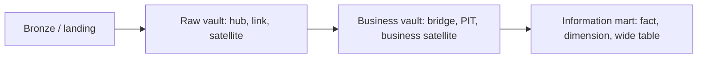

Trang này đưa ra chuẩn khuyến nghị để tổ chức dữ liệu trên lakehouse của Hanas Data Platform. Đây là hướng dẫn thiết kế, không phải ràng buộc do nền tảng cưỡng chế. Bạn có thể áp dụng một phần, miễn là nhất quán trong cùng miền dữ liệu.

## Medallion: bronze, silver, gold

| Lớp | Vai trò | Ví dụ |
|---|---|---|
| Bronze | Dữ liệu tiếp nhận từ nguồn, giữ nguyên cấu trúc gốc, thêm cột audit. | Bảng do [Ingestion](../connect/ingestion.md) ghi. |
| Silver | Dữ liệu đã làm sạch, chuẩn hóa kiểu, khử trùng lặp, tích hợp giữa nguồn. | Model dbt tham chiếu bronze. |
| Gold | Mô hình phục vụ nghiệp vụ và BI: fact, dimension, mart. | View hoặc bảng cho dashboard. |

Mỗi lớp là một namespace trong Iceberg catalog. Model dbt trong [dbt Studio](dbt-studio.md) đọc lớp dưới và ghi lớp trên; luồng chạy theo thứ tự được điều phối bằng [Pipeline](pipelines.md) hoặc [lịch dbt](dbt-runs.md).

Nguyên tắc chung:

- Chỉ ghi vào lớp trên từ lớp ngay dưới; tránh gold đọc thẳng bronze.
- Khai báo grain và business key cho mỗi bảng trước khi viết model.
- Bronze không chứa logic nghiệp vụ; silver không chứa chỉ số dành riêng cho một báo cáo.
- Mỗi model có test tối thiểu cho khóa (`not_null`, `unique`) và quan hệ.

## Data Vault 2.0

Data Vault 2.0 phù hợp khi nhiều nguồn thay đổi thường xuyên và bạn cần truy vết lịch sử đầy đủ. Có thể dùng nó thay cho silver, hoặc bỏ qua nếu số nguồn ít và mô hình dimensional trực tiếp đã đủ. Dữ liệu đi qua ba lớp:



### Raw vault

Raw vault lưu dữ liệu nguồn đã chuẩn hóa, không áp logic nghiệp vụ, chỉ thêm.

| Thành phần | Nội dung |
|---|---|
| Hub | Business key duy nhất của một thực thể, ví dụ khách hàng, tài khoản. |
| Link | Quan hệ giữa các hub, ví dụ khách hàng sở hữu tài khoản. |
| Satellite | Thuộc tính và lịch sử thay đổi của hub. |
| Link satellite | Thuộc tính và lịch sử của link. |

Satellite chỉ thêm dòng mới khi `hash_diff` của bản ghi thay đổi so với bản mới nhất. Có thể tạo view lấy bản ghi hiện hành (hậu tố `_der`) hoặc bảng snapshot (`_snp`) để truy vấn nhanh.

### Business vault

Business vault chứa logic nghiệp vụ dùng chung, tính từ raw vault.

| Thành phần | Mục đích |
|---|---|
| Bridge | Nối sẵn nhiều hub và link để rút ngắn truy vấn. |
| PIT (point-in-time) | Với mỗi thời điểm snapshot, trỏ tới bản ghi satellite hiệu lực. |
| Business satellite | Thuộc tính tính toán, ví dụ phân hạng khách hàng. |

### Information mart

Information mart là lớp phục vụ BI, tương đương gold: star schema gồm fact và dimension, wide table cho khám phá nhanh, và view phân tích. Dữ liệu được nạp từ business vault hoặc trực tiếp từ raw vault.

## Surrogate key và hash key

Dùng khóa thay thế ổn định, không phụ thuộc giá trị hiển thị của nguồn.

- Trong Data Vault, khóa hub là hash của business key (`hkey_hub`). Chuẩn hóa business key trước khi hash: bỏ khoảng trắng, đổi chữ hoa/thường thống nhất, ghép nhiều cột bằng ký tự phân tách cố định.
- Khóa link là hash của các khóa hub tham gia; `hash_diff` là hash của các cột thuộc tính để phát hiện thay đổi.
- Trong dimension, dùng cột `*_key` làm surrogate key; fact tham chiếu qua `dim_*_key`.
- Giữ business key gốc trong bảng để đối soát.

Ví dụ tạo hash key trong model dbt, dùng hàm băm của engine bạn đang chạy:

```sql
select
    lower(to_hex(sha256(cast(upper(trim(customer_id)) as varbinary)))) as hkey_hub,
    customer_id,
    current_timestamp as dv_ldt
from bronze.customer
```

Hàm băm cụ thể có thể khác theo dialect; hãy chạy thử trên target trước khi áp dụng và đồng nhất một thuật toán cho toàn bộ vault.

## Slowly changing dimension (SCD)

| Loại | Hành vi | Khi nào dùng |
|---|---|---|
| Type 1 | Ghi đè giá trị cũ. | Sửa lỗi dữ liệu, thuộc tính không cần lịch sử. |
| Type 2 | Thêm dòng mới, đóng dòng cũ bằng `effective_date`, `expiry_date`, `is_current`. | Thuộc tính cần theo dõi theo thời gian, ví dụ phân hạng khách hàng. |

Với Type 2, mỗi business key chỉ có một dòng `is_current = true`, và các khoảng hiệu lực không chồng lấn. Thêm test dbt kiểm tra hai điều kiện này. Có thể dùng snapshot của dbt hoặc dựng từ satellite trong Data Vault.

## Cột audit

Mọi bảng bronze và vault nên có các cột kỹ thuật sau, đặt tên theo [quy ước đặt tên](naming-conventions.md).

| Cột | Ý nghĩa |
|---|---|
| `dv_ldt` | Thời điểm nạp bản ghi vào lớp hiện tại. |
| `dv_src_ldt` | Thời điểm bản ghi phát sinh tại nguồn. |
| `dv_src_rec` | Tên bảng hoặc hệ thống nguồn. |
| `dv_cdc_ops` | Loại thao tác CDC: `INIT`, `INSERT`, `UPDATE`, `DELETE`. |

Nếu nguồn có sequence nhật ký như SCN hay RBA, giữ thêm để sắp xếp bản ghi cùng thời điểm. Với luồng CDC, xử lý `DELETE` thành bản ghi đánh dấu xóa thay vì xóa vật lý, và thống nhất cách ingestion biểu diễn thao tác xóa trước khi thiết kế model.

## Giới hạn

:::caution Giới hạn hiện tại

Nền tảng không kiểm tra việc tuân thủ medallion hay Data Vault. Việc đó dựa vào review model, test dbt và phép đối soát. Nếu bạn muốn ép quy ước, hãy đưa vào quy trình review và test của project.

:::

## Tiếp theo

- [Quy ước đặt tên](naming-conventions.md).
- [Phát triển model trong dbt Studio](dbt-studio.md).
- [Tăng tốc truy vấn với Reflection](../query/acceleration.md).
