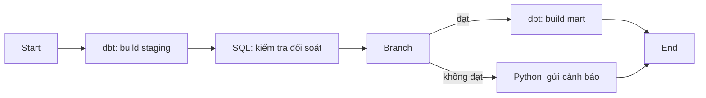

import Diagram from '@site/src/components/Diagram';

Pipeline trong Hanas Data Platform cho phép bạn ghép nhiều bước xử lý thành một đồ thị có thứ tự, chạy theo lịch hoặc chạy tay, rồi theo dõi kết quả từng bước. Trang này dành cho data engineer cần điều phối công việc vượt quá một command dbt.

<Diagram name="04-pipeline-run" alt="Một lần chạy Pipeline" />

## Khái niệm

| Khái niệm | Ý nghĩa |
|---|---|
| Pipeline | Định nghĩa đồ thị có hướng không chu trình (DAG) gồm các Step và quan hệ phụ thuộc. |
| Step | Một đơn vị công việc: dbt, SQL trên query engine, Python, Branch hoặc Pipeline con. |
| Run | Một lần thực thi Pipeline, có trạng thái chung và kết quả từng Step. |
| Step result | Trạng thái, thời gian, log và lỗi của một Step trong một Run. |
| Logical date | Mốc thời gian nghiệp vụ mà Run đại diện, dùng khi backfill. |

Mỗi Step chỉ chạy khi các Step phía trước thỏa quy tắc kích hoạt. Quy tắc gồm `all_success`, `all_done`, `none_failed`, `one_success`, `one_failed`. Nhờ vậy bạn có thể tạo nhánh xử lý lỗi hoặc bước dọn dẹp luôn chạy.

## Điều kiện cần

:::note Điều kiện

Menu **Data Pipeline** chỉ hiển thị khi quản trị viên bật dịch vụ điều phối. Engine mới cần thêm Temporal và cơ sở dữ liệu PostgreSQL của dịch vụ. Quyền theo role viewer, operator, editor và admin; mặc định các role này dùng role dbt tương ứng.

:::

Run được thực thi dưới danh tính chủ Pipeline hoặc một service account (quản lý bằng nút **Service accounts** trên trang Pipelines). Khi Step truy cập query engine hoặc dbt, danh tính này cần có quyền dữ liệu tương ứng.

## Tạo và chạy Pipeline

1. Mở menu **Data Pipeline**. Trang **Pipelines** có hai tab: **Pipelines** và **Runs**.
2. Chọn **Create pipeline** và đặt tên mô tả mục đích.
3. Trên canvas, thêm các Step từ palette và nối chúng theo thứ tự phụ thuộc.
4. Chọn từng Step để nhập cấu hình: project và selector cho dbt, câu lệnh cho SQL, file cho Python.
5. Đặt quy tắc kích hoạt, retry và timeout cho Step khi cần.
6. Lưu Pipeline. Hệ thống kiểm tra đồ thị trước khi chấp nhận.
7. Chọn **Run now**, theo dõi trạng thái trên canvas và mở chi tiết Run để đọc log từng Step.

Canvas có thể chứa các ghi chú trình bày; những phần tử này không thực thi công việc dữ liệu.

## Lịch và backfill

Bạn có thể gắn lịch cron cho Pipeline cùng múi giờ riêng. Mỗi Run theo lịch mang một logical date. Khi cần xử lý lại giai đoạn trước, dùng backfill để xem trước danh sách Run sẽ tạo, rồi xác nhận chạy.

Rerun một Run đã có kết quả cho phép tái sử dụng các Step đã thành công và chỉ chạy lại phần cần thiết. Hãy kiểm tra tính idempotent của từng Step trước khi chạy lại; Pipeline không hoàn nguyên dữ liệu đã ghi.

## Theo dõi Run

Tab **Runs** liệt kê các Run theo Pipeline hoặc toàn workspace. Chi tiết Run hiển thị đồ thị với trạng thái từng Step, thời gian bắt đầu, kết thúc và thông báo lỗi. Bạn có thể hủy Run đang chạy; Step đang thực thi nhận tín hiệu hủy.

Cài đặt thông báo cho phép gửi email hoặc webhook khi Run lỗi, tùy cấu hình bản triển khai. Lịch sử thông báo được lưu để đối chiếu.

## Engine Temporal và legacy

Hai engine có thể cùng tồn tại trên một bản triển khai.

| | Engine mới (Temporal) | Engine legacy |
|---|---|---|
| Phạm vi | Pipeline độc lập; mỗi Step mang project riêng. | Pipeline gắn với một project dbt. |
| Step | dbt, SQL, Python, Branch, Pipeline con. | dbt, SQL, Branch và Step Compute. |
| Lịch, backfill | Có lịch, múi giờ, logical date, backfill. | Theo khả năng của engine legacy. |
| Cập nhật trạng thái | Giao diện hỏi lại định kỳ. | Có log trực tiếp. |

Engine mặc định phụ thuộc cấu hình triển khai; giao diện cho phép chọn engine cho từng Pipeline.

:::caution Giới hạn hiện tại

Với engine mới: chưa có log realtime, giao diện cập nhật bằng cách hỏi lại định kỳ; chưa có thao tác chạy riêng một Step; bộ kiểm tra định nghĩa chưa đầy đủ bằng engine legacy; Step Spark/Compute chưa được hỗ trợ chính thức trên engine này, nên dùng engine legacy nếu cần Step Compute. Loại Step chưa có executor sẽ báo lỗi khi chạy.

:::

## Xử lý sự cố

| Hiện tượng | Cách xử lý |
|---|---|
| Không thấy menu Data Pipeline | Nhờ quản trị viên kiểm tra dịch vụ điều phối đã được bật. |
| Step bị bỏ qua | Kiểm tra quy tắc kích hoạt và trạng thái các Step phía trước. |
| Step SQL hoặc dbt bị từ chối | Kiểm tra quyền dữ liệu của chủ Pipeline hoặc service account. |
| Run theo lịch chạy sai giờ | Kiểm tra múi giờ của lịch; lịch dbt riêng tính theo UTC. |
| Trạng thái chậm cập nhật | Engine mới hỏi lại định kỳ; làm mới trang hoặc chờ chu kỳ kế tiếp. |

## Tiếp theo

- [Chạy và lập lịch dbt](dbt-runs.md).
- [Compute: Spark và notebook](compute.md).
- [Chuẩn mô hình hóa](modeling-standards.md).
