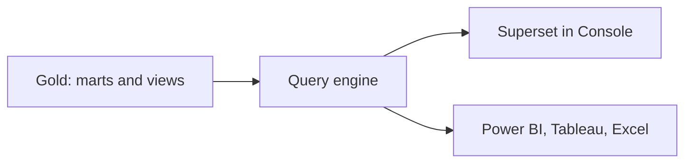

Hanas Data Platform supports analysis in two ways: use Apache Superset embedded in Hanas Console, or connect your existing BI tools to the query engine. This section is for analysts, BI developers, and administrators preparing connections.

## Pages in this section

| Page | Content |
|---|---|
| [Analytics with Superset](superset.md) | Use Superset in Console: datasets, charts, dashboards, and permissions. |
| [External BI tools](external-bi.md) | Connect Power BI, Tableau, and Excel through JDBC, ODBC, or Arrow Flight using a token. |

## Choose an approach

| Need | Suggestion |
|---|---|
| Build dashboards quickly without installing more software | Superset in Console |
| Your organization already has Power BI or Tableau | External BI tools |
| Free-form analysis on tables in a spreadsheet | Excel through ODBC |

Both approaches read through the query engine, so [workspaces and views](../query/spaces-and-views.md) and [Reflections](../query/acceleration.md) apply to both. Have BI read the gold layer or standardized views instead of bronze tables.

:::note Requirements

Superset is an optional component; an administrator must enable it during deployment. External tools need the corresponding driver and a token that you create.

:::

## Next

- [Use Superset](superset.md).
- [Connect external BI tools](external-bi.md).
- [Modeling standards](../transform/modeling-standards.md).
