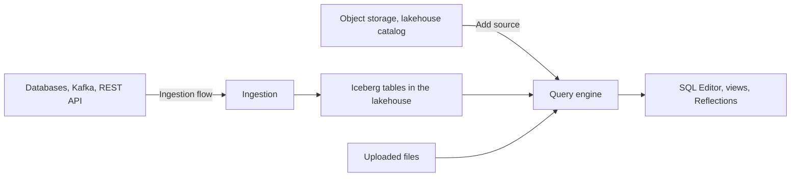

This section shows you how to bring data into **Hanas Data Platform**: connect sources to query in place, upload files, or ingest data from operational systems into the lakehouse. It is intended for data engineers and data administrators.

## Two ways to bring data into the platform

Hanas has two separate paths for two different needs.

| Criterion | Query in place (federation) | Ingest into the lakehouse (Ingestion) |
|---|---|---|
| Where the data lives | Stays in the source system | Copied into Iceberg tables |
| How you do it | Add a source in Connections, query with SQL | Create a connection, a destination, and an ingestion flow |
| Data freshness | Read directly at query time | On a schedule or on change (CDC) |
| Load on the source system | Every query reads from the source | Increases only while an ingestion run executes |
| Best when | Quick exploration, reconciliation, data that rarely changes | Repeated analysis, history retention, offloading operational systems |

The two approaches complement each other: data ingested into the lakehouse is also queried through the query engine like any other source. You typically explore data with federation, then switch to ingestion when you need stable, fast data.

## Pages in this section

| Page | Contents |
|---|---|
| [Query data sources in place](./data-sources.md) | Connector groups, steps to add a source, metadata refresh options, formatting files as datasets. |
| [Upload files](./file-upload.md) | Upload files from the DATA tree in SQL Editor and choose a format. |
| [Ingest data into the lakehouse (Ingestion)](./ingestion.md) | Concepts, ingestion engines, the flow-creation wizard, data type mapping, limitations. |
| [Schedules, checkpoints, and reruns](./ingestion-schedules.md) | Schedules, checkpoints, reruns, run monitoring, and error handling. |

## Next steps

- Query the data you just connected in [SQL Editor](../query/sql-studio.md).
- Speed up queries on external sources with [Reflections](../query/acceleration.md).
- Collect metadata to search data assets: [Metadata ingestion](../govern/metadata-ingestion.md).
