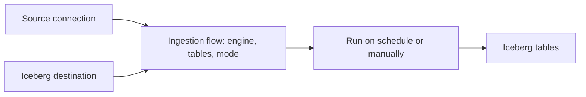

Ingestion loads data from source systems into Apache Iceberg tables in the lakehouse of **Hanas Data Platform**. This page is for data engineers who need to choose the right engine and create ingestion flows in **Hanas Console**. Transforming data after ingestion belongs to [dbt Studio](../transform/dbt-studio.md).

## Concepts

| Concept | Meaning |
|---|---|
| Connection (source) | Connection details for a source system: PostgreSQL, MySQL, SQL Server, Oracle, MongoDB, S3, Kafka, REST API, Kafka T24. Supports connection testing and table discovery. |
| Destination | The Iceberg catalog that receives the data: Iceberg REST or Iceberg Hive. You can import the Lakehouse configuration from the query engine and then add secrets. |
| Ingestion flow | The configuration that links one source to one destination: team, namespace, engine, table list, and the sync mode of each table. |
| Run | One execution of an ingestion flow. States: queued, running, cancelling, succeeded, failed, cancelled. |
| Checkpoint, watermark | Read state saved after each successful run; the next run continues from there. See [Schedules, checkpoints, and reruns](./ingestion-schedules.md). |

## Sync modes

- **Full refresh**: re-reads the entire table on every run.
- **Incremental**: reads only new or changed rows based on a tracking column (cursor). Does not detect rows deleted at the source.
- **CDC**: reads the source's change log and writes both updates and deletes. Requires preparation on the source side (see the table below).

## Ingestion engines

Each flow uses one engine. The wizard suggests only the engines that fit the source type and the goal you choose.

| Source | Engine | Main capabilities |
|---|---|---|
| PostgreSQL, MySQL, SQL Server | OLake | Full refresh, incremental, CDC. Deleted rows are kept with the marker column `_op_type = 'd'`. |
| Oracle | OLake | Full refresh, incremental. No CDC. |
| PostgreSQL, MySQL, SQL Server, Oracle | dlt | Full refresh, incremental. Preserves DECIMAL exactly. No CDC; incremental does not detect deletes. |
| PostgreSQL, MySQL, SQL Server, Oracle | Debezium | CDC with exact data types, hard-deletes rows. |
| MongoDB | OLake | Each collection becomes a table; CDC through change streams. |
| S3 | OLake | CSV, JSON lines or arrays, Parquet; each folder becomes a table; full refresh or incremental by file modification time. |
| Kafka | OLake | JSON or Avro through a schema registry; append or upsert mode. |
| REST API | dlt | Full refresh or incremental, upsert or append. Does not detect rows deleted at the API. |
| Kafka T24 | T24 | Parses XML from Kafka into RAW tables, current-state tables, and child tables for multi-value fields according to the mapping. |

:::note Requirements

- CDC requires preparation on the source side: PostgreSQL needs a publication and a replication slot; MySQL needs binlog in ROW format and replication privileges; SQL Server needs CDC enabled and SQL Server Agent; Oracle (Debezium) needs ARCHIVELOG, supplemental logging, and a user with LogMiner privileges; MongoDB needs a replica set. The preflight step checks these and displays the statements you need to run.
- The Debezium engine is suggested only when the environment has Kafka Connect.
- Ingestion flows require the Ingestion service to be deployed with the platform and an Iceberg catalog as the destination.

:::

Not every source and destination combination is verified. Run a trial of the combination you plan to use before putting it into production.

## Create an ingestion flow

1. Open **Ingestion** in Hanas Console, go to **Sources**, and create a connection. Select **Test** to verify the connection.
2. Go to **Destinations**, create an Iceberg REST or Iceberg Hive connection, or import the Lakehouse configuration and add the secrets.
3. Select **New** in the ingestion flow list.
4. Select the source, destination, team, namespace, and engine.
5. Select the goal (full refresh, incremental, or CDC). The wizard discovers the table list and lets you select only suitable tables.
6. Select the tables to ingest and set the destination table names.
7. Configure each table: the tracking column (cursor) for incremental, the key column when the table has no primary key, partitioning, filters, and column selection (with OLake).
8. Run preflight. Resolve the warnings, especially those about data types and CDC prerequisites.
9. Choose the schedule, then save. See [Schedules, checkpoints, and reruns](./ingestion-schedules.md).

After the flow has run, you can add tables, edit table configuration, or remove tables from the flow, depending on the engine's capabilities. Changing the mode, tracking column, or key of an ingested table deletes the destination table and re-reads it from the beginning; the interface lists the affected tables before you confirm.

## Data type mapping

How decimals are preserved is the most important difference between engines.

| Engine | Handling of decimals and numeric types |
|---|---|
| OLake | DECIMAL and NUMBER may be written as DOUBLE. Preflight rejects some wide types (for example, DECIMAL above 15 digits, SQL Server `money`). For Oracle, some high-precision NUMBER types are rejected and unbounded types produce a warning. |
| dlt | Preserves DECIMAL with the declared precision. A `numeric` type without declared precision becomes DECIMAL(38,9); values with more decimal places make the run fail instead of being rounded. |
| Debezium | Numeric becomes DECIMAL(p,s); unbounded becomes DECIMAL(38,9); wider than 38 digits becomes exact text. Values that do not fit make the run fail. |
| T24 | All columns are text. |

For financial data, choose dlt or Debezium to keep monetary amounts exact. The wizard suggests these engines when preflight detects a type that OLake does not preserve exactly.

Other rules:

- MongoDB: nested documents and arrays become JSON text; Decimal128 becomes exact text.
- Kafka: JSON numbers become DOUBLE; send monetary amounts as strings. Messages deleted by topic retention before a run reads them are lost.
- S3: numbers, including Parquet DECIMAL, become DOUBLE; the schema is inferred from the first file in each folder.

## Permissions and teams

- The service uses the roles `ingest-admin` (full access, including namespace grants and egress rules) and `ingest-viewer` (view only).
- Teams are groups in Keycloak; an ingestion flow belongs to one team. You must enable the `groups` claim for the Console client.
- The guardrail has two modes. In `open` mode (the default), every team can write to every namespace and reach every host, except that loopback addresses, link-local addresses, and cloud metadata endpoints are always blocked. In `enforced` mode, everything is denied until an administrator grants the team namespace permissions and egress rules in the **Admin** tab.

See also [Manage users, groups, and roles](../operate/user-management.md).

## Limitations

:::caution Current limitations

- Each destination table has only one writing flow.
- CDC and Kafka run as many short runs repeated on a schedule, not as a continuous streaming flow. Latency is close to the interval between two runs.
- Destination tables that receive continuous commits from many runs accumulate many delete files; enable automatic compaction in the Iceberg catalog to maintain read speed.
- Debezium and T24 do not support **Reload all**; to rebuild, delete the flow and the destination table.
- There is no automatic lineage path from an ingestion flow to Hanas Catalog. Use [Metadata ingestion](../govern/metadata-ingestion.md) to bring destination tables into the catalog.
- Kafka T24 requires an entity mapping for each stream and is not byte-for-byte compatible with other ingestion systems.

:::

## Troubleshooting

| Symptom | Common cause | Resolution |
|---|---|---|
| Cannot connect to the source | Network, host name, team egress rules | Check the network and the **Admin** tab, then **Test** the connection again. |
| Preflight rejects a column | A numeric type that OLake does not preserve exactly | Choose dlt or Debezium. |
| Errors about a replication slot, publication, or binlog | CDC prerequisites missing at the source | Run the statements that preflight suggests. |
| 401 or 403 error from the catalog | PAT expired or missing permissions on the catalog | Reissue the PAT on the destination, and grant the CREATE and MODIFY permissions. |

See also [Troubleshooting](../operate/troubleshooting.md).

## Next steps

- [Schedules, checkpoints, and reruns](./ingestion-schedules.md)
- [Iceberg tables: DDL, DML, time travel](../query/iceberg-tables.md)
- [dbt Studio](../transform/dbt-studio.md) to transform ingested data
