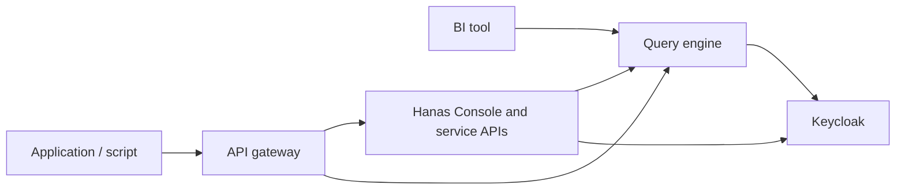

This section is for developers and data engineers who need to access Hanas Data Platform from applications, BI tools, or automation scripts. It explains which interface to use for each need, how to authenticate, and how to read returned errors.

## Integration surfaces

| Surface | Use when | Details |
|---|---|---|
| SQL client (JDBC, ODBC, Arrow Flight) | Run SQL from BI tools, applications, or Python, and get results as tables or Arrow. | [JDBC, ODBC, and Arrow Flight](sql-clients.md) |
| Query engine REST API | Submit SQL asynchronously, and manage catalogs, Reflections, jobs, and users over HTTP. | [Query engine REST API](query-engine-api.md) |
| Ontology API | Read and operate on ontology objects, relationships, and metrics. | [Ontology API](ontology-api.md) |
| Kapas API | Ask questions about data and receive streamed responses. | [Kapas API and SSE](kapas-api.md) |
| Hanas Catalog API | Search data assets, read lineage, manage glossary and tags, and ingest metadata. | [Hanas Catalog API](catalog-api.md) |

Your organization's gateway determines the public domain names and paths. See [API gateway and domain names](../operate/gateway.md) and [Ports and endpoints](../reference/ports-and-endpoints.md).

## Authentication methods

Hanas supports two types of credentials. They differ in where they are issued and where you can use them, and they are not interchangeable.

| Method | Issued by | Used for | How to send |
|---|---|---|---|
| Keycloak OIDC token | Keycloak, after sign-in or through client credentials | Hanas service APIs (Hanas Catalog, Ontology, Kapas, dbt, Ingestion) | Header `Authorization: Bearer <access_token>` |
| Personal Access Token (PAT) | Hanas Console, account menu **Access Tokens** | Query engine: REST, JDBC, ODBC, Arrow Flight; scripts and tools that cannot sign in interactively | Header `Authorization: Bearer <PAT>` or as the SQL client password |

Keycloak tokens are short-lived and are reissued when you sign in or refresh. For a service account, use the client credentials flow of the Hanas realm; see [Authentication and SSO with Keycloak](../operate/identity.md) for the realm, client, and audience.

:::note Requirements

Whether the query engine accepts Keycloak tokens directly depends on the environment's SSO configuration. If it is not enabled, use a PAT for all access to the query engine.

:::

### Create a Personal Access Token

A PAT is tied to your account and inherits exactly that account's data permissions.

1. Sign in to Hanas Console.
2. Open the account menu (the avatar at the bottom left) and select **Access Tokens**. The **Personal Access Tokens** dialog opens and lists tokens with the columns Token ID, Label, Creation, and Expiration.
3. Click **Generate Token**.
4. Enter a **Label** that describes the purpose, for example `bi-reporting`.
5. Enter a **Lifetime** in days. The default value in the form is 30 days.
6. Click **Generate**, then copy the displayed token.

:::caution Current limitations

The token is displayed only once, at the last step. After you close the window, you cannot view it again; create a new token if you lose it. Button names may appear in Vietnamese, depending on the interface language.

:::

On the same screen, you can see the creation and expiration dates of each token, and delete one token or all tokens. Use a separate token for each application so you can revoke them independently, and set the shortest lifetime that fits.

Store the PAT in a secret manager or an environment variable. Do not put it in source code or support tickets. Examples in this documentation use the placeholder `<PAT>`.

## Common error conventions

| HTTP code | Common meaning | How to handle |
|---|---|---|
| 400 | Malformed request or invalid parameter (for example, `limit` exceeds the maximum). | Check the body and query string. |
| 401 | Missing, invalid, or expired token. | Reissue the token or create a new PAT. |
| 403 | Valid token, but the account lacks permission (application role or data permission). | Ask an administrator to grant access; see [Manage users, groups, and roles](../operate/user-management.md). |
| 404 | The object does not exist, or it exists but you cannot view it. | Check the identifier and your permissions. |
| 409 | Conflict, such as a duplicate name or an object being processed by another operation. | Change the name or retry later. |
| 5xx | Service-side error. | Retry with backoff; include the job ID or the time of the error when you contact [support](../reference/support.md). |

Hanas Catalog returns errors as JSON `{ "status": 400, "message": "...", "detail": "..." }`. The query engine returns JSON that describes the error along with the HTTP code; for SQL jobs, the error state is in the job record, not in the response to the submit request.

When you call an API, record the job ID or the call time so you can match it against the [job history](../query/jobs.md) and service logs.

## Next steps

- [Connect with JDBC, ODBC, or Arrow Flight](sql-clients.md).
- [Submit SQL through the REST API](query-engine-api.md).
- [Look up metadata through the Hanas Catalog API](catalog-api.md).
