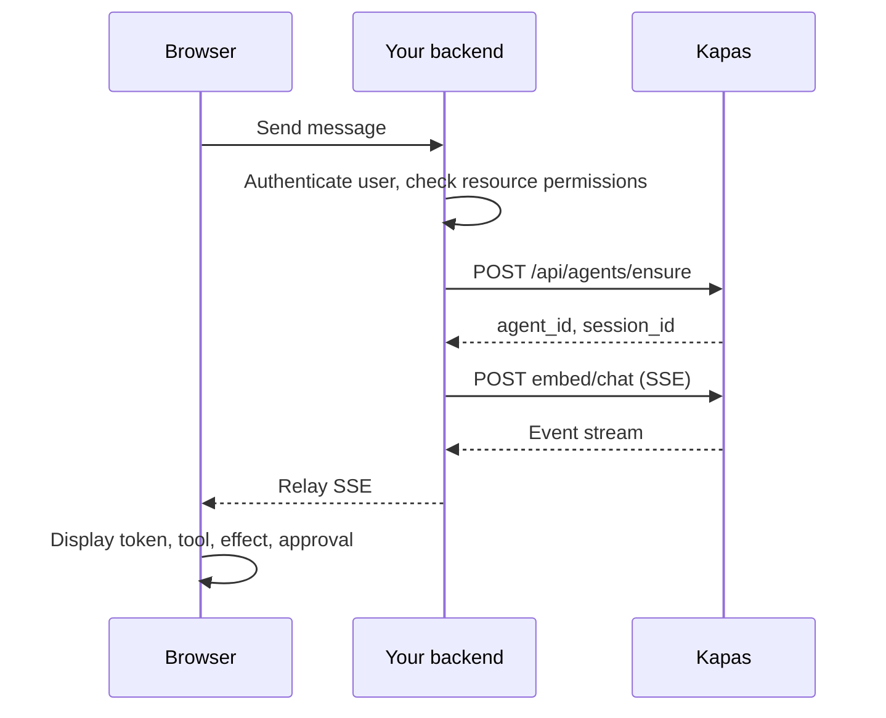

You have two ways to bring Kapas into your application. Choose based on how much interface customization you need.

| | Kapas Console iframe | Custom interface (Embed API) |
|---|---|---|
| Effort | Low: embed one URL | Higher: build the UI and a backend proxy yourself |
| Interface | Original Kapas Console | You decide |
| Application context (current project, object) | Cannot be passed | Yes, through `meta.app` |
| Suitable agents | All agents | Agents with the `embed` channel |

## Option 1: Kapas Console iframe

Embed Kapas Console with an iframe tag in your page.

1. Register your application's domain in the Kapas list of origins allowed to embed. The Kapas gateway allows embedding only from itself and from Hanas origins that are explicitly declared.
2. Embed the Kapas URL.
3. Users sign in through Keycloak SSO as usual.

```html
<iframe
  src="https://<kapas-host>/"
  title="Kapas"
  style="width:100%;height:640px;border:0"
  allow="clipboard-write">
</iframe>
```

:::caution Current limitations

The browser blocks origins that are not declared. SSO sign-in and cookies in cross-origin embedding depend on the browser and domain configuration; test in practice before wide deployment. If you need cookie-based SSO, put the application and Kapas under the same parent domain. See [Authentication and SSO with Keycloak](../operate/identity.md).

:::

## Option 2: custom interface on the Embed API

Kapas provides an HTTP and SSE contract, not a one-line JavaScript widget. You build the interface, and your backend sits between the browser and Kapas.



Standard flow:

1. The backend authenticates the user and checks permissions on the resource (project, workspace).
2. Call `POST /api/agents/ensure` with the user's token, including `template_id` and `meta.app`.
3. Receive `agent_id` and `session_id`, then call chat with `stream: true`.
4. Relay the SSE to the browser; display text, tools, effects, and approval requests.
5. Read the history when a session is reopened; use the stop API when the user clicks Stop.

For endpoint details and the event envelope, see [Kapas API and SSE](kapas-api.md).

### Templates and binding

Each template declares how to assemble a session from the application context:

| Agent | Session | `meta.app` context |
|---|---|---|
| Ontology Assistant | one main session | can include `current_type`, `current_pk` |
| Project Copilot | one session per project | `project_id` is required |
| SQL Copilot | one main session | editor content sent by the host |
| Analytics Studio, Catalog Steward | one main session per agent | optional |
| Concept, Mapping Copilot | one main session | also needs workspace, run, draft |

Binding only partitions sessions within the same user; it does not create a shared chat among multiple people.

### Backend proxy (Python, FastAPI)

The example below uses the `httpx` library; install it yourself and set `KAPAS_URL` in the environment.

```python
import os
import httpx
from fastapi import FastAPI, Request, HTTPException
from fastapi.responses import StreamingResponse

KAPAS_URL = os.environ["KAPAS_URL"]  # for example https://kapas.example.com
app = FastAPI()


def bearer(request: Request) -> str:
    auth = request.headers.get("authorization", "")
    if not auth.lower().startswith("bearer "):
        raise HTTPException(401, "Missing token")
    return auth.split(" ", 1)[1]


@app.post("/ai/project/{project_id}/chat")
async def chat(project_id: str, request: Request):
    token = bearer(request)
    # TODO: check that the user has permission on project_id before calling Kapas
    payload = await request.json()
    headers = {"Authorization": f"Bearer {token}"}
    app_ctx = {"project_id": project_id}

    async with httpx.AsyncClient(timeout=30) as client:
        r = await client.post(
            f"{KAPAS_URL}/api/agents/ensure",
            headers=headers,
            json={"template_id": "project-copilot", "meta": {"app": app_ctx}},
        )
        r.raise_for_status()
        ids = r.json()

    body = {
        "message": payload["message"],
        "session_id": ids["session_id"],
        "stream": True,
        # end-user token for downstream tools
        "meta": {"user_token": token, "app": app_ctx},
    }

    async def relay():
        async with httpx.AsyncClient(timeout=None) as client:
            async with client.stream(
                "POST",
                f"{KAPAS_URL}/api/agents/{ids['agent_id']}/embed/chat",
                headers=headers,
                json=body,
            ) as resp:
                if resp.status_code != 200:
                    raise HTTPException(502, "Kapas rejected the request")
                async for chunk in resp.aiter_raw():
                    yield chunk  # relay the raw SSE bytes unchanged

    return StreamingResponse(relay(), media_type="text/event-stream")
```

Kapas also provides Python and TypeScript SDKs that ship with the release and handle the tasks above (create the agent, relay the stream, read history, read SSE, approve and deny). Contact the support team to get the SDK that matches the version you are running.

### Frontend (TypeScript)

Read SSE from your proxy endpoint with `fetch`. A minimal example that handles the envelope itself:

```ts
type Envelope = {
  contract_version: number;
  type: string;
  seq: number;
  data: Record<string, unknown>;
};

export async function chat(
  message: string,
  onToken: (text: string) => void,
  signal?: AbortSignal,
) {
  const resp = await fetch("/ai/project/project-123/chat", {
    method: "POST",
    headers: { "Content-Type": "application/json" },
    body: JSON.stringify({ message }),
    signal,
  });
  if (!resp.ok || !resp.body) throw new Error(`Error ${resp.status}`);

  const reader = resp.body.getReader();
  const decoder = new TextDecoder();
  let buffer = "";
  let lastSeq = -1;

  for (;;) {
    const { done, value } = await reader.read();
    if (done) break;
    buffer += decoder.decode(value, { stream: true });
    const parts = buffer.split("\n\n");
    buffer = parts.pop() ?? "";
    for (const part of parts) {
      const line = part.split("\n").find((l) => l.startsWith("data:"));
      if (!line) continue;
      const ev: Envelope = JSON.parse(line.slice(5).trim());
      if (ev.seq <= lastSeq) continue; // drop duplicates
      lastSeq = ev.seq;
      switch (ev.type) {
        case "token":
          onToken(String(ev.data.text ?? ""));
          break;
        case "approval_request":
          // show a dialog, then call the approve or deny API
          break;
        case "error":
        case "done":
          return ev;
        default:
          break; // ignore unknown types (ping, effect...)
      }
    }
  }
}
```

In a real environment you need two more things: a Stop button (call the stop API and abort the `AbortController`) and handling of `effect` to refresh the interface, for example refreshing the file tree when the agent edits a file.

## Limits

:::caution Current limitations

- With the Embed API, your backend is responsible for sending the correct end-user token. Kapas does not exchange query engine tokens by itself as it does in Console. See [Safety](../kapas/safety.md).
- Embedded integration has no automatic reconnection; the backend and frontend must handle it themselves as described in [Kapas API](kapas-api.md).
- `meta.app` is context, not permission. Always check the user's permissions on the resource in your backend.
- Hanas Analyst has no `embed` channel; use another agent or Kapas Console.

:::

## Next steps

- [Kapas API and SSE](kapas-api.md)
- [Agents, skills, and tools](../kapas/agents.md)
- [API gateway and domain names](../operate/gateway.md)
