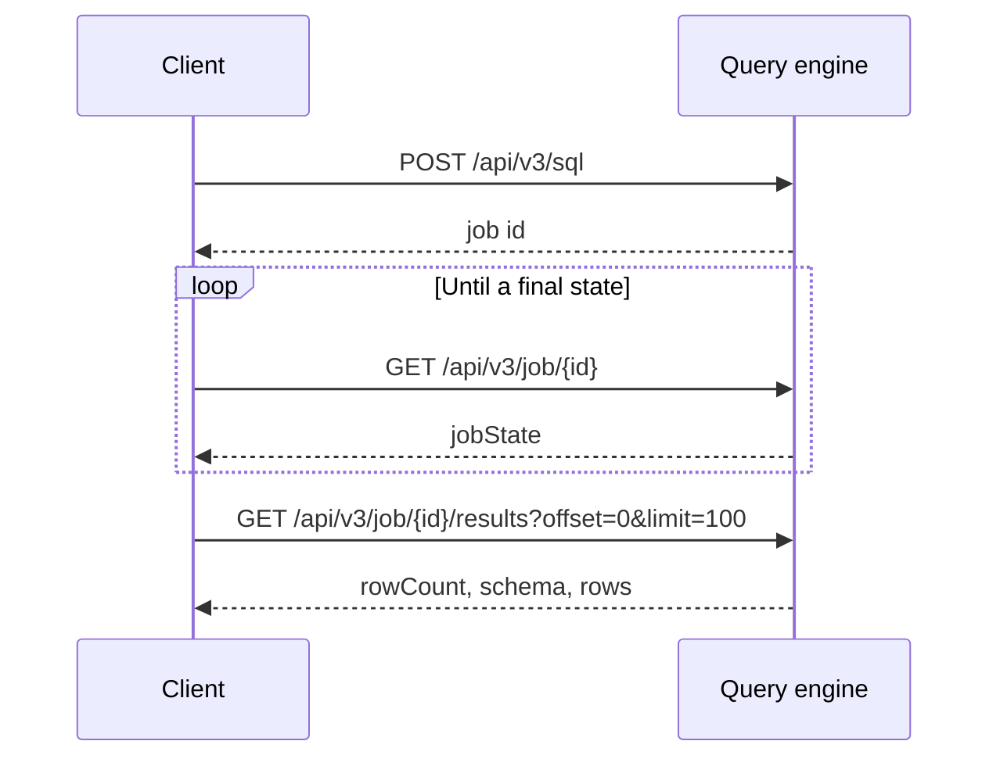

The query engine REST API lets you submit SQL, track jobs, and manage catalogs and Reflections over HTTP. This page is for developers who need to automate operations that you normally perform in Hanas Console.

## Concepts

The API is under the base path `/api/v3`, on the query engine web port (default 9047) or through your organization's gateway domain. Every request sends JSON and needs the header `Authorization: Bearer <PAT>`; see [Create a Personal Access Token](index.md).

Hanas Console also uses some internal non-v3 APIs for sign-in and system settings. Those APIs are not part of the integration contract; rely only on the v3 endpoint groups below.

## Endpoint groups

| Group | Main endpoints | Function |
|---|---|---|
| SQL | `POST /sql` | Submit SQL asynchronously and return a job ID. |
| Job | `GET /job/{id}`, `GET /job/{id}/results`, `POST /job/{id}/cancel` | View status, fetch results by page, cancel a job. |
| Catalog | `GET /catalog`, `GET /catalog/{id}`, `GET /catalog/by-path/{path}`, `POST /catalog`, `PUT /catalog/{id}`, `DELETE /catalog/{id}` | List, read, create, update, and delete sources, spaces, folders, and views. |
| Catalog (extended) | `POST /catalog/{id}` (promote dataset), `POST /catalog/{id}/refresh`, `GET /catalog/search`, `POST /catalog/by-ids`, `POST /catalog/by-paths` | Promote a file or folder to a dataset, refresh metadata, search, and look up in bulk. |
| Reflection | `GET /reflection/{id}`, `POST /reflection`, `PUT /reflection/{id}`, `DELETE /reflection/{id}` | Manage [Reflections](../query/acceleration.md). |
| User | `POST /user`, `GET /user/{id}`, `PUT /user/{id}`, `GET /user/by-name/{name}` | Manage users in the query engine. |
| Source | `/source`, `/source/type` | List of source types and the source configuration that Console uses. |
| Role | `/role` and member operations | Manage roles. |
| Object ACL | `GET/PUT /catalog/{id}/grants` | Read and write permissions on objects. |
| Workload | `/wlm/queue`, `/wlm/rule` | Workload management queues and rules. |
| PAT | `/user/{uid}/token` | Manage a user's Personal Access Tokens. |

:::note Requirements

Hanas Console calls the Source, Role, Object ACL, Workload, and PAT groups, but the level of support depends on the query engine version that is running. Test them in your environment before relying on them in production automation. The SQL, Job, Catalog, Reflection, and User groups are the core groups.

:::

## SQL submission flow

`POST /sql` does not return results directly. You take three steps: submit SQL to get a job ID, check the status until the job finishes, then fetch the results by page.



### Step 1: submit SQL

```bash
export HANAS_URL="https://<host>"
export HANAS_PAT="<PAT>"

JOB_ID=$(curl -s -X POST "$HANAS_URL/api/v3/sql" \
  -H "Authorization: Bearer $HANAS_PAT" \
  -H "Content-Type: application/json" \
  -d '{"sql": "SELECT customer_id, COUNT(*) AS txn_count FROM lakehouse.retail.transactions GROUP BY customer_id LIMIT 10"}' \
  | jq -r '.id')
echo "$JOB_ID"
```

The response has the form `{ "id": "<job-id>" }`. You can add the `context` key to set the default path for unqualified table names.

### Step 2: track the job

```bash
until [ "$STATE" = "COMPLETED" ] || [ "$STATE" = "FAILED" ] || [ "$STATE" = "CANCELED" ]; do
  STATE=$(curl -s "$HANAS_URL/api/v3/job/$JOB_ID" \
    -H "Authorization: Bearer $HANAS_PAT" | jq -r '.jobState')
  echo "jobState=$STATE"
  sleep 2
done
```

The final states are `COMPLETED`, `FAILED`, and `CANCELED`. When a job fails, the job record contains the error message; you can also view the profile in [Job history](../query/jobs.md).

### Step 3: fetch results

```bash
curl -s "$HANAS_URL/api/v3/job/$JOB_ID/results?offset=0&limit=100" \
  -H "Authorization: Bearer $HANAS_PAT" | jq '.rowCount, .rows[:3]'
```

| Parameter | Default | Notes |
|---|---:|---|
| `offset` | 0 | Starting row position. |
| `limit` | 100 | Maximum 500 rows per call; larger values are rejected. |

To read more than 500 rows, increase `offset` page by page. You can fetch results only when the job has completed.

### Cancel a job

```bash
curl -s -X POST "$HANAS_URL/api/v3/job/$JOB_ID/cancel" \
  -H "Authorization: Bearer $HANAS_PAT"
```

## Limits

- Each result fetch returns at most 500 rows. For large result sets, use [Arrow Flight](sql-clients.md) or write the results to a table with SQL.
- `POST /sql` is always asynchronous; do not assume results are available right after the submit call.
- Limit the polling frequency (once every few seconds) to avoid unnecessary load.

## Troubleshooting

| Symptom | Common cause | Resolution |
|---|---|---|
| 401 on call | The PAT is invalid or expired. | Create a new PAT. |
| 403 when submitting SQL | The account lacks permission to query the object. | Grant access; see [Data access control](../govern/access-control.md). |
| 400 when fetching results | `limit` exceeds 500 or the job has not completed. | Reduce `limit` and wait for the job to be `COMPLETED`. |
| Job `FAILED` | Syntax error, missing table, or missing permission. | Read the error message in the job record. |

## Next steps

- [SQL reference](../query/sql-reference.md).
- [Connect with JDBC, ODBC, or Arrow Flight](sql-clients.md).
- [Hanas Catalog API](catalog-api.md).
