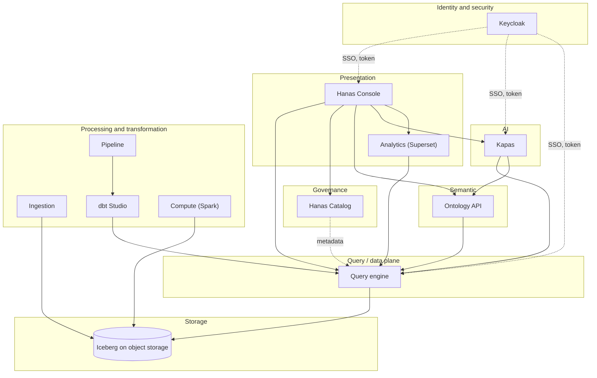
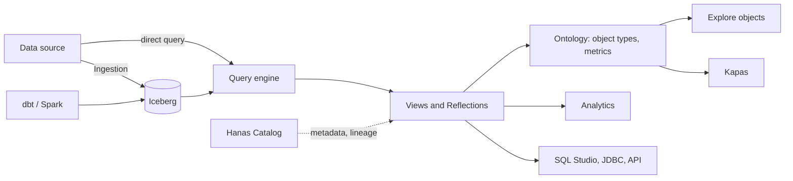
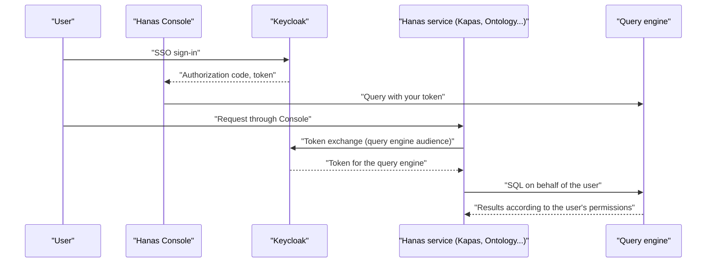

This page describes the layers of Hanas Data Platform, how data moves from sources to end users, and how your identity is passed through the services. It is intended for architects, data engineers, and administrators who need to understand the boundaries between components before configuring or integrating them.

## Platform layers

Hanas Data Platform has eight layers. Each layer has its own responsibility and can be enabled or disabled independently according to the deployment configuration.

| Layer | Components | Responsibility |
|---|---|---|
| Storage | Apache Iceberg on object storage (MinIO or a compatible service) | Stores data files, table metadata, and snapshots; the Iceberg catalog looks up tables |
| Query / data plane | Query engine | Runs SQL, manages datasets, views, jobs, and Reflections; provides REST API, JDBC, ODBC, and Arrow Flight |
| Processing and transformation | Ingestion, dbt Studio, Pipeline, Compute (Spark) | Loads data into Iceberg, develops models, orchestrates processing steps, runs Spark |
| Governance | Hanas Catalog | Metadata search, ownership, glossary, tags, lineage |
| Semantic / Ontology | Ontology Workspace and Ontology API | Models object types, link types, and metrics bound to datasets |
| AI | Kapas | Conversations, agents, tools; calls the query engine, Ontology, and other services |
| Presentation | Hanas Console, Analytics (Apache Superset) | Shared interface, BI datasets, charts, dashboards |
| Identity and security | Keycloak, User API | SSO, groups, roles; passes identity between applications |

### Storage: Iceberg on object storage

Lakehouse tables are stored in Apache Iceberg format on object storage. Each table consists of data files, metadata, and snapshots, so it supports time travel and controlled schema changes. The Iceberg catalog manages table lookup; it is a different component from Hanas Catalog.

### Query / data plane

The query engine is the single SQL execution point for interactive queries. It reads both connected sources (direct query) and Iceberg tables, stores views, records job history, and manages Reflections. Ontology, Kapas, Analytics, and SQL clients all go through the query engine when they need to read data.

### Processing and transformation

- **Ingestion** loads data from sources into Iceberg tables on a schedule, with logs and checkpoints.
- **dbt Studio** develops and runs dbt projects; the SQL statements of a model run on the query engine.
- **Pipeline** orchestrates multiple steps by dependency and schedule.
- **Compute** runs PySpark and notebooks on Kubernetes, reading and writing Iceberg with the platform identity.

### Governance

Hanas Catalog stores metadata collected from sources and serves search, glossary, tags, ownership, and lineage. Catalog describes data assets but does not run queries.

### Semantic / Ontology

Ontology defines object types, properties, link types, and metrics, then maps them to datasets. PostgreSQL stores Ontology definitions and state; business records remain in the data and are read through the query engine.

### AI

Kapas runs agents per user. Agents call the query engine to run SQL, call Ontology to browse objects and compute metrics, and can call dbt Studio or Analytics depending on the agent's grants.

### Presentation

Hanas Console is the common entry point. Analytics embeds Apache Superset to create BI datasets, charts, and dashboards on connected data.

### Identity and security

Keycloak provides SSO, groups, and roles. User API forwards user, role, and group administration operations to Keycloak and synchronizes them with the query engine. Each service still checks permissions itself when it receives a request.

## End-to-end data flow

1. **Connect**: you add a source for direct query, or configure Ingestion to load data into Iceberg tables.
2. **Process**: dbt models, Pipelines, or Spark transform raw data into standardized layers.
3. **Semantics**: you save SQL as a view, create a Reflection when you need acceleration, and can map datasets to object types and metrics in Ontology.
4. **Use**: analysts query in SQL Studio, business users explore objects, the BI team builds dashboards, and Kapas answers questions in natural language.
5. **Govern**: Hanas Catalog collects metadata for search, glossary tagging, and lineage across the steps above.

## Identity flow

Queries run on behalf of the user, so permissions on sources, tables, and views are checked against your account instead of a shared account.

1. You sign in through Keycloak. Console receives a session and token to call the query engine and other Hanas services.
2. When a service such as Kapas needs to run SQL on your behalf, it uses your token. If no query engine token is available, the service exchanges your Keycloak token for the query engine audience using **token exchange** (RFC 8693).
3. The query engine receives the exchanged token and applies that user's own permissions. The service does not use a shared account for Kapas SQL queries.

:::note Requirements

Token exchange requires client configuration and exchange permissions in Keycloak, plus an External Token Provider in the query engine. See [Authentication and SSO with Keycloak](../operate/identity.md).

:::

:::caution Current limitations

Not every integration uses the user's own identity. Ingestion and Spark access storage with their own credentials, so query engine policies do not automatically apply to these read paths. Some metadata and dbt integrations may use service credentials depending on the configuration. When you embed Kapas in an application, the host application must provide credentials that meet the contract; see [Embed Kapas in an application](../develop/kapas-embed.md).

:::

## Next

- [Key concepts](concepts.md).
- [Deployment architecture](../operate/deployment-architecture.md).
- [Authentication and SSO with Keycloak](../operate/identity.md).
- [Get to know Hanas Console](console-tour.md).
