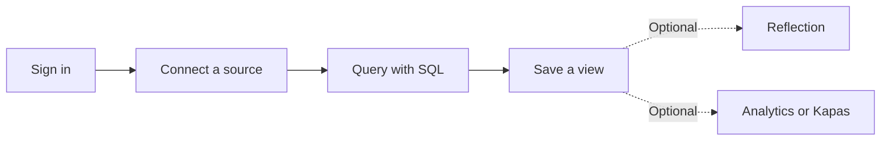

Hanas Data Platform supports multiple roles working together on enterprise data. This section helps you understand the platform structure, choose tools, and complete your first workflow.

If you already have an account and a sample data source, you can go straight to the quickstart. If you are preparing to deploy or integrate the platform, read the architecture and concepts first.

## Pages in this section

| Page | Content | Suited for |
|---|---|---|
| [What is Hanas Data Platform](introduction.md) | Role, components, and deployment model of the platform | Everyone |
| [Platform architecture](architecture.md) | Layers, data flows, and the identity used to run queries | Architects, engineers, administrators |
| [Key concepts](concepts.md) | Distinguishes common concepts across products | Everyone |
| [Get to know Hanas Console](console-tour.md) | Menus, work areas, and display conditions | Console users |
| [Quickstart](quickstart.md) | Sign in, add a source, run SQL, and save a view | Analysts, data engineers |

## Hands-on path

The quickstart uses sample data prepared by the deployment team and does not require every component to be set up. Perform the Analytics, Kapas, and Reflection steps only when you have the corresponding services and permissions.

## Before you begin

You need the Hanas Console address, an account, and the data scope you are authorized to use. To add a source or save a view, you also need permissions in the query engine and on the destination location.

:::tip

If you only need to analyze data that is already prepared, you can use existing sources and views. Confirm the dataset path, column descriptions, and the data owner before you use it.

:::

## Next

- [Learn about the platform](introduction.md).
- [Complete the quickstart](quickstart.md).
- [Look up terms](../reference/glossary.md).
