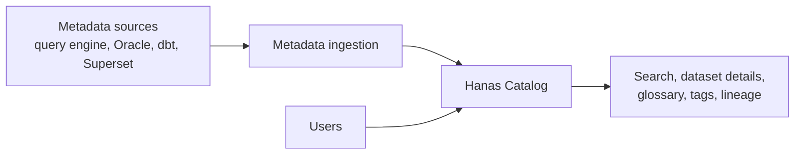

Hanas Catalog is where you search for, describe, and track the data assets of Hanas Data Platform. This section is for data stewards, analytics engineers, and administrators who need to know where data is, who owns it, where it comes from, and who can access it.

## Two kinds of catalog in the platform

Hanas Console has two concepts called "catalog" that serve different purposes. Keep them distinct so you know where to work.

| | Query engine execution catalog | Hanas Catalog (metadata and governance) |
|---|---|---|
| Purpose | Browse sources, workspaces, folders, tables, and views to query | Discover, describe, tag, and track the lineage of data assets |
| Data it manages | Objects the query engine reads and writes directly | Metadata collected by metadata ingestion or declared by users |
| Typical actions | Run SQL, create views, set Reflections, grant object permissions | Search, edit descriptions, apply tags and terms, view lineage |
| Scope | Only data the query engine manages | Can also include dbt, Superset, and other metadata collection sources |

Hanas Catalog does not replace the query engine. It reads metadata, while whether you can view a dataset is still decided by the query engine based on the viewer's own session.

## Pages in this section

| Page | Content |
|---|---|
| [Search and discover data assets](catalog.md) | Search, filter, and read the dataset details page. |
| [Metadata ingestion](metadata-ingestion.md) | Create sources and recipes, run on a schedule, Run History, and Secrets. |
| [Glossary, tags, and ownership](glossary-and-tags.md) | Standardize terminology, apply labels, and assign owners. |
| [Lineage](lineage.md) | View upstream and downstream relationships and the limits on lineage sources. |
| [Data access control](access-control.md) | Permission domains, grants, row access policies, and column masking. |

## Permissions in Hanas Catalog

Hanas Catalog has three levels: viewer, editor, and admin; a higher level includes the lower ones. A user with no role is treated as a viewer. See [Data access control](access-control.md) for details.

## Next steps

- [Search and discover data assets](catalog.md)
- [Metadata ingestion](metadata-ingestion.md)
- [Naming conventions](../transform/naming-conventions.md)
