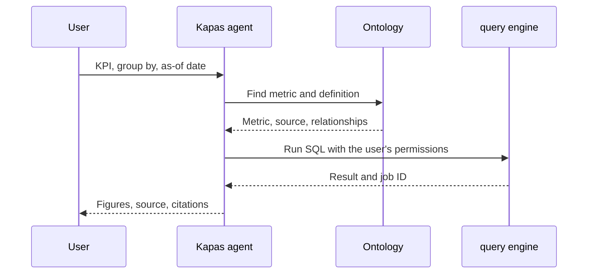

This page shows you how to ask questions about data with Hanas Analyst and SQL Copilot, how Kapas processes a question, and how to verify the results you get.

## Concepts

- **Hanas Analyst**: the agent that answers data questions. It finds suitable tables and columns, calls a query or metric, and answers in Vietnamese.
- **Metric**: an indicator declared and published in the Ontology. When a suitable metric exists, Kapas builds SQL from the metric definition instead of letting the model write the formula itself.
- **SQL Copilot**: the agent that helps write, fix, explain, and check SQL in the **SQL Editor**.

## Requirements

- A Hanas account that signs in through Keycloak (SSO).
- Data read permission in the query engine. Kapas queries with your permissions; see [Safety](safety.md).
- For metric-based questions: a published Ontology workspace with relevant metrics.

## Steps

1. Sign in to Hanas Console with SSO, then open the **AI Agent** menu in the left sidebar.
2. Choose **New chat** to start a new conversation, or pick an earlier one from the chat history. Select the **Hanas Analyst** agent in the agent list.
3. Enter your question. State the indicator, what to group by (grain), and the **as-of date** if you want a balance at a point in time.
4. Follow the streaming response. Tool call steps appear directly in the chat panel.
5. Read the answer, which includes source tables, filters, units, and notes. Open the citation to check the original query.

## Processing flow

For a question such as "Total outstanding loans by region as of date X", the agent follows this sequence. This illustrates the flow and is not a real result.

1. Clarify the indicator, grain, and as-of date if you did not state them.
2. Look for a metric in the Ontology.
3. If a suitable metric exists, run it with the as-of date, grouping, and filters; the SQL is built from the metric definition.
4. If there is no metric, find the real table path, read the schema, write SQL, and run a read-only query.
5. Return the figures with the source table, snapshot, filters, and data notes.

The metric compiler rejects or warns when the as-of date is missing, a metric name is duplicated, or there are multiple join paths. When the latest snapshot is older than the date you requested, the result includes a warning.

## Tips for asking questions

| Do | Avoid |
|---|---|
| "Total outstanding loans by branch as of 30/06" | "How much is outstanding?" |
| State the unit, filters, and period to view | Letting the agent guess code values (for example, status codes) |
| Ask follow-ups in the same session to narrow down | Pasting several unrelated questions into one message |

Hanas Analyst is instructed to distinguish period figures from balances at a point in time, and not to translate code values on its own. This is guidance for the model, not a hard constraint; verify sensitive business indicators.

## Q&A in the SQL Editor

Kapas is also embedded as an **AI Agent** side panel next to the editor in the **SQL Editor** (menu **Workspaces**). SQL Copilot receives the editor content, the selection, and job errors sent by the application. The agent validates SQL with `EXPLAIN` and offers to insert or open SQL; the editor operation is performed by the UI after you confirm. A standalone Kapas Console does not know what the editor contains.

## Charts in conversation

The agent can return a table or chart directly in the chat. This is a temporary display, different from a dashboard saved in Superset. To save it, see [Reports and schedules](reports-and-schedules.md).

## Limitations

:::caution Current limitations

- No accuracy measurement for NL-to-SQL is published; always verify important results.
- By default, queries add `LIMIT 100` when the statement has no LIMIT, and read only the first rows of the result. This is a default limit, not a hard cap.
- Search in the Ontology is substring matching and requires correct Vietnamese diacritics; it is not semantic search.
- Aggregation through the Ontology returns at most 100 groups; do not infer the "lowest group across all data" from this set.

:::

## Troubleshooting

| Symptom | Common cause | Resolution |
|---|---|---|
| Missing or expired query engine token error | Sign-in session expired | Sign in again. Kapas has no fallback account for the query engine. |
| Agent cannot find a table | You lack permission or the name does not match | Provide the full table name or ask an administrator to grant access. |
| Agent asks for the as-of date again | A balance question is missing the point in time | Answer with a specific as-of date. |

## Next

- [Reports, citations, and schedules](reports-and-schedules.md)
- [Agents, skills, and tools](agents.md)
- [SQL Editor](../query/sql-studio.md)
