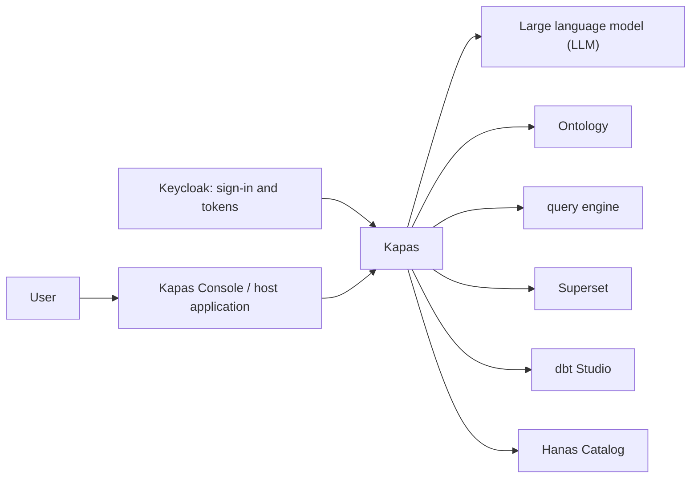

Kapas is the AI assistant layer of Hanas Data Platform. You ask questions in natural language; Kapas calls the tools it has been granted (query engine, Ontology, Apache Superset, dbt, Hanas Catalog) and composes an answer in Vietnamese with the source of each figure.

This section is for business users, administrators, and developers who want to integrate Kapas into applications. AI model configuration is in the operations section, and the API is in the development section.

## Where does Kapas sit in the architecture?

Kapas is a separate service that runs in the same Kubernetes cluster and uses its own PostgreSQL (with a vector extension) and Redis. Each user has a separate workspace for agents, chat sessions, and schedules.

## What can Kapas do?

| Need | Responsible agent | Guide |
|---|---|---|
| Ask about figures and KPIs in natural language | Hanas Analyst | [Data Q&A](chat-with-data.md) |
| Write, fix, and explain SQL | SQL Copilot | [Data Q&A](chat-with-data.md) |
| Build charts and dashboards on Superset | Analytics Studio Copilot, Dashboard Copilot | [Agents, skills, and tools](agents.md) |
| Explore Ontology objects and metrics | Ontology Assistant | [Agents, skills, and tools](agents.md) |
| Look up and enrich metadata in the catalog | Catalog Steward | [Agents, skills, and tools](agents.md) |
| Support dbt projects | Project Copilot | [Agents, skills, and tools](agents.md) |
| Propose Ontology concepts and mappings | Concept Copilot, Mapping Copilot | [Agents, skills, and tools](agents.md) |
| Cite figures, schedule runs | Hanas Analyst, Cron job | [Reports, citations, and schedules](reports-and-schedules.md) |

## Pages in this section

| Page | Content |
|---|---|
| [Ask questions about data in natural language](chat-with-data.md) | Q&A flow, how to ask good questions, reading results. |
| [Agents, skills, and tools](agents.md) | The nine system agents and the tools each uses. |
| [Reports, citations, and schedules](reports-and-schedules.md) | Dashboards, figure citations, Cron jobs, and Inbox. |
| [Safety and access control](safety.md) | Query identity, read-only SQL, sandbox, administration limits. |

Related: [Configure AI models](../operate/ai-models.md), [Kapas API and SSE](../develop/kapas-api.md), [Embed Kapas](../develop/kapas-embed.md).

## General requirements and limitations

:::note Requirements

Kapas must be enabled in the deployment configuration, have at least one language model configured, and have the query engine, Ontology, or the relevant service running. If a component is missing, the agent that uses it reports an error instead of answering.

:::

:::caution Current limitations

Kapas is an assistant, not a source of truth. Answers are generated by a language model; verify important figures through the query citation. Data permissions are decided by the query engine and the target services, not by Kapas. See [Safety](safety.md).

:::

## Next

- Start with [Data Q&A](chat-with-data.md).
- Administrators: read [Safety](safety.md) before granting broad access.
- Infrastructure administrators: [Configure AI models](../operate/ai-models.md).
