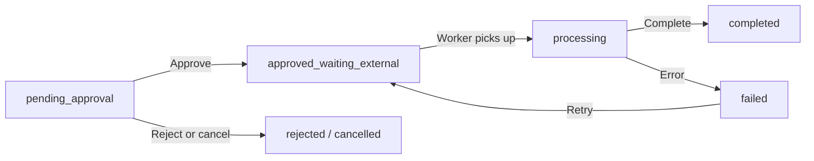

An action describes a proposed operation on a record, for example updating a limit or changing a status. This page explains the current **action request** flow and states clearly which parts do not work yet.

:::caution Current limitations

Direct writeback from actions to records is currently blocked. The legacy action execution endpoint returns an error and requires you to use the request flow. The Ontology records proposals and approvals; an external processor is responsible for changing the source system. Hanas Data Platform does not yet provide a built-in write connector to core systems.

:::

## Concepts

An action consists of a target object type, parameters, a proposed change, and an approval policy. Each request stores the pre-change value, the proposed change, the parameters, the ontology revision, and the approval policy at the time of submission.

The flow follows the **maker-checker** principle: the submitter and the approver are two different roles. The approver's scope can be tied to a property value of the record.

| Role | Responsibilities |
|---|---|
| Submitter | Creates a request from the record detail page, tracks it, and cancels it while it is pending. |
| Approver | Views the approval inbox and approves or rejects with a reason. |
| External processor | A machine account with the `ontology-action-worker` role that picks up approved requests, performs them, and reports the result. |

## Request lifecycle

1. The submitter creates a request; the status is `pending_approval`.
2. The approver approves or rejects. An approved request moves to `approved_waiting_external`.
3. An external worker picks up the request (`processing`), processes it in the source system, then reports completion with an external reference, or reports an error.
4. A failed request can be put back into the external queue with the retry operation.

The `completed` status records the result that the worker reports. It does not by itself prove that the source system has changed.

## Steps

1. Open the detail page of a record that has an action.
2. Select the action, enter the parameters, and submit the request.
3. Track it in the record's request list or your own request list.
4. The approver handles the request in the approval inbox.

:::note Requirements

The detail page shows an action only when the ontology defines an action for the object type. The request and approval inboxes have routes but may not appear in the navigation bar of a deployment; contact your administrator if you need access.

:::

## For developers

The request endpoints are in the Action group on the [Ontology API](../develop/ontology-api.md) page. An external worker uses the `ontology-action-worker` role to list, pick up, complete, report errors for, and retry requests.

## Troubleshooting

| Symptom | Resolution |
|---|---|
| Calling the legacy action execution endpoint returns an error | Use the submit request endpoint. |
| Request stays in the approved state | No worker has picked it up; check the external processor. |
| Cannot approve your own request | Maker-checker requires a different approver. |

## Next steps

- [Ontology governance](governance.md) for roles and audit.
- [Explore objects](explore.md) to open a record.
- [Ontology API](../develop/ontology-api.md) to integrate a worker.
