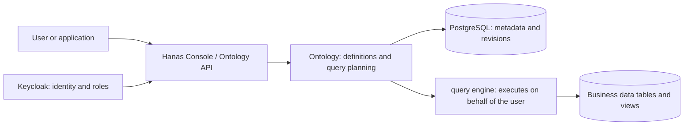

The Ontology in Hanas Data Platform adds business semantics on top of the tables and views served by the query engine. Instead of starting from column names or SQL statements, you work with customers, accounts, transactions, and the relationships between them.

This section is for business model designers, administrators, and data consumers. Developers can use the same definitions to build applications through the Ontology API.

## Where does the Ontology sit in the architecture?

The Ontology keeps object definitions, data mappings, metrics, and release information in the PostgreSQL metadata store. Business data is still read through the query engine; publishing an ontology does not copy all records into the metadata store.

When you filter a customer list, the Ontology identifies the declared object type, properties, and capabilities. The planner validates the request and generates a query from valid definitions, instead of accepting free-form SQL from the Query DSL.

In a production configuration, queries run on behalf of the caller through token exchange with Keycloak. Data permissions, row access, and masking depend on the policies configured in the query engine.

:::note Requirements

To read records, the workspace must have an active deployment, and the object type must be mapped to a valid dataset. Users need an appropriate Ontology role and read permission on the data in the query engine.

:::

## From tables and views to business objects

A customer view can provide the customer ID, name, and managing branch. You map this view to a customer object type, choose the customer ID as the key, and declare the properties.

An account view can link to customers through the customer ID. A link type describes that relationship, including the join column pairs and the read label for each direction.

| Layer | Content | Example |
|---|---|---|
| Data source | Tables or views that already exist in the query engine | Customer and account views |
| Business definition | Meaning, identity, and relationships of a concept | A customer owns accounts |
| Mapping | Dataset, columns, keys, and join conditions | Customer ID joins to accounts |
| Runtime | Published object types, properties, links, and metrics | A customer list and related accounts |
| Application | Explore records or call the API using the definitions | Filter customers by branch |

A concept can be kept as business vocabulary without a dataset. Only definitions that have a mapping and meet the runtime requirements provide records to query.

## What can you do?

Designers use **Ontology Workspace** to author concepts, configure mappings, and prepare releases. Drafts are validated before an admin publishes them and activates a deployment.

Business users use **Explore** to find object types, filter records, and follow declared relationships. Metrics appear in the positions and contexts that the designer configures.

Developers use the API to read definitions, query records, aggregate data, or traverse links. Applications must keep the correct workspace and user identity in every request.

## Pages in this section

| Page | Content |
|---|---|
| [Ontology concepts](concepts.md) | Object types, properties, links, interfaces, metrics, and the definition lifecycle. |
| [Ontology Workspace](workspace.md) | Author drafts, validate mappings, and release a workspace. |
| [Map the ontology to data](mapping.md) | Choose datasets, keys, properties, relationships, and date policies. |
| [Metrics](metrics.md) | Define indicators, execution settings, and display placement. |
| [Explore objects](explore.md) | Search, filter, view records, and explore relationships. |
| [Actions and change requests](actions.md) | Submit requests, approve them, and understand the limits on data updates. |
| [Ontology governance](governance.md) | Roles, release gates, audit, revisions, and rollback. |
| [Banking industry ontology templates](industry-templates.md) | Use business templates and add mappings for your data. |

## Scope and limitations

:::caution Current limitations

Direct writeback from actions to records is currently blocked. The action request flow can record proposals and approvals; changing the source system requires an external processor.

:::

The Ontology does not grant dataset read permission when you publish an object type. The property hidden flag and business groups do not replace the data permission mechanism.

The Project IDE in Console is labeled **Preview** on the Workspace page. Optional AI features require the corresponding service and configuration; suggestions must still be reviewed before release.

## Next steps

- Read [Ontology concepts](concepts.md) to align on terminology before designing.
- Follow the authoring flow in [Ontology Workspace](workspace.md).
- Integrate applications with the [Ontology API](../develop/ontology-api.md) and [Query DSL](../develop/ontology-query-dsl.md).
