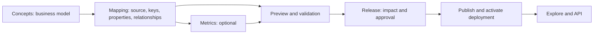

Ontology Workspace in Hanas Data Platform is where you design and release the business model. This page is for ontology authors and admins responsible for putting definitions into the runtime.

A workspace holds a project's canonical document, platform manifest, and revision history. A saved version, an approved revision, and the serving deployment are different states.

## Requirements

| Task | Required permission or component |
|---|---|
| Read the catalog and records | `ontology-viewer` and data permission in the query engine. |
| Author concepts, mappings, and metrics | `ontology-editor` or `ontology-admin`. |
| Create and manage workspaces | `ontology-admin`. |
| Publish, roll back, and activate | `ontology-admin`. |
| Preview data | A dataset that is accessible with the identity of the person performing the action. |

:::note Requirements

Copilot tools require an AI service and the corresponding integration configuration. You can author the model and mappings manually without using AI suggestions.

:::

## Authoring stages

The Workbench flow consists of **Concepts**, **Mapping**, **Metrics**, and **Release**. Metrics are an optional step; an object type can be released without declaring a metric.

### 1. Select a project

Ontology work is organized in **projects**. The **Ontology** menu has the **Explore**, **My requests**, **Workbench**, **Governance**, and **Settings** items.

1. Open **Ontology** > **Explore** in Hanas Console. The page shows **Explore projects**.
2. To start a new project, choose **Create project**. To work on an existing one, find its card; the card shows the publication state, **PUBLISHED** (with a version number, for example vN) or **NOT PUBLISHED**.
3. On the project card, choose **Open Build** to enter the authoring environment (Workbench) of that project. Choose **Explore** to browse the published data.

Check the project name before editing or importing documents. The project determines the content scope, while access is still checked by tenant and role.

### 2. Initialize a draft

You can create a draft from a template, import a YAML/JSON document, or create a change draft from a previous revision. A workspace with no content can start with an empty draft.

Choose the initialization method that fits your existing documents, then check the namespace and description. Import only creates content to author; it does not release records to users.

### 3. Design concepts

In **Concepts**, declare the business meaning, identity, and relationships of the concepts you need. Distinguish concepts that need a runtime from vocabulary that does not need a data connection yet.

You can organize concepts by business group to make the model easier to browse. For subtypes, check the classification conditions and the relationship to the parent concept before configuring the runtime.

If you use Copilot, select metadata datasets as the basis, then review each suggestion. A source selected for the agent to reference does not become a dataset binding of the object type.

### 4. Map data

In **Mapping**, complete the data source, properties, keys, relationships, and record experience in order. Enable only the capabilities that your data and usage needs actually support.

An entity that requires a runtime but lacks a dataset or primary key blocks release. See [Map the ontology to data](mapping.md) to handle grain, composite keys, and date policies.

### 5. Preview the draft

Use record preview to check the list and a few specific records according to the mapping you are authoring. Also check relationships and date context if the model uses snapshots.

Preview reads data with the identity of the person performing the action. Seeing a record in preview does not prove that every user will have the same permissions or the same results.

### 6. Check the release

1. Open **Release** for the draft.
2. Run validation to get the list of issues.
3. Resolve blocking errors using the reported code and location.
4. Review the impact of the change compared with the serving version.
5. Check dependent resources before a breaking change.

Validation checks the model, mappings, source schema, and release conditions. If an agent is still running, you must end the run before releasing the draft.

### 7. Submit for approval or publish

An editor submits the draft to the pending approval status. The draft then becomes read-only; the submitter can withdraw it to edit if needed.

An admin checks the preview and the current checksum before publishing. The standard publish flow approves the revision, prepares the deployment, and activates the new runtime version.

If the content changed after the preview, reload and review the new impact. Do not use an old checksum to continue releasing a version that someone else has modified.

## Project IDE in Console (Preview)

The Project IDE has a UI in Console, but its API group is still experimental. The descriptions below help you recognize the interface; they do not guarantee that every operation works in every deployment.

| Area | Displayed content |
|---|---|
| Explorer | The project file tree and file operations. |
| **Concept** tab | A structural view of concepts and related progress. |
| **Mapping** tab | A view of the mapping from concepts to data. |
| Editor | A visual or YAML view for supported content. |
| **Problems** and **Changes** | Diagnostics and the content changes. |
| Agent pane | Controls and monitoring for AI tasks. |

The toolbar has **Save**, **Validate**, **Compile**, **Publish**, **Download ZIP**, and **Import**. The **Save** button only saves content; confirm the serving state through the release flow.

:::caution Current limitations

The Project IDE ZIP import has a confirmation UI that overwrites all draft files and the initialization configuration. Do not treat this operation as equivalent to the staged import with reconciliation in Ontology Workspace.

:::

## Troubleshooting

| Symptom | Resolution |
|---|---|
| Draft cannot be edited | Check your role and the pending approval status; withdraw the submission if you have permission. |
| Save conflict | Keep the content you are authoring, load the new revision, then compare the changes. |
| Preview shows no records | Check the dataset, keys, date filter, and the caller's permissions. |
| Publish is blocked | Read the issues in the release preview; resolve blockers and any active agent runs. |
| Saved but Explore has not changed | Check the publish and serving deployment of the correct workspace. |

## Next steps

- Complete the [data mapping](mapping.md) before release.
- Add indicators in [Metrics](metrics.md).
- Apply [Ontology governance](governance.md) for review and rollback.
