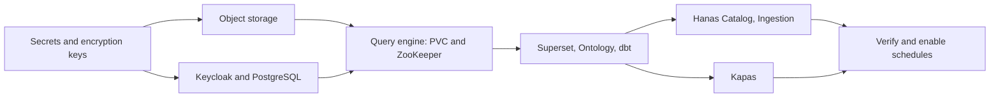

This page lists what to back up to recover Hanas Data Platform, and the recovery order based on dependencies between components. Use it to build your own organization's runbook.

:::caution Current limitations

The installer does not provide a unified, automated backup and restore mechanism for the whole platform. No RPO, RTO, retention, or recovery drill schedule has been confirmed. The steps below are a suggested outline; you must verify the runbook in an isolated environment at your deployment site before relying on it.

:::

Currently only Kapas ships a PostgreSQL backup CronJob (`pg_dump`, keeping the 7 most recent copies, stored on a cluster PVC), and this CronJob is disabled in the sample configuration. A backup stored in the same cluster is not enough to recover from the loss of the cluster.

## What to back up

| Item | Scope | Recovery requirement |
|---|---|---|
| Hanas Catalog encryption key | Stored separately in a secret management system, recorded with the database point in time | If the key is lost or changed, the source credentials encrypted in the database cannot be decrypted. |
| Hanas Catalog PostgreSQL | Metadata, sources, encrypted credentials, lineage, schedules, migration history | Restore with a compatible application version and the correct key. |
| Ingestion | Encryption key, PostgreSQL, and state PVC | Keep the old key; checkpoints must be consistent with the destination data to avoid duplicate or missed loads. |
| dbt | Encryption key, PostgreSQL, and PVCs (storage, workspace, Git SSH) | Do not restore only the database and then create an empty workspace if runs depend on files. |
| Keycloak | PostgreSQL: realm, clients, roles, users, groups, translations | Client secrets must match. The seed Job recreates only part of the configuration and does not replace a backup of the realm and users. |
| Superset | PostgreSQL and secret keys | The correct PostgreSQL major version and application schema; PATs are reissued by a Job. |
| Ontology | PostgreSQL (pgvector) | Requires the extension and the correct embedding dimension. Redis is a cache, not a primary data source. |
| Kapas | PostgreSQL and PVCs (data, secrets, backups) | Keep the agent configuration and credentials; check the impact of template migrations before starting. |
| Query engine | Metadata PVC, security, keystore, and the required ZooKeeper state | Object storage is not the complete backup of the query engine. |
| Object storage (MinIO or S3) | Objects in the buckets and paths in use, plus IAM and policies | Do not change the endpoint or bucket and expect the metadata to find the data again. |
| Release configuration | Environment configuration files, `images.yaml` (digest, revision), APISIX routes, TLS, secrets | Reproduces the environment exactly. Do not store secrets as plaintext in Git. |

A database dump file does not replace the encryption key. Conversely, having only the key without the database is meaningless. Back up both at the same point in time.

## Recovery order by dependency

1. Restore the secret store and encryption keys, at the version that matches the database.
2. Restore object storage with the correct buckets, paths, and permissions.
3. Restore Keycloak (database, realm), then confirm the client secrets match.
4. Restore the query engine: PVCs and coordination state.
5. Restore the applications that have their own database (Superset, Ontology, dbt) together with their PVCs.
6. Restore Hanas Catalog, Ingestion, and Kapas if enabled.
7. Check routes, permissions, and the main flows, and only then enable schedules and workers.

This order is derived from the dependencies described in [Deployment architecture](deployment-architecture.md); it has not been exercised in practice.

## Suggested runbook outline

1. Choose a consistent backup scope. Pause writers, schedules, and Ingestion when needed, and determine the matching database, object, and PVC points in time.
2. PostgreSQL: use logical backup, or the physical solution and PITR you have chosen, keeping roles and extensions. Choose tools compatible with the server's major version.
3. Object storage: use replication, versioning, or an off-cluster backup that has been verified.
4. PVCs: use the storage solution you have chosen. Longhorn replicas are not an independent backup.
5. Store encryption keys and credentials, versioned, in a secrets vault that has its own backup.
6. Restore into an isolated environment with compatible applications. Do not let workers and schedules run until the database, keys, object storage, routes, and permissions are consistent.
7. Run the smoke test and business cases, including credential decryption and data reads and writes. Confirm there are no duplicated scheduled runs; record the measured RPO and RTO.

For production, you also need an owner, a storage location, retention, a drill schedule, and approved RPO and RTO targets.

## Next steps

- [Upgrade and rollback](upgrade.md).
- [Health checks and monitoring](health-checks.md).
- [Deployment architecture](deployment-architecture.md).
