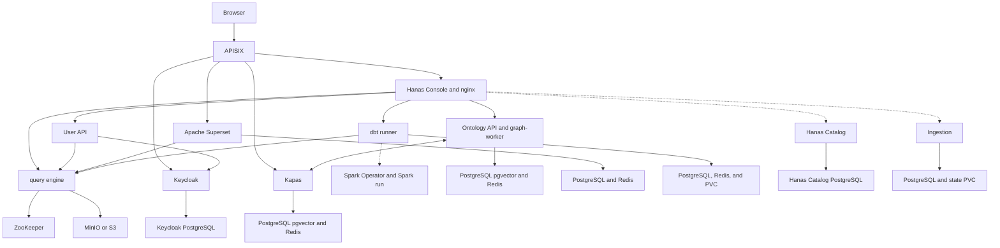
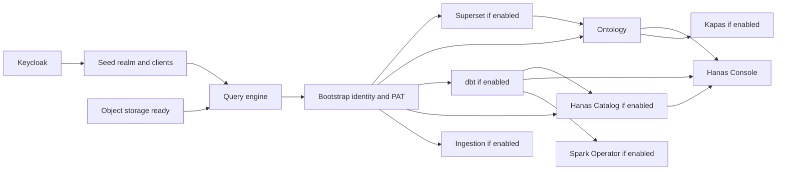

Hanas Data Platform organizes its applications into multiple Helm releases on Kubernetes, with Keycloak providing shared identity. This page helps operations teams determine access paths, persistent data, and deployment order.

## Components and communication paths

Hanas Console is the main web interface and also uses nginx to proxy internal APIs. APISIX receives external traffic and forwards requests to the appropriate Service in the cluster.

Dashed lines indicate components that are optional by feature flag. The diagram omits some authentication connections to show application and data dependencies more clearly.

The installer declares 14 releases; the sample configuration enables 11 and disables Hanas Catalog, Ingestion, and Spark Operator. The number of releases does not equal the number of pods, because a release can contain multiple workloads and datastores.

| Group | Main workloads | Sample namespace |
|---|---|---|
| Identity | Keycloak, PostgreSQL, and seed Job | `keycloak-dp` |
| Query | Master coordinator, coordinator, executor, ZooKeeper, and bootstrap | `dataplatform` |
| Interface | Console UI and User API | `dataplatform` |
| Object storage | MinIO standalone | `hanas-minio` |
| BI | Superset web, worker, Celery beat, PostgreSQL, Redis, and PAT-issuing Job | `superset-dp` |
| Ontology | API, graph-worker, migration Job, PostgreSQL pgvector, and Redis | `ontology` |
| AI | Kapas web, PostgreSQL pgvector, and Redis | `kapas` |
| Transformation | dbt runner, PostgreSQL, Redis, and PVC | `dbt-studio` |
| Metadata governance | Hanas Catalog API, runner, and PostgreSQL | `hanas-catalog` |
| Data ingestion | API, worker, and PostgreSQL | `ingestion` |
| Compute | Spark Operator and per-run Spark workloads | `hanas-compute` |

## Public and internal networking

Application Services use ClusterIP by default. PostgreSQL, Redis, and graph-worker serve internal communication only; regular users do not need a public route to them.

The browser uses public domain names for sign-in, callbacks, iframes, and the application interface. Backends typically use Service DNS to call APIs, fetch JWKS, or connect to datastores.

Superset and Kapas specifically need to reach the public Keycloak domain from inside their pods. The hostAliases configuration in the installer supports this path, but it does not replace DNS on users' machines.

Console and the bootstrap Job pin the query engine SSO connection to the master coordinator through headless DNS. This routing keeps an OAuth request on the node that issued the state; replacing it with round-robin can cause sign-in session errors.

Application ingress is mostly disabled in the current values. APISIX is managed outside Helmfile, so a successful apply does not create a public access path to the platform.

## Deployment order

Helmfile uses dependency relationships to order the apply, combined with each release's wait configuration. Superset uses its own migration and gate mechanism, with release-level waiting for Ready turned off.

:::caution Current limitations

A completed apply does not prove that Superset web, worker, and Celery beat are Ready. You must check the workloads and run functional tests after deployment.

:::

## Persistent data and recovery boundaries

Each application has its own PostgreSQL, so no single database holds all platform state. Ontology and Kapas use pgvector; keep the matching extension in place when you restore.

The query engine needs object storage and metadata on a PVC. dbt stores its storage, workspace, and Git SSH data on PVCs; Ingestion keeps engine state in a persistent workdir.

Kapas uses PVCs for data, secrets, and backups, and runs a single replica in the current configuration. Redis for Ontology and Superset has no persistence enabled, while Redis for Kapas and dbt each have their own PVC.

## Components outside the installer scope

StorageClass, APISIX, DNS, TLS, and the backup system must be deployed separately. Some Kapas integrations also depend on a knowledge service, skills, and TTS/STT; Ontology needs an embedding provider as configured.

:::note Requirements

Compute requires the dbt runner to be enabled, a Spark Operator, a Spark image, and permission to create the corresponding Kubernetes resources. External AI services must be configured with endpoints from your deployment environment.

:::

Do not infer HA capability by increasing the replicas of each application. With RWO PVCs, shared state, and single-instance databases, a topology change needs its own design and testing.

## Next

- [Size CPU, RAM, and PVCs](requirements.md).
- [Install in dependency order](install.md).
- [Set up the gateway and domains](gateway.md).
- [Identify the data to back up](backup-recovery.md).
