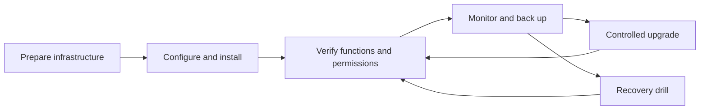

Hanas Data Platform is deployed on Kubernetes with Helmfile, using centralized configuration for applications and datastores. This section is for platform administrators, infrastructure teams, and service operators.

You will find procedures for installation, gateway configuration, identity management, upgrades, and data recovery. The guides use the unified installer rather than assembling each component separately.

:::note Configuration scope

The parameters in this section are checked against the installer released in November 2026. They describe declarative configuration; verify the actual deployment state in your own environment.

:::

## Choose a guide by task

| Page | Contents |
|---|---|
| [Deployment architecture](deployment-architecture.md) | Components, network boundaries, datastores, and dependency order between releases. |
| [System requirements and sizing](requirements.md) | Infrastructure prerequisites, CPU, RAM, PVCs, and how to plan resources. |
| [Install with helmfile](install.md) | Prepare the environment, apply, seed Keycloak, and verify after installation. |
| [Configuration reference](configuration.md) | Feature flags, URLs, storage, concurrency, and the secret groups you need to manage. |
| [API gateway and domains](gateway.md) | Configure APISIX, DNS, forwarded headers, and application access paths. |
| [Authentication and SSO](identity.md) | Realm, client, issuer, audience, and token exchange with Keycloak. |
| [Manage users, groups, and roles](user-management.md) | Create accounts, assign application roles, and verify data permissions. |
| [Upgrade and rollback](upgrade.md) | Pin images, handle migrations, and choose a rollback approach. |
| [Backup and recovery](backup-recovery.md) | Backup scope, encryption keys, and dependency-ordered recovery. |
| [Health checks and monitoring](health-checks.md) | Smoke tests, functional checks, and operational signals to watch. |
| [Troubleshooting](troubleshooting.md) | Known symptoms, causes, and corresponding fixes. |

## Operations cycle

For a first installation, read the architecture and system requirements before filling in the environment configuration. After the releases are deployed, complete the gateway routes and verify sign-in with a regular account.

During operation, keep a record of the release configuration, image digests, feature flags, and check results. When you change a schema or storage, this record helps you identify the datasets and versions that must be restored together.

## Responsibility boundaries

The installer creates application workloads, internal datastores, and initialization Jobs according to the selected configuration. Kubernetes, StorageClass, APISIX, DNS, and TLS certificates must be prepared in the deployment infrastructure.

| Scope | Responsibility to assign |
|---|---|
| Infrastructure | Nodes, networking, DNS, storage, gateway, and the ability to pull images. |
| Platform | Helmfile configuration, images, migrations, secrets, and application state. |
| Identity | Keycloak realm, admin accounts, groups, roles, and credential lifecycle. |
| Data | Source permissions, object storage, checkpoints, schedules, and consistency on restore. |
| Services outside the cluster | Endpoints, credentials, networking, and availability of AI or data source integrations. |

Assign an owner to each scope before you accept the environment. An application in the Ready state does not prove that sign-in, query, and scheduled-run flows work correctly.

## Known limitations

:::caution Current limitations

The sample configuration runs many components with a single replica and MinIO in standalone mode. The installer does not provide a verified HA runbook, backup/restore runbook, or centralized monitoring for the whole platform.

:::

Feature flags can control the Helm release lifecycle. Disabling a component and then applying can remove its release, so review the diff and assess the related data first.

A backup must include the datastores, PVCs, object storage, and the matching encryption keys. A single dump file or snapshot is not enough to show that the platform can recover from an incident.

A smoke test helps detect common deployment and connectivity errors, but you must add functional checks. In particular, confirm permissions with a restricted account and try a restore in a separate environment.

## Next

- [Learn about the deployment architecture](deployment-architecture.md).
- [Prepare resources and storage](requirements.md).
- [Install with helmfile](install.md).
