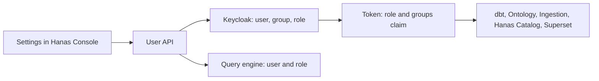

Administrators manage users, groups, and roles in **Settings** of Hanas Console. Console does not store identities; operations are forwarded to Keycloak and synchronized to the query engine.

## Concepts

- Keycloak is the source of identity. Users, groups, and roles are created there.
- The query engine receives a synchronized copy of users and roles to enforce data permissions.
- Every other application reads roles and groups from the user's token and decides permissions on its own. See the role table in [Authentication and SSO](identity.md).

## Requirements

- An account with administrator permissions (the `admin` role). The Settings screen is for administrators.
- Hanas Console, User API, Keycloak, and the query engine are running.

## Steps

### Create a user

1. Open **Settings** and select user management.
2. Select add new user, then enter the username, contact information, and an initial password.
3. Save. The user appears in the Keycloak realm and is synchronized to the query engine.
4. Ask the user to test signing in to Hanas Console.

### Create groups and roles

1. In **Settings**, open the group or role list.
2. Create groups that follow your organization structure, for example by business team.
3. Add users to groups and assign roles to users or groups.

Groups appear in the `groups` claim of the token as full paths. Ingestion uses this claim to determine the user's team.

### Assign application permissions

Assign roles per application, for example `ontology-editor` for ontology designers, `dbt-editor` for people who run dbt, and `data-governance-editor` for metadata administrators. The full role list is in [Authentication and SSO](identity.md).

## Verify permissions

Synchronizing roles does not automatically grant every data permission. The following three kinds of permission are independent of each other:

| Permission type | Where it is managed |
|---|---|
| Application access | Roles in Keycloak. |
| Permissions on data objects (source, workspace, folder, view, table) | Grants in the query engine; see [Data access control](../govern/access-control.md). |
| Superset and storage permissions | Superset roles and the corresponding storage credentials. |

After you create a user, sign in with a restricted account and confirm that the user sees and queries only the permitted data. A menu hidden in the UI does not replace backend access control.

## Limitations

:::caution Current limitations

Some changes may not take effect immediately for tokens that were already issued. Users must sign in again to receive new roles or groups. The User API service allows some pipeline paths without a JWT, so do not assume every endpoint in the stack requires authentication.

:::

:::note Requirements

If you change the application administrator password directly in Keycloak, the seed Job can reset it to the value in the secret when the Job runs again. Change the password through the secret configuration.

:::

## Troubleshooting

- A user can sign in but an application returns `403`: check that the corresponding role is assigned, then sign in again.
- A user does not see their team in Ingestion: check the `groups` mapper and the group assignment.

See also [Troubleshooting](troubleshooting.md).

## Next steps

- [Authentication and SSO with Keycloak](identity.md).
- [Data access control](../govern/access-control.md).
- [Health checks and monitoring](health-checks.md).
