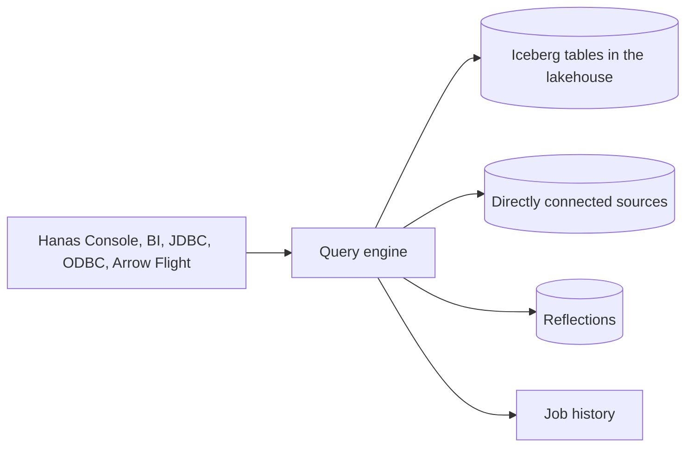

The query engine is the SQL execution component of Hanas Data Platform. Every query from Hanas Console, BI tools, JDBC, ODBC, or Arrow Flight goes through the query engine, over both lakehouse data and directly connected sources.

This section is for analysts, data engineers, and administrators who need to write SQL, organize views, maintain Iceberg tables, and monitor performance.

## Role in the platform

The query engine does four main things:

- Provides one unified SQL layer over Apache Iceberg tables and connected data sources.
- Stores views and the workspace and folder structure as a semantic layer for business users.
- Speeds up repeated queries with Reflections.
- Records every job so you can track its status, timing, and profile.

## Pages in this section

| Page | Contents |
|---|---|
| [SQL Studio](sql-studio.md) | Write and run SQL, tabs, context, multiple statements, Save as View. |
| [Workspaces, folders, and views](spaces-and-views.md) | Organize the semantic layer by bronze, silver, gold, and manage permissions. |
| [Iceberg tables](iceberg-tables.md) | DDL, DML, maintenance, and time travel. |
| [Accelerate queries with Reflections](acceleration.md) | Raw and Aggregation Reflections, refresh, monitoring. |
| [Job history](jobs.md) | Filter jobs, view SQL, timing, and profiles. |
| [Engines, queues, and workload management](workload-management.md) | Resource management and query routing. |
| [SQL reference](sql-reference.md) | Command groups, functions, and data types. |

## Next steps

- [Query data sources in place](../connect/data-sources.md).
- [JDBC, ODBC, and Arrow Flight](../develop/sql-clients.md).
- [Query engine REST API](../develop/query-engine-api.md).
