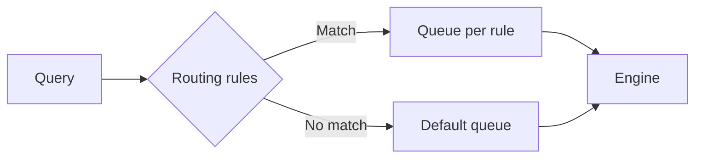

Workload management helps administrators divide compute resources among user groups and query types: engines provide resources, queues limit load, and routing rules decide which queries go into which queue.

:::note Requirements

These screens are in the administration area of Hanas Console and require administrative permission. Actual availability depends on whether your query engine deployment enables engine and workload management. If the menu appears but actions report errors, contact your operations team. Treat this as a **(Preview)** feature until you confirm it in your environment.

:::

## Concepts

| Component | Role |
|---|---|
| Engine | A group of resources that executes queries, with a size and a state. |
| Queue | A waiting line with limits: CPU priority, number of concurrent queries, and memory for the queue and for each job. |
| Routing rule | A condition, evaluated in order, that selects the queue for each query. |
| Default rule | Applies to every query that matches no rule. |

## Manage engines

The **Engines** page lists engines with their status and size; you can filter by these two criteria. From here you create a new engine or adjust the resources of an existing one.

## Manage queues

1. Open the **Queues** page in the administration area.
2. Select add queue and enter a name.
3. Set the CPU priority, the concurrency limit, and the memory limits for the queue and for each job.
4. Save; the queue appears in the list for use in routing rules.

## Routing rules

1. Open the **Engine Routing** page.
2. Add a rule, set its name, enter the condition, and select the target queue. You can also choose to reject queries that match the rule.
3. Drag and drop to set the order; rules higher in the list are evaluated first.
4. Edit the default rule for the remaining queries.

An example idea: queries from the dashboard group go into a queue with a low concurrency limit, and queries from the ETL group go into a queue with large memory.

## Monitoring

The monitor and **Node Activity** screens show job and node activity. Use them together with [Job history](jobs.md) to identify overloaded queues or nodes.

## Troubleshooting

| Symptom | What to check |
|---|---|
| Cannot save a queue or rule | Check administrative permission and that the deployment supports workload management. |
| A query does not go into the expected queue | Check the rule order; the rule higher in the list matches first. |
| Jobs wait a long time | Increase the concurrency limit or move load to another queue. |

## Next steps

- [Job history](jobs.md).
- [Accelerate with Reflections](acceleration.md).
- [Health checks and monitoring](../operate/health-checks.md).
