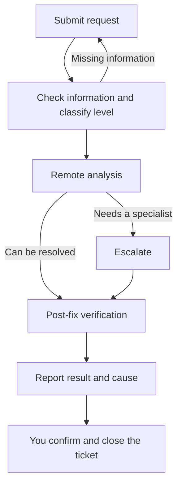

This page describes how you submit a support request for Hanas Data Platform, how requests are classified and handled, and the maintenance and patching process. Commitments on response time, recovery, and availability follow the service contract.

:::note Scope of commitments

This document does not state SLA figures. Response time, recovery time, support hours, and uptime targets apply according to your organization's service contract and its attached appendices.

:::

## Support channels

Specific contact channel details are fixed at system handover. Store the following information in your internal operations handbook.

| Item | Content |
|---|---|
| Channel to open a request (ticket system, email, or phone) | Per the service contract |
| Support hours and holidays | Per the service contract |
| Your organization's point of contact | Designated by your organization at handover |
| Hanas support point of contact | Per the service contract |
| Maintenance window | Agreed between both parties |

Every request needs a ticket with the impact level, the owner, and a timestamp. Do not send passwords, tokens, private keys, or sensitive data by email or ticket; use a temporary account or an approved access-granting process.

## Information to provide

A request with complete information shortens handling time.

| Information | What to include |
|---|---|
| Contact person | Full name, organization, email or phone number |
| Environment | Dev, test, staging, or production; cluster and namespace |
| Time | When it started, how often, and the most recent occurrence |
| Impact | The services, datasets, pipelines, or user groups affected |
| Symptoms | Error messages, job IDs, pipeline or dbt run IDs |
| Already tried | The actions taken and their results |
| Version | Image tag or digest, see [Components and versions](components-and-versions.md) |
| Evidence | Logs, screenshots, with secrets and sensitive data masked |

For slow or failing queries, the job ID and profile in [Job history](../query/jobs.md) are the most useful information. You should also self-check first with [Troubleshooting](../operate/troubleshooting.md).

## Severity levels

| Level | Criteria | Example |
|---|---|---|
| Level 1, critical | The production system is completely down or a large part is down; wide impact or a security incident. | The platform cannot be accessed; suspected data leak. |
| Level 2, high | A production function is failing with a limited workaround. | A main pipeline fails repeatedly; queries cannot serve a large user group. |
| Level 3, normal | Partial degradation that does not block critical business operations. | One dataset runs slowly; one connector fails but can be backfilled. |
| Level 4, request | Questions, configuration requests, or non-urgent changes. | Asking for guidance, suggesting optimizations. |

Target times for each level follow the service contract. Security incidents are reported immediately to the management contact, and containment starts without waiting for complete logs.

## Request handling process

1. The support side checks that the information is complete, identifies the service and severity, and acknowledges the ticket.
2. Initial analysis: service status, recent alerts, recent changes, and the scope of impact.
3. Escalate when a specialist is needed, the issue recurs, data loss or a security breach is suspected, or an infrastructure change is required.
4. Every production change has a change record, a rollback plan, an approver, and a post-change verification step.
5. A temporary measure (workaround) must state the risk, the time limit for its use, and the action for the root fix.
6. Before closing, the handler records the cause, the scope of impact, the duration of the disruption, and recommendations for prevention. You confirm the result before the ticket is closed.

## Maintenance process

Proactive maintenance keeps the platform available, secure, and recoverable. Each maintenance session has a change record, an executor, an approver, and verification evidence.

| Reference cycle | Main content |
|---|---|
| Daily | Service status, failed jobs and pipelines, storage capacity, alerts, the latest backup. |
| Weekly | Queues and retries, Iceberg table health (small files, snapshots), ingestion logs. |
| Monthly | Overall check, capacity and performance trends, permission review, certificate and secret expiry, a sample restore test. |
| Quarterly | Scoped recovery drill, capacity and RBAC review. |
| On request | Optimization, version upgrades, source expansion, alert handling. |

This cycle is a reference only. The official frequency is adjusted according to the service contract, the data growth rate, and your organization's operations calendar.

The steps of a maintenance session:

1. Plan: scope, risks, execution window, success criteria.
2. Prepare: check the backup and restore point, access permissions, the current configuration, and the rollback plan.
3. Notify stakeholders of the schedule and the scope of impact.
4. Execute according to a checklist, recording timestamps and results; do not record secret values.
5. Verify: service status, sign-in, sample queries, schedule runs, and permissions; see [Health checks and monitoring](../operate/health-checks.md).
6. Close: update the change record, the report, and any outstanding items.

:::caution Current limitations

Do not delete production objects, snapshots, or tables without a backup, approval, and a recovery plan. Tasks such as expiring snapshots, deleting orphan files, and compaction must run according to the agreed policy.

:::

## Patching and version update process

A version update or patch is done by changing the images in the installation bundle and then applying them with helmfile.

1. Read the change notes and, if any, warnings about migrations or new environment variables from the development team.
2. Back up datastores, PVCs, object storage, and the related encryption keys; see [Backup and recovery](../operate/backup-recovery.md).
3. Test in a separate environment with representative data, checking the sign-in, query, and schedule run flows.
4. Update the image tag or digest, review `helmfile diff`, and have the responsible person approve it.
5. Apply during the maintenance window, monitoring migrations and release status.
6. Verify after the upgrade. If an incident occurs, choose a rollback option according to [Upgrade and rollback](../operate/upgrade.md).

Some versions have one-way migrations, so rolling back an image may need to be combined with a data restore. Record the list of tags or digests before and after the update, per [Components and versions](components-and-versions.md).

## Maintenance report

A periodic report should include: a summary of the period and scope, key indicators (run success rate, capacity, query latency, backup results), findings and risks, actions taken, recommendations with priority, and confirmation from representatives of both parties. Store the report in the ticket system or an approved document repository, not as a single copy on a personal computer.

## Next

- [Troubleshooting](../operate/troubleshooting.md).
- [Upgrade and rollback](../operate/upgrade.md).
- [Components and versions](components-and-versions.md).
