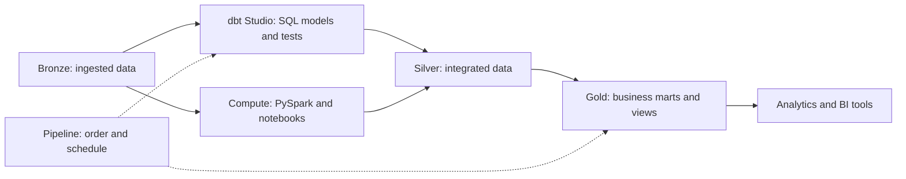

Hanas Data Platform provides dbt Studio, Pipeline, and Compute to develop, run, and monitor data transformation jobs. This section is for data engineers, analytics engineers, and owners of shared data models.

You can start with a SQL model in dbt Studio, test the results, and then set up an appropriate run schedule. For PySpark or notebook tasks, Compute provides an execution environment on Kubernetes when this component is enabled.

## Pages in this section

| Page | Content |
|---|---|
| [dbt Studio](dbt-studio.md) | Create projects, work in the IDE, and manage code with Git. |
| [Run and schedule dbt](dbt-runs.md) | Choose commands, targets, and selectors; view logs, artifacts, and schedules. |
| [Pipeline](pipelines.md) | **Data Pipeline** menu. Combine multiple steps into a dependency graph and monitor each execution. |
| [Compute](compute.md) | **Compute Engine** menu. Run PySpark, notebooks, and declarative pipelines on Spark. |
| [Modeling standards](modeling-standards.md) | Apply bronze, silver, gold, and Data Vault according to your data needs. |
| [Naming conventions](naming-conventions.md) | Standardize names for namespaces, models, tables, and technical columns. |

## Choose a tool

| Need | Suitable tool | Main result |
|---|---|---|
| Transform with SQL and manage dependencies between models | dbt Studio | dbt models, tests, documentation, and artifacts |
| Run a command for a project on a recurring basis | dbt schedule | Runs tracked in dbt Studio → Orchestrate |
| Orchestrate multiple commands or multiple projects | Pipeline | Runs made up of Steps and dependency states |
| Process with Python/PySpark, experiment in notebooks | Compute | Spark runs, cell results, and driver/executor logs |
| Standardize data structures for BI | Modeling standards | Tables and views with a defined grain, owner, and quality rules |

A Pipeline orchestrates execution order; dbt models describe the transformation logic and the data relationships between models. Spark can read from and write to the lakehouse directly, depending on the catalog and storage configuration of Compute.

The diagram shows the recommended organization. Whether a given Step type can be added to a Pipeline depends on the engine and executor available in your deployment.

## Requirements

:::note Requirements

An administrator must enable the dbt development feature and deploy the dbt runner before you use dbt Studio. Compute additionally requires the Spark Operator, a lakehouse configuration, and Compute permissions; the new Pipeline engine requires the orchestration service and Temporal.

:::

The dbt roles are `dbt-viewer`, `dbt-editor`, and `dbt-admin`. Viewers read projects, view history, and perform the read operations that are allowed; editors develop and run dbt. Admins also manage connections, targets, and project administration operations.

Permission to run tools and permission to access data are configured separately. A person who can edit a model still needs read access to the sources and write access to the target zone. Query engine policies also have their own enforcement scope for the direct Spark read path.

## Recommended workflow

1. Define the grain, business key, and data sources of the target table before writing the model.
2. Choose the bronze, silver, or gold layer according to the responsibility of the transformed data.
3. Create a dbt or Compute project and use the connection prepared by the administrator.
4. Develop the model on test data, and add descriptions and data quality tests.
5. Run the job as a trial to check the target, data permissions, and results before you schedule it.
6. Choose a dbt schedule or a Pipeline based on the dependencies between execution steps.
7. Update metadata in Hanas Catalog so users can find the table and understand the lineage that was collected.

For transactional data, also check for late-arriving records, deleted records, and the ability to rerun. A successful run only confirms that the command completed according to the recorded status; business results need corresponding reconciliation checks.

## Boundaries to understand

A dbt workspace is currently shared among people who have dbt roles. Compute adds project-level permissions: view, run, edit, and manage. Choose an appropriate sharing model before you place sample data, SQL, or sensitive information in a project.

Lineage in the dbt IDE is built from the manifest at the model level. Column lineage in Hanas Catalog depends on the metadata and SQL that were collected. After you change a model, rerun the steps that generate artifacts and collect the required metadata.

## Next steps

- [Create and develop a dbt project](dbt-studio.md).
- [Choose a modeling standard](modeling-standards.md).
- [Understand permission domains](../govern/access-control.md).
