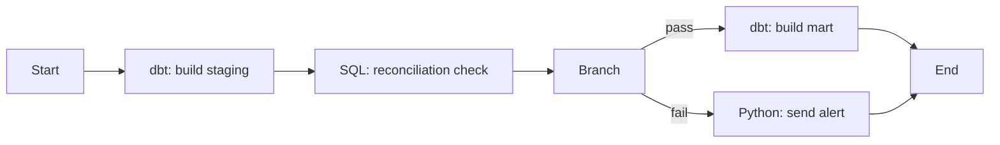

Pipeline in Hanas Data Platform lets you combine multiple processing steps into an ordered graph, run it on a schedule or manually, and then monitor the result of each step. This page is for data engineers who need to orchestrate work beyond a single dbt command.

## Concepts

| Concept | Meaning |
|---|---|
| Pipeline | The definition of a directed acyclic graph (DAG) of Steps and dependency relationships. |
| Step | A unit of work: dbt, SQL on the query engine, Python, Branch, or a child Pipeline. |
| Run | One execution of a Pipeline, with an overall status and the result of each Step. |
| Step result | The status, time, log, and error of a Step in a Run. |
| Logical date | The business time point that a Run represents, used when backfilling. |

Each Step runs only when the preceding Steps satisfy its trigger rule. The rules are `all_success`, `all_done`, `none_failed`, `one_success`, and `one_failed`. This lets you create error-handling branches or cleanup steps that always run.

## Requirements

:::note Requirements

The Orchestrate menu shows Pipelines only when an administrator enables the orchestration service. The new engine also needs Temporal and the service's PostgreSQL database. Permissions follow the viewer, operator, editor, and admin roles; by default these roles use the corresponding dbt roles.

:::

A Run executes under the identity of the Pipeline owner or a service account. When a Step accesses the query engine or dbt, this identity needs the corresponding data permissions.

## Create and run a Pipeline

1. Open **Orchestrate** and then choose **Pipelines**.
2. Choose to create a new Pipeline and give it a name that describes its purpose.
3. On the canvas, add Steps from the palette and connect them in dependency order.
4. Select each Step to enter its configuration: project and selector for dbt, statement for SQL, file for Python.
5. Set the trigger rule, retry, and timeout for a Step when needed.
6. Save the Pipeline. The system validates the graph before accepting it.
7. Choose **Run now**, monitor the status on the canvas, and open the Run details to read each Step's log.

The canvas can contain presentation notes; these elements do not execute any data work.

## Schedules and backfill

You can attach a cron schedule to a Pipeline, with its own time zone. Each scheduled Run carries a logical date. When you need to reprocess an earlier period, use backfill to preview the list of Runs that will be created, then confirm the run.

Rerunning a Run that already has results lets you reuse the Steps that succeeded and rerun only what is necessary. Check the idempotency of each Step before you rerun; a Pipeline does not roll back data that was already written.

## Monitor Runs

The **Runs** tab lists Runs by Pipeline or across the workspace. The Run details show a graph with each Step's status, start and end times, and error messages. You can cancel a running Run; the executing Step receives a cancel signal.

Notification settings let you send an email or webhook when a Run fails, depending on your deployment configuration. Notification history is stored for reference.

## Temporal engine and legacy engine

Both engines can coexist in one deployment.

| | New engine (Temporal) | Legacy engine |
|---|---|---|
| Scope | Standalone Pipelines; each Step carries its own project. | A Pipeline attached to one dbt project. |
| Steps | dbt, SQL, Python, Branch, child Pipeline. | dbt, SQL, Branch, and Compute Steps. |
| Schedules, backfill | Schedules, time zones, logical dates, backfill. | According to the legacy engine's capabilities. |
| Status updates | The UI polls periodically. | Live logs. |

The default engine depends on the deployment configuration; the UI lets you choose the engine for each Pipeline.

:::caution Current limitations

With the new engine: there are no realtime logs and the UI updates by polling periodically; there is no action to run a single Step on its own; the definition validator is not as complete as in the legacy engine; Spark/Compute Steps are not officially supported on this engine, so use the legacy engine if you need a Compute Step. A Step type with no executor reports an error when it runs.

:::

## Troubleshooting

| Symptom | Resolution |
|---|---|
| The Pipelines menu does not appear | Ask an administrator to check that the orchestration service is enabled. |
| A Step is skipped | Check the trigger rule and the status of the preceding Steps. |
| A SQL or dbt Step is rejected | Check the data permissions of the Pipeline owner or service account. |
| A scheduled Run runs at the wrong time | Check the schedule's time zone; separate dbt schedules are evaluated in UTC. |
| Status updates slowly | The new engine polls periodically; refresh the page or wait for the next cycle. |

## Next steps

- [Run and schedule dbt](dbt-runs.md).
- [Compute: Spark and notebooks](compute.md).
- [Modeling standards](modeling-standards.md).
